# Windows AI 桌宠 V1 产品与系统架构设计

> 版本：V1.1 完整技术设计稿　｜　日期：2026-11-25　｜　目标平台：Windows 10/11（x64 优先）　｜　开发策略：从零开发　｜　产品形态：桌面常驻伴侣与放置养成游戏

本文用于确定第一版产品的**完整功能边界、玩法、页面、业务状态、数据结构与技术架构**。所有功能都纳入 V1 的设计，但允许按开发阶段逐步开放；尚未实现的模块也应预先定义接口和数据归属，避免后续为了加入 AI、语音、旅行或多角色而重构基础架构。

从零创建独立项目，不依赖 AIRI 或其他已有桌宠产品的代码架构。第 1–14 章是产品及总体系统设计；第 15–23 章是独立技术选型、工程装配和实机验证方案。技术选型根据官方资料形成，尚未实施和实测的能力均保留 POC 验收闸门。

## 目录

1. 产品定位与体验目标
2. 功能全景及应用页面
3. 多桌宠与角色资源系统
4. 桌面行为和状态模型
5. 放置旅行、冒险与自动战斗
6. 等级、装备、经济与日常养成
7. 随机事件、CG 与图鉴
8. AI 伴侣与角色人格
9. 语音交互与记忆系统
10. Windows 快捷入口与习惯推荐
11. 技术架构与模块划分
12. 数据模型、事件与接口契约
13. 离线恢复、安全、性能与异常
14. 开发路线及验收标准
15. 技术决策总表与统一工程约定
16. Windows 宿主与进程架构
17. 前端 UI、角色渲染、资源包与 CG
18. 游戏领域内核、离线模拟与数据库
19. AI 人格、对话、模型适配与长期记忆
20. 语音识别、合成、录音与嘴型联动
21. Windows 快捷入口、习惯推荐与系统辅助
22. 工程结构、构建、测试与发布
23. 独立审核结论及 POC 冻结清单

---

## 1. 产品定位与体验目标

### 1.1 产品定位

将桌宠设计成拥有独立身份、性格、生活状态和成长历程的虚拟角色。它平时陪伴用户工作，在桌面活动、和用户聊天、提供快捷工具；也会在离开桌面后进入自己的冒险世界，自动探索、打怪、升级、收集道具，并带回旅途见闻和插画。

游戏不要求用户长时间盯着窗口。每天打开电脑，桌宠已经有可能经历了新的事情；用户只需花几分钟互动、整理行囊、查看战报、准备下一次旅行。AI 让这些行为具有角色个性，而不是替代玩法规则。

| 体验支柱 | 用户实际获得的体验 | 设计原则 |
|---|---|---|
| 桌面陪伴 | 角色待机、移动、表情、互动、主动问候 | 不遮挡重要工作，随时免打扰 |
| 多角色养成 | 收集不同角色，独立培养、切换陪伴 | 每只宠物的进度和记忆独立 |
| 放置冒险 | 出门旅行、战斗、掉落、升级、探索地图 | 关机仍能完成既有旅行 |
| 收集与惊喜 | 随机剧情、CG、明信片、成就 | 以探索与关系驱动，不做付费抽卡 |
| AI 伙伴 | 人设一致的对话、语音、长期记忆 | AI 尊重真实游戏状态和用户权限 |
| 桌面助手 | 常用应用组合、一键打开、习惯推荐 | 用户掌握执行权，不随意控制系统 |

### 1.2 一天中的典型体验

| 时间 | 角色及功能行为 |
|---|---|
| 09:00 开机 | 昨日出门的角色已返回，托盘显示一封旅行报告；桌宠问候。 |
| 09:05 | 用户点击「开发工作台」，一次打开 IDE、浏览器和音乐软件。 |
| 09:10 | 将暂时不陪伴的另一只宠物派往森林，选择补给与探索方式。 |
| 12:00 | 关闭免打扰后发现新的旅途明信片与随机事件。 |
| 18:00 | 领取战报，宠物升级，获得装备材料和 CG；通过语音问它今天遇到了什么。 |
| 22:00 | 让角色休息，选择下一次旅行；关闭电脑。明天依然可以结算这次旅行。 |

### 1.3 核心玩法闭环

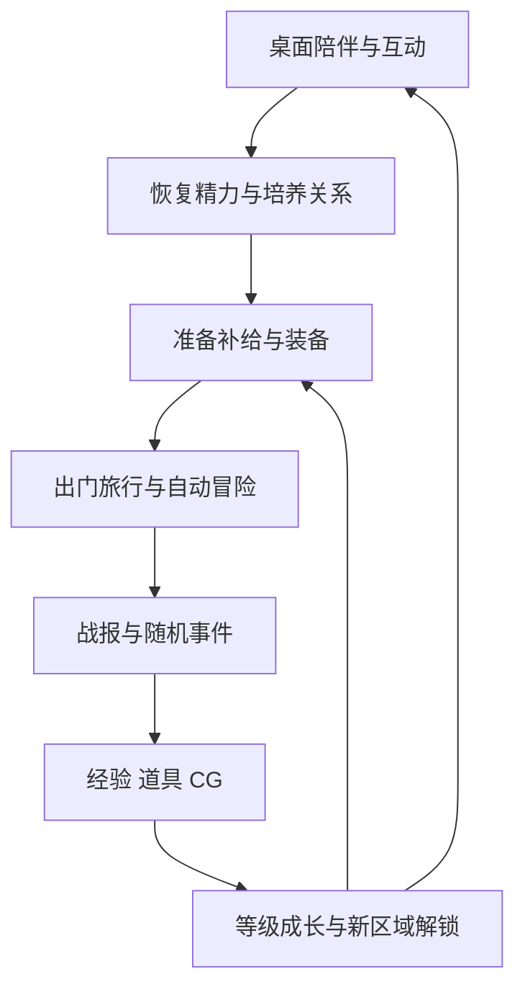

短期目标是看到一次新动画、一份奖励或一段新对话；中期目标是提高等级、收集装备和探索地图；长期目标是建立不同角色的关系、完成个人故事与 CG 图鉴。

**反向约束：** 不设计永久死亡、离线饥饿惩罚、强制每日签到、连续点击刷经验或真实金钱概率抽取。桌宠应当适合长期安装，不应让用户感觉被游戏绑架。

## 2. 功能全景及应用页面

### 2.1 功能全景图

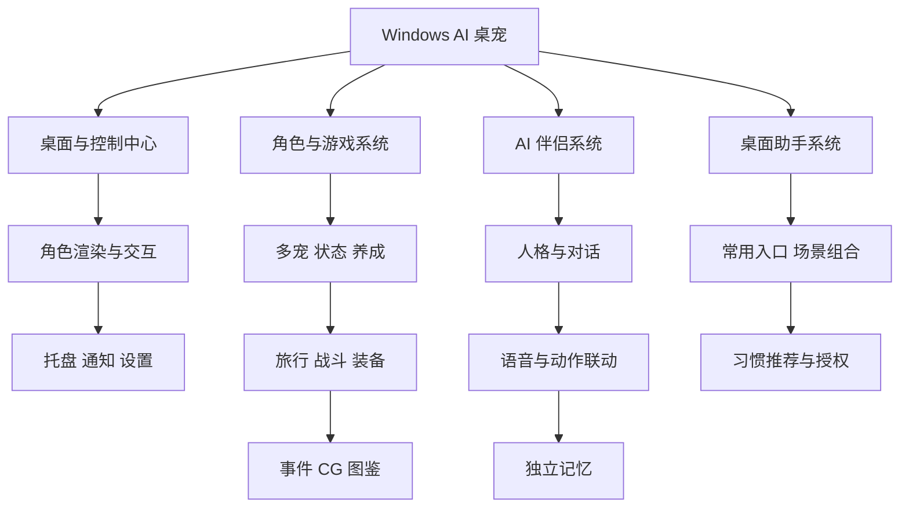

| 模块 | V1 功能清单 | 建议实现阶段 |
|---|---|---|
| Windows 桌面 | 透明无边框窗口、置顶、穿透、拖动、托盘、多屏、热键、免打扰 | A |
| 角色库 | 角色模板、模型包、角色获得、昵称、主宠与同屏选择 | A |
| 状态与互动 | 待机、走动、睡觉、拖拽、触摸、情绪、精力、好感 | A–B |
| 旅行冒险 | 地图、目的地、出发准备、离线计时、战斗、战报、结算 | B |
| 成长 | 等级、属性、职业倾向、装备、背包、货币、强化、区域解锁 | B |
| 随机事件 | 条件事件池、概率、分支选择、个人剧情、旅途见闻 | B |
| CG 图鉴 | CG 解锁、角色分类、旅途明信片、剧情回放、收藏 | B |
| AI | 逐宠人格、文本聊天、主动互动、状态感知、受控行动建议 | C |
| 记忆 | 短期上下文、逐宠长期记忆、授权共享偏好、查看编辑删除 | C |
| 语音 | STT、TTS、角色音色、嘴型同步、打断、静音 | D |
| 快捷工具 | 应用收藏、快捷场景、一次批量启动、执行反馈 | E |
| 推荐 | 启动统计、时段建议、可解释推荐、隐私开关 | E |
| 发布运维 | 存档迁移、内容包升级、日志、备份恢复、安装更新 | F |

> A–F 是实现阶段，不是功能的设计版本。V1 架构从一开始就应支持表中的全部能力。

### 2.2 UI 信息架构

产品由三个入口组成：桌面角色、系统托盘、控制中心。大部分日常互动不需要打开控制中心；深度配置、冒险、图鉴等操作放在独立窗口。

| 页面或入口 | 核心内容与操作 |
|---|---|
| 桌面角色 | 模型、浮动气泡、拖动、点击、视线跟随、快速交谈、右键菜单。 |
| 桌宠右键 | 对话、摸头、切换姿势、出门旅行、查看详情、切换宠物、隐藏、本次静音。 |
| 托盘菜单 | 显示/隐藏全部、选择主宠、免打扰、打开控制中心、暂停动画、退出。 |
| 控制中心 首页 | 今日摘要、当前主宠、其他宠状态卡、待处理事件、待领取旅行奖励、快捷入口。 |
| 宠物馆 | 已拥有角色、未解锁预览、角色详情、状态、等级、亲密度、装备、外观、人格配置。 |
| 冒险地图 | 区域解锁、路线难度、预计时长、推荐战力、进入准备、旅行中的任务列表。 |
| 旅行报告 | 时间线、遭遇、战斗胜负、收获、升级、CG、领取或查看已结算结果。 |
| 背包与商店 | 消耗品、素材、装备、外观；购买基础补给、强化装备、整理仓库。 |
| 事件与图鉴 | 未读事件、个人故事、含选择的剧情、CG 收藏、旅行明信片、成就与回放。 |
| 对话中心 | 按角色分会话、输入与语音、聊天记录、当前健康状态、记忆管理。 |
| 快捷工作台 | 单个快捷项、场景组合、最近使用、推荐、执行结果与编辑。 |
| 设置 | 桌面表现、声音、系统启动、AI 服务、隐私授权、数据备份、资源管理。 |

### 2.3 控制中心首页布局草案

| 左侧导航 | 中间主要内容 | 右侧辅助内容 |
|---|---|---|
| 首页 | 主宠卡片与实时状态 | 待处理事件 |
| 宠物馆 | 其他宠物横向列表 | 今日快捷工作台 |
| 冒险地图 | 旅行进度与返回时间 | 新 CG / 明信片提示 |
| 背包装备 | 近期成长与旅行摘要 | 安静模式与音量 |
| 事件图鉴／聊天／设置 | 当前页面详情 | 根据页面切换 |

桌面角色浮层应小巧；聊天长文本、装备管理及复杂设置只在普通窗口呈现，不把桌面变成一个全屏游戏界面。

## 3. 多桌宠与角色资源系统

### 3.1 模板与实例分离

角色模板负责定义角色是什么，宠物实例负责记录玩家实际养成的这个角色。这样能够新增角色、替换外观、更新模型资源，并且保留旧角色所有存档。

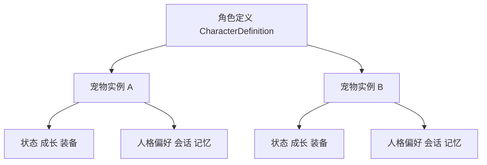

即使同一个角色定义允许创建多个实例，实例也不能共享私有记忆或装备状态。实际产品初期可以限制每个角色只获得一只，但数据层不依赖这个限制。

| 角色模板 CharacterDefinition | 宠物实例 PetInstance |
|---|---|
| 角色 ID、名称、种族、职业和背景 | petId、玩家昵称、获得时间 |
| 人格模板、说话风格、默认声音 | 自定义偏好与当前语音配置 |
| 模型、立绘、动作、表情、服装、CG | 当前外观配置、桌面位置和缩放 |
| 初始属性、成长倾向、天赋与职业 | 等级、经验、属性、技能、装备 |
| 事件池、关系故事、解锁条件 | 好感、心情、精力、健康、已完成故事 |
| 资源包版本及依赖 | 当前旅行、个人会话、个人记忆 |

### 3.2 多宠规则

- 主宠：用户当前默认聊天、语音、桌面互动的对象；主宠切换不重置任何宠物数据。
- 陪伴位：初期默认同时显示 1 只，可在设置预留多角色同屏；后续开放数量上限，例如 2–3 只。
- 其他宠物：即使没有显示，也保留独立游戏进度、状态、旅行任务和记忆。
- 出门后：宠物离开桌面本体，用户可看到旅途状态或者切换其他宠物。回家时产生通知，是否重新显示由用户设置决定。
- 所有宠物出门时：托盘、助手、管理中心照常运行，桌面可以留下一张「旅行中」便签。
- 角色之间：预留共同对话、互相赠礼、结伴探索、友情事件，第一阶段不要求实现复杂多人 AI。
- 共享内容：账号共享通用货币、材料仓库、内容包和总图鉴；装备穿戴、经验、亲密度、旅程与角色记忆独立。

### 3.3 首批示例角色

以下为验证不同角色行为与成长差异的示例，不是正式角色名单。

| 角色 | 定位 | 人格及日常 | 冒险特点 | 特色 CG |
|---|---|---|---|---|
| 星咏 | 魔法使 | 好奇，喜欢读书、问问题 | 魔法输出、探索特殊事件 | 星空露营、古遗迹研究 |
| 绒绒 | 兽耳游侠 | 活泼、爱睡觉、喜欢食物 | 速度高、采集、发现隐藏路线 | 森林小憩、抱着战利品回家 |
| 诺瓦 | 机械助手 | 理性、认真，喜欢整理任务 | 防御、稳定收益、修理道具 | 工坊维修、夜间守护 |

不同角色不仅换皮。至少应在动画、语气、职业倾向、事件条件和个人 CG 上形成差异；同时保证各角色都能完成主要玩法，不把用户锁死在最强角色上。

### 3.4 角色资源包

每个角色使用版本化内容包。运行时通过渲染适配器载入，不让游戏逻辑直接依赖 Live2D、Sprite 或 VRM 的文件结构。

| 资源类别 | 必要内容 |
|---|---|
| manifest | 角色 ID、版本、作者/授权信息、渲染类型、资源路径、依赖、校验值 |
| 模型 | Live2D 模型或二维序列帧；预留 VRM 或静态立绘适配 |
| 基础动作 | Idle、Walk、Drag、Happy、Sad、Sleep、Talk、Return、Celebrate、Hurt |
| 表情 | Neutral、Smile、Surprised、Angry、Embarrassed、Tired；缺失使用 Neutral |
| 人格 | 角色背景、语气、喜好、世界观、对话示例、行为偏好，不包含真实密钥 |
| 音频 | 默认音色配置、短互动声、事件音效；无 TTS 时可使用已有音效 |
| 内容 | 专属事件定义、旅行明信片、CG 元数据、解锁条件、文本模板 |

资源包内容须通过导入校验，且仅包含允许的声明式数据和资源，不执行资源包提供的任意脚本。缺少某个动作时自动使用通用待机或静态立绘，不影响游戏进度。

## 4. 桌面行为与状态模型

### 4.1 为什么要将状态拆开

宠物可能同时「在家、睡觉、心情开心、精力低、处于隐藏显示」。若把每一种组合都做成单独枚举，状态将迅速失控。采用多个正交状态维度，并由状态引擎校验互斥关系，最后由表现解析器决定播放什么动画。

| 状态维度 | 候选值或数据 | 说明 |
|---|---|---|
| 真实位置 Presence | HOME、AWAY、RETURNING | 冒险与家园位置，隐藏不改变真实位置 |
| 在家行为 Activity | IDLE、WALK、DRAG、INTERACT、CHAT、EAT、REST、SLEEP、CELEBRATE | 不同活动互斥，可按允许规则打断；不在家时可为空 |
| 情绪 Mood | CALM、HAPPY、EXCITED、BORED、UPSET、TIRED | 由互动、剧情、精力等规则更新 |
| 健康 Health | NORMAL、INJURED、RECOVERING | 旅行战斗后的健康与恢复 |
| 旅行 Adventure | NONE、PREPARING、TRAVELING、RESOLVING、SETTLED | 其中 TRAVELING/SETTLED 持久化，准备与结算是派生瞬态；返程由检查点 phase 表示 |
| 显示 Visibility | VISIBLE、HIDDEN | 用户显示偏好，不影响旅行和成长 |
| 运行模式 Mode | doNotDisturb、pausedRender 两个独立开关 | 可同时开启；全局呈现/提醒策略，不改变事实 |
| 数值 Needs | energy、moodScore、bond、healthPoints | 与 Mood/Health 状态枚举分开；显示 0–100，存储固定点整数 0–1000 |

### 4.2 位置状态图

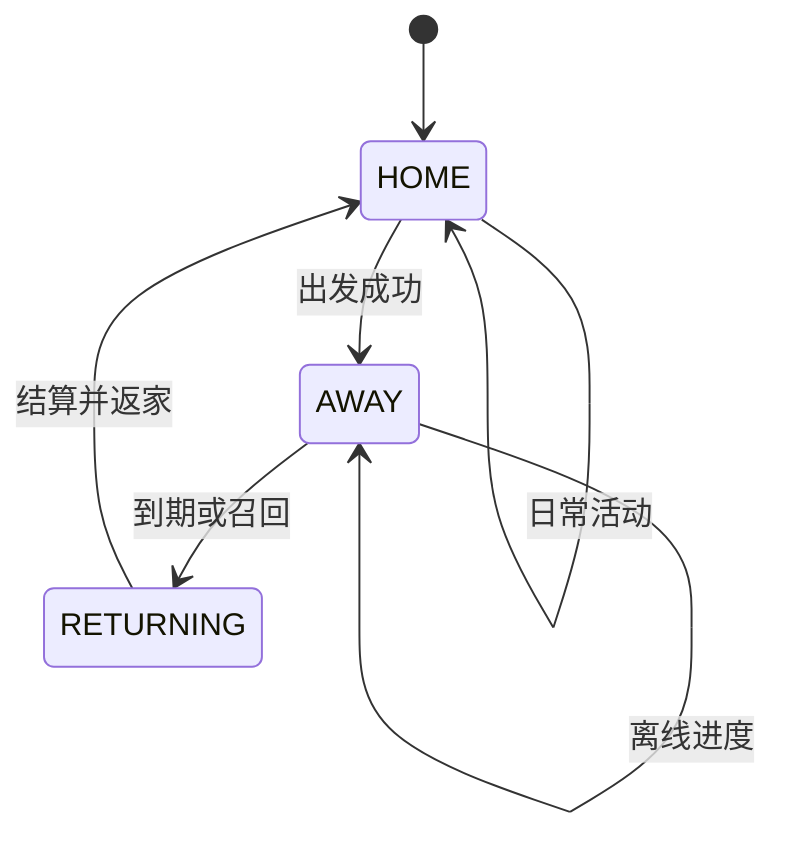

在家行为的基本规则：待机可进入移动、休息、互动和聊天；拖动应暂停移动，松开后恢复；睡觉可根据用户唤醒或恢复条件结束；对话期间不应突然播放另一随机动作。旅行中不能执行在家动画，允许查看旅行记录和明信片。

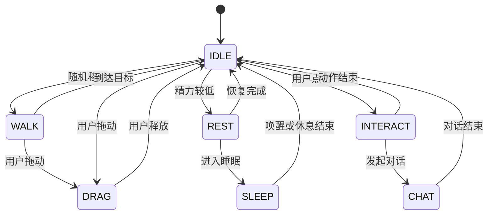

这张图描述常规自动行为；用户主动点击、拖动或系统位置变化可通过统一仲裁器抢占允许被打断的状态。EAT、CELEBRATE 等短动作通过 INTERACT 同类的活动入口处理，结束后返回待机。出发成功时统一退出在家活动，不保留隐藏的聊天或移动任务。

| 当前情况 | 用户操作 | 状态引擎处理 |
|---|---|---|
| 在家且聊天中 | 发起旅行 | 提示结束本次聊天，确认后再出发 |
| 在途 | 请求摸头或拖动 | 拒绝在家动作，显示旅行进度或切换主宠 |
| 在途且到达截止时间 | 回家 | 原子结算并返家，动画可延后播放 |
| 隐藏或免打扰 | 旅行结束 | 正常结算，按设置记录静默通知 |
| 精力不足 | 选择高消耗路线 | 展示恢复时间和可选择的低消耗路线 |

### 4.3 动画及交互仲裁

| 优先级 | 来源 | 行为 |
|---|---|---|
| 1 最高 | 系统隐藏、暂停或窗口不可用 | 停止或降低渲染，不清空业务状态 |
| 2 | 拖动、用户主动点击、强制状态切换 | 中断低优先级动作，表现即时反馈 |
| 3 | 正在聊天或播放语音 | 尽量保持说话、倾听、对应表情及嘴型 |
| 4 | 回家、升级、剧情、受伤 | 播放有限时长的事件反馈，可在免打扰后展示 |
| 5 | 睡眠、恢复、日常行为 | 使用当前活动的循环动画 |
| 6 最低 | 随机眨眼、伸懒腰、走动 | 不影响明确交互，不重复狂刷动作 |

点击识别建议使用角色互动区域；透明区域允许鼠标穿透。保留托盘或全局快捷键关闭穿透、隐藏桌宠，防止用户无法操作窗口。支持记忆角色所在显示器、桌面工作区、缩放和拖动位置；显示器移除后重定位到可见屏幕。

### 4.4 日常行为调度示例

| 触发 | 行为与限制 |
|---|---|
| 每隔一段随机时间 | 播放伸懒腰、翻书、坐下等短动画，只在可互动状态下发生。 |
| 长时间没有互动 | 进入休息或睡觉；不强制降低长期好感。 |
| 用户摸头 | 播放与角色人格匹配的反馈；有效好感奖励有冷却和每日上限。 |
| 开机时 | 如有未读旅行事件，先简短提示；不同时弹出多条消息。 |
| 用户全屏或免打扰 | 隐藏大气泡，减少声音，延后非紧急提示；旅行照常计算。 |
| 休息完成 | 精力恢复至阈值，回到待机；无需运行 AI。 |

## 5. 放置旅行冒险与自动战斗

### 5.1 地图与路线

玩家选择宠物、目的地、装备和补给，宠物自动前往。路线配置包含地区、风险、时长、入场条件、遭遇池、资源池、CG 事件池以及解锁条件。

| 示例区域 | 建议等级 | 旅行时长 | 主要玩法与收获 |
|---|---:|---:|---|
| 晨露草原 | 1–4 | 15 分钟 | 基础史莱姆、草药、入门旅行 CG |
| 迷雾森林 | 4–9 | 60 分钟 | 森林魔物、木材、野生动物、隐藏事件 |
| 星落遗迹 | 10–20 | 4 小时 | 遗迹守卫、稀有素材、遗迹故事、特殊 CG |

这些时长和数值是初期测试建议，需根据实际游玩节奏调整并存放在规则配置文件。地图可持续增加分支地点和 Boss，预留天气、季节、活动区域，但不要求 V1 首次运行就提供完整世界。

### 5.2 旅行流程图

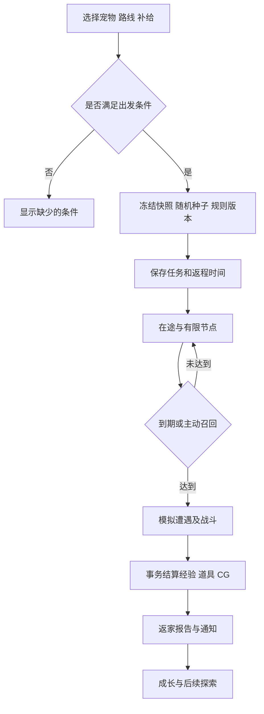

出发条件包含：宠物在家、没有未结束任务、符合路线解锁条件、精力充足、补给存在。校验通过后扣除精力和消耗品，生成一次且唯一的 tripId，记录角色战力、装备、路线和规则版本。旅行中的后续装备变化不能影响已出发的战斗。

### 5.3 放置战斗规则

战斗由规则引擎根据角色职业、等级、属性、装备、敌人数据和种子模拟。用户无需在桌面实时操作战斗。设计既能支持简化的单次胜负，也预留逐回合战报、技能触发和 Boss 机制。

| 维度 | 推荐规则 |
|---|---|
| 属性 | HP（战斗生命）、ATK（攻击）、DEF（防御）、SPD（速度）、LUK（幸运）；魔法等扩展属性通过职业定义。 |
| 职业 | 剑士、法师、游侠、辅助等拥有不同属性倾向和被动效果。 |
| 遭遇 | 一次旅行由若干固定或随机节点组成，例如战斗、采集、休息、奇遇。 |
| 战报 | 记录节点、敌人、回合摘要、胜负、消耗与结果，不要求渲染实时战斗。 |
| 胜利 | 经验、通用货币、素材、装备掉落机会、事件资格。 |
| 失败 | 提前撤退、部分经验、体力或健康影响；进入短暂恢复，不永久丢失角色。 |
| Boss | 预留等级/任务/装备门槛；战胜可解锁区域、称号、剧情与限定 CG。 |
| 召回 | 根据已完成的节点结算部分奖励，未到达的节点不发奖。 |

初期战斗实现可在本地离线运行。AI 仅将已生成的战报解释成符合角色人格的故事，不能决定战斗结果或新增掉落。

### 5.4 在途状态及离线旅行

在途面板展示目的地、出发时间、预计归来时间、已到达节点及明信片。宠物真实位置为 AWAY，桌面不显示其本体；可以通过模板化的旅途留言获取进度，不伪造已经返回的对话。

应用无需持续运行。系统使用时间戳、固定随机种子、出发快照和有限节点记录，在打开应用、恢复睡眠或达到截止时间时恢复进度。最多结算已创建的旅程，不因关机数天自动无限派遣宠物。

每个 tripId 在奖励流水中建立唯一约束；重复打开应用、连续点击领取、进程崩溃后恢复，都不能重复发放经验、装备或 CG。归来报告只是查看和确认结果，结算业务和「已读」状态分开。

## 6. 等级装备经济与日常养成

### 6.1 成长系统

| 系统 | 常见设计 | V1 测试配置建议 |
|---|---|---|
| 等级 Lv | 旅行战斗、探索获取 XP；等级影响属性和解锁 | Lv.1–20，数据结构预留更大等级上限 |
| XP 曲线 | 所需经验随等级增长，集中配置 | 下一等级经验 = 100 + 35 × (当前等级 - 1) |
| 属性 | 初始属性 + 等级成长 + 天赋 + 装备加成 | 基于角色职业定义，不能直接由 AI 修改 |
| 体力 | 出门消耗精力，休息自然恢复 | 0–100，路线消耗 15/30/50，每小时恢复 20 |
| 好感 | 真实互动、旅行归来、个人故事提高好感 | 0–100，20/50/80 解锁关系阶段 |
| 心情 | 短期情绪反馈，影响表现和少量事件概率 | 0–100，默认中性；避免长期负面惩罚 |
| 健康 | 旅行失败或特殊剧情后进入恢复状态 | 恢复中可陪伴，达到条件后正常冒险 |
| 技能 | 职业被动、路线技能和装备用效果 | 预留技能树/熟练度，初期每角色少量特色技能 |

所有参数为可调初始值，不把数值硬编码在 UI。游戏内 XP、货币、好感等奖励由规则系统和流水记录决定。

### 6.2 道具、装备和货币

| 类型 | 来源 | 消耗与用途 |
|---|---|---|
| 通用金币 | 旅行、事件、任务 | 基础补给、部分装备、外观、收藏 |
| 材料 | 采集、掉落、重复收藏补偿 | 强化、合成、制作补给 |
| 消耗品 | 商店、旅行、合成 | 食物、绷带、护符，影响下一次旅行 |
| 装备实例 | 路线掉落、任务、制作 | 穿戴、强化、回收；一个实例不可同时装备给两宠 |
| 外观 | 关系事件、成就、探索 | 模型衣装、配饰、主题；原则上以装饰为主 |
| 收藏品 | 特殊事件、旅途 | 图鉴、房间装饰、个人故事、成就 |

初期装备槽建议为武器、防具、饰品三类。资源通过共享仓库管理；消耗或穿戴时明确归属宠物。装备升级有明确成本和限制，回收可提供少量材料。不要让金币只能积累而无消耗出口，也不要让低等级宠物因为没补给就永远无法出门。

### 6.3 日常小玩法与长期目标

- 互动：摸头、赠礼、聊天、换装、观看角色特殊动画。
- 家园：预留小房间/营地装饰，角色可以在休息时出现于家园界面。
- 任务：探索某地区、击败指定敌人、完成个人故事、收集一定 CG。
- 称号：显示角色旅行次数、探索成就、传奇装备或亲密度里程碑。
- 成长解锁：不同等级、路线、好感阶段开启新动作、角色语音、个人 CG 或异地见闻。
- 后续扩展：多宠编队、角色关系事件、季节活动和更复杂的装备系统。

## 7. 随机事件与 CG 图鉴

### 7.1 事件分类

CG 是事件、经历和关系的记录，不仅是点击按钮抽取图片。一个事件可以包含文字、选项、表情动画、对话以及已有 CG 资源；不是所有事件都必须给 CG。

| 事件分类 | 典型触发 | 示例 CG |
|---|---|---|
| 日常 | 清晨、用户互动、角色休息 | 睡眼朦胧、翻书、喝下午茶 |
| 亲密关系 | 好感阈值、个人故事前置 | 纪念日、赠礼回应、两人的合照 |
| 旅行 | 目的地、路线节点、季节、职业 | 山顶日出、古遗迹、雨中避难 |
| 战斗 | 首次击败 Boss、战斗里程碑 | 斩获胜利、遇见传说魔物 |
| 特殊隐藏 | 多条件组合、稀有事件、角色专属 | 星雨夜、罕见生物、秘密地点 |
| 节日与纪念 | 本地日历、活动开关、角色生日 | 节日晚餐、冬日礼物 |

### 7.2 随机事件引擎流程

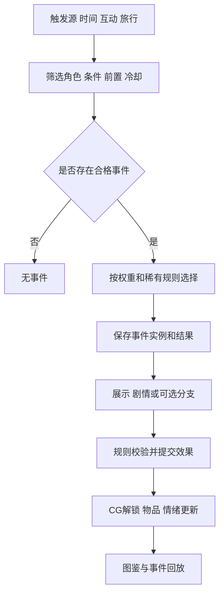

随机性必须发生在业务层，按已保存种子或事件实例结果处理。打开界面、重启应用、重新播放 CG 不重新抽奖。跳过事件动画不导致已获得的收藏消失。

### 7.3 事件定义模型

| 字段 | 含义 |
|---|---|
| eventId / version | 事件稳定 ID 和版本，历史实例保留生成版本 |
| trigger | 日常时间、交互、升级、好感、战斗、旅行节点等 |
| conditions | 角色 ID、等级、好感、地点、季节、前置事件、任务状态 |
| weight / rarity | 候选事件权重、稀有类别；允许配置合理保底 |
| cooldown / limit | 重复触发冷却、每宠次数、账号次数、是否只触发一次 |
| narrative | 标题、文本模板、动作提示、角色台词、CG 资产引用 |
| choices / effects | 可选分支及由规则引擎认可的奖励、状态、后续事件 |
| fallback | 资源缺失、语音不可用或读档时的默认展示 |

### 7.4 示例事件

| 事件 | 触发条件 | 表现与分支 | 结果 |
|---|---|---|---|
| 森林里的雨 | 迷雾森林、已到休息节点 | 旅行报告记录角色在树下避雨，可观看插画 | 解锁该角色「雨中避难」CG；重复可获得少量素材 |
| 神秘的小猫 | 森林路线、等级 ≥3、好感 ≥20 | 可选择帮助迷路的猫或继续赶路；角色有专属台词 | 不同后续心情、辅助事件或纪念品；不改变既已结算的战斗 |
| 深夜陪伴 | 夜间、在家、未免打扰、当日未触发 | 一句关心用户的问候，播放坐下动作 | 记录日常事件，具备更高好感时解锁专属 CG |
| 第一次获胜 | 特定 Boss 首次击败 | 胜利演出、回家自豪地讲战斗经历 | 固定成就与战斗 CG，一次性奖励 |

### 7.5 CG 资产及图库

CG 以预制或合法导入的资源为主，保存 assetId、角色、事件、版本、分辨率、缩略图、解锁要求和授权信息。AI 生成文本不应依赖实时图片生成。未来可以扩展经过审核的动态插画服务，但已解锁 CG 必须有可稳定回看的本地资产。

图鉴支持：全部/角色/地点/事件/稀有度筛选，已解锁插画预览，锁定状态的适度线索，事件时间、解锁角色、剧情回看，收藏和隐藏剧透。单个 CG 的唯一键可使用 petId + cgId + variant；账号图鉴汇总各角色收藏。允许用户关闭弹窗、将非紧急事件放入事件箱；同一时间合并提示，不阻断工作。

## 8. AI 伴侣与角色人格

### 8.1 功能范围

每只宠物拥有自己的角色设定、性格、对话风格、当前状态和会话。用户切换主宠，AI 上下文也必须切换。聊天既可由用户主动发起，也可由已确认的游戏事件触发短句，例如升级后分享喜悦、旅途回来讲见闻。

| 对话形式 | 示例 |
|---|---|
| 普通闲聊 | 「今天工作怎么样？」角色根据人设和用户授权偏好回答。 |
| 游戏事实 | 「你刚才去哪了？」读取该宠的旅行报告，按角色风格讲述。 |
| 陪伴 | 开启安静陪伴，角色以低频率短句与动作互动。 |
| 工具意图 | 「帮我打开开发工作台。」匹配已保存场景，展示确认后执行。 |
| 个人剧情 | 结合已完成事件和角色关系，回应之前真正发生过的经历。 |
| 多角色聊天 | 预留独立群聊会话，有明确发言者及轮流发言机制。 |

### 8.2 AI 流程总图

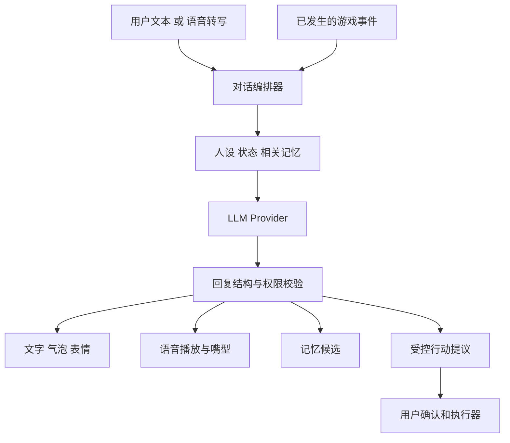

对话上下文按照角色模板、用户允许的角色偏好、当前游戏事实、近期会话、相关长期记忆和本次输入组装。不要把整个存档、用户文件或者所有其他角色记忆发送给模型。

### 8.3 人格与游戏事实

| 数据层 | 示例内容 | 优先级/边界 |
|---|---|---|
| Persona | 背景、行为倾向、称呼、语气、示例台词 | 按角色模板稳定存在 |
| UserPetProfile | 用户修改的角色昵称、交流偏好、音色 | 该宠独立、可编辑 |
| PetContext | 当前等级、精力、位置、近期旅行摘要、好感 | 引擎提供只读快照，真实事实优先 |
| Conversation | 本会话近期对话、检索到的上下文 | 不跨 petId 串台 |
| ModelResponse | 文字、emotion、motionIntent、记忆或工具候选 | 是建议；须校验后才使用 |

AI 不得直接改变经验、货币、物品、装备、CG、旅行结果或亲密度。若用户和宠物聊天满足好感条件，应该由 InteractionService 发出合规互动事件，再由规则引擎处理奖励。模型生成「我带回来一把传奇剑」不能让背包凭空出现该道具。

主动互动同样经过事件调度、冷却、用户设置和当前模式判断。默认优先响应用户，免打扰和全屏时抑制非紧急语音、弹窗；模型不可用时使用角色本地预置文案。

### 8.4 服务适配与成本控制

- LLMProvider 提供 chat、stream、cancel；允许使用用户配置的本地或远端兼容服务。
- 对话与后台事件分开管理请求优先级；无需在每一次眨眼、移动或计时更新时调用模型。
- 游戏事实、属性计算、随机抽取、提示调度不依赖模型。可将低成本规则文案作为默认方案，仅在完整对话或特定故事需要时请求 AI。
- 设置并发限制、超时、取消、上下文长度、每日请求预算以及用户可见的错误信息。
- 切换主宠时取消或保留原宠会话请求，结果按原始 petId 和 conversationId 路由，绝不显示到另一只宠物。

## 9. 语音交互与记忆系统

### 9.1 语音管线

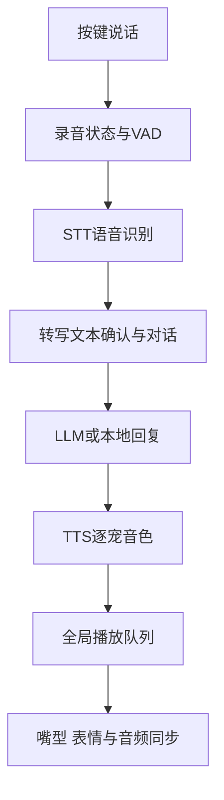

| 功能 | V1 设计 |
|---|---|
| 输入方式 | 默认按键说话或点击麦克风；预留可选唤醒词和本地 VAD。 |
| 录音授权 | 首次显式授权，常显录音状态，随时停止；默认不保存原始音频。 |
| STT | 本地或云识别适配器，失败可手动编辑文本或重新输入。 |
| TTS | 每宠独立 VoiceProfile，支持音量、音色、语速、语言、逐宠静音。 |
| 动画同步 | 音频时间轴或音量驱动嘴型，结构化情绪映射表情；无资源时正常播放文本。 |
| 打断 | 用户插话或停止时取消未完成 TTS/LLM 请求，清理播放队列。 |
| 多宠仲裁 | 默认只有一个主语音通道，明确发言者；切宠不串音。 |
| 降级 | STT 不可用则文本输入；TTS 不可用保留文字；AI 不可用规则文案仍可播放。 |

不默认常驻监听麦克风；云 STT/TTS 需向用户说明输入音频或文本将交由其配置的服务处理。避免 TTS 播放被麦克风再次识别而自动触发新请求。

### 9.2 记忆分层

真正的长期陪伴需要记住相关事实，但每只宠物应有独立认识。共享用户偏好只在用户明确授权时对其他宠物开放。

| 记忆类型 | 存储范围 | 内容示例 | 权限 |
|---|---|---|---|
| 短期上下文 | petId + conversationId | 最近几轮对话 | 会话内使用，可清理 |
| 角色长期记忆 | petId | 共同经历、称呼、用户告诉该宠的喜好 | 默认相互隔离，用户可查看修改 |
| 用户共享偏好 | userId | 用户希望所有宠物使用的称呼、语言、常用场景 | 仅经用户确认共享 |
| 游戏历史 | petId | 旅行报告、成就、CG、剧情、升级 | 游戏引擎记录，AI 只读事实 |

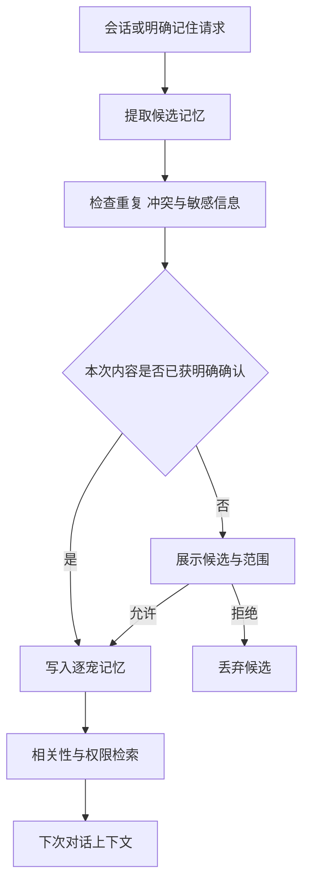

候选记忆至少包含 memoryId、scope、petId、type、summary、sourceRef、confidence、consentState、createdAt、updatedAt、expiresAt、pinned。第一版默认每条长期记忆均需用户明确确认；模型推测不能直接作为真实事实，冲突需标为待确认或由用户纠正。

记忆管理页面可以按角色、类型、时间查看，支持固定、改写、删除、清空、禁用和导出。删除记忆后，检索上下文和对应索引应同步失效。密码、API Key、剪贴板、文件内容、窗口内容和音频原文件默认不自动采集或保存。

记忆初期可以使用结构化标签和关键词检索，后续增加向量检索、摘要和置信度排序。向量索引只是检索辅助，SQLite 中的记忆记录才是可编辑的权威数据。

## 10. Windows 快捷入口与习惯推荐

### 10.1 快捷工作台

桌宠可以作为常用工作环境的入口，例如用户每天打开电脑都会使用 Android Studio、浏览器和音乐软件，设置一次后将其保存为「开发工作台」组合。

| 快捷类型 | 具体功能 |
|---|---|
| 应用快捷项 | 用户选定已安装程序、受信快捷方式、受支持的应用 ID，并保存名称和图标。 |
| 文件夹/网页 | 用户明确添加的目录或可信 URL，支持打开预配置目标。 |
| 场景组合 | 多个快捷项按顺序或并行启动，支持间隔、重复运行策略。 |
| 置顶与最近使用 | 手动常用收藏、最近运行记录、拖动排序。 |
| 执行结果 | 每项显示已发起、失败、跳过或未知；已发起不表示窗口已经就绪。允许单项手动重试。 |
| AI 入口 | 对角色说「打开开发工作台」，匹配已保存组合，再展示确认。 |

已保存场景被用户主动点击时，该点击即构成本次执行授权，不需要逐个确认。AI 产生的调用建议应展示组合名称与应用清单并获得明确确认；不能把任意自然语言直接转换为 shell 命令。

### 10.2 习惯识别与建议流程

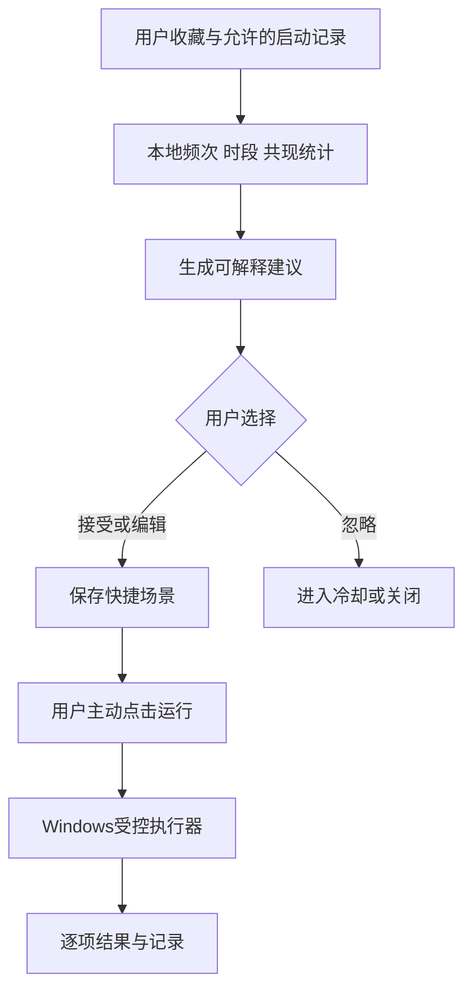

第一阶段推荐通过规则实现：用户开启本地统计后，根据近 7/30 天经本软件发起的启动记录，计算应用使用频次、常见时间段、组合共现与最近使用情况。统计默认关闭，数据不足或未授权时只展示用户手工收藏。识别系统中其他启动行为属于后续扩展，另行授权，仅允许记录必要应用标识和时间，不读取窗口正文、键盘、屏幕、浏览历史或文件内容。

示例：「你最近多个工作日上午都会打开开发工具、浏览器和音乐，要不要把它们组合成晨间工作台？」用户可接受、修改、忽略或永久关闭建议。AI 可以优化文案，但不会自行决定系统执行目标。

### 10.3 可扩展桌面技能

| 能力 | 设计阶段是否预留 | 边界 |
|---|---|---|
| 一键工作环境 | 是 | 仅已保存并授权的组合 |
| 专注计时和休息提醒 | 是 | 用户控制频率、时段和静音 |
| 快捷打开笔记或项目文件夹 | 是 | 用户显式配置目标 |
| 任务提醒 | 是 | 由用户创建、查看、取消 |
| 开机自动启动桌宠 | 是 | 用户设置开启/关闭 |
| 自动运行指定场景 | 仅预留，V1 不实现 | 后续需独立授权，明确时间及目标；不默认触发 |
| 任意脚本和电脑控制 | 否 | 不纳入 V1 AI 权限，避免模型直接控制 OS |

## 11. 技术架构与模块划分

### 11.1 技术选型建议

| 层级 | 推荐选择 | 选择依据 |
|---|---|---|
| Windows 宿主 | Electron + TypeScript；可替换 Win32 适配层，Tauri 为宿主备选 | 透明窗口、多窗及 Web 模型生态；真实 Windows POC 通过后锁定 |
| 桌面渲染 | PixiJS WebGL 序列帧先行；Live2D Cubism Web 独立适配，授权及 POC 通过后发布 | 静态降级；预留 VRM/Three.js 与 Spine |
| 控制中心 | Vue 3 + TypeScript + Vite + Vue Router + Pinia | 多页面管理、组件化 UI、只读领域投影 |
| 核心逻辑 | 独立 TypeScript 领域模块 | 模拟、状态、事件、结算与 UI 框架解耦 |
| 持久化 | SQLite（better-sqlite3 主选、node:sqlite 备选）+ 手写 SQL 迁移 + 本地资源目录 | 独立 app-service 持唯一写连接、事务、离线存档与资源管理 |
| AI | 自有 ModelProvider + 官方 SDK 薄适配器；SQLite FTS5 记忆 | 逐宠隔离、结构化校验及可替换模型；向量检索后置 |
| 语音 | AudioWorklet + whisper.cpp + Windows System.Speech；Azure Speech 可选 | 按键说话、分句/整段 WAV、独立音色和本地降级 |
| Windows 工具 | 宿主进程受控 API | 执行权限不暴露给网页渲染或模型 |
| 工程与发布 | pnpm workspace + electron-vite + electron-builder（NSIS）+ electron-updater | 同一仓库、Windows 原生构建及可验证升级 |

项目使用独立代码仓库从零开发，不依赖 AIRI 的项目结构。上述选型是推荐基线，需通过第 16–23 章中列出的 POC；未过关的技术仅在相同接口下替换，不改变产品状态模型与存档所有权。

### 11.2 系统总体架构图

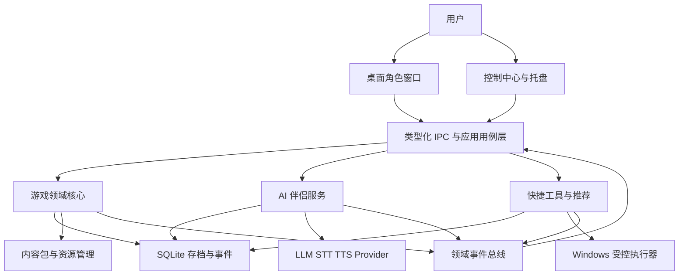

Windows 宿主负责生命周期、窗口、系统托盘、权限和受控执行；表现层只渲染状态、接收输入和提出命令。游戏领域核心对宠物状态、冒险、等级和奖励拥有最终写入权；AI 层读取经过授权的上下文并提出建议，不拥有游戏规则或系统执行权。

### 11.3 代码模块建议

以下是建议的模块边界与职责，实际目录可适配现有项目。

| 模块 | 职责 | 必须隔离的内容 |
|---|---|---|
| windows-host | 单实例、窗口配置、穿透、托盘、屏幕、热键、应用启动、系统权限 | 只暴露明确白名单 IPC |
| desktop-stage | 模型加载、动作、表情、拖动、气泡、对话反馈 | 不直接写入游戏数据 |
| control-center | 宠物馆、冒险、背包、图鉴、聊天、快捷和设置页面 | 使用领域用例与查询接口 |
| pet-domain | CharacterDefinition、PetInstance、状态机、互动、行为调度 | petId 明确隔离 |
| adventure-domain | 路线、任务、进度、种子、战斗模拟、召回、结算 | 奖励通过事务和服务处理 |
| progression-domain | 等级、属性、装备、仓库、货币、关系、成就 | 权威写入与奖励流水 |
| event-domain | 随机事件、条件、权重、实例、选择、CG 图鉴 | 内容定义和实例分离 |
| ai-companion | 逐宠会话、上下文、结构化输出、主动互动建议 | 不执行任意工具和修改数值 |
| voice | 麦克风、STT/TTS 适配、队列、嘴型、取消 | 麦克风授权、音频生命周期 |
| memory | 记忆候选、检索、范围、冲突、编辑删除 | 私有/共享 scope 强制校验 |
| quick-tools | 快捷项、组合、受控提议、执行记录 | 模型不可直接接触执行器 |
| recommendation | 许可统计、频次与共现规则、推荐卡片 | 默认仅本地、可关闭/清理 |
| content | 模型、动画、CG、地图、角色、事件资源与版本 | 声明式资源验证、兼容迁移 |
| infrastructure | SQLite 事务、时钟、日志、配置、迁移、备份 | 事务、凭据、隐私和可恢复性 |

### 11.4 命令和事件边界

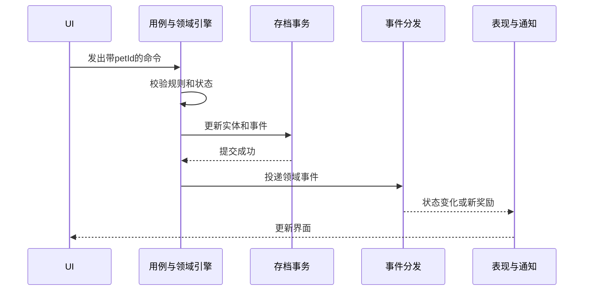

命令负责请求做事，事件负责记录已经发生的事实。应用层可调用领域服务并订阅事件，但表现层不得直接写 SQLite。全局调度器统一处理状态恢复、旅行截止、冷却与提醒，避免多个页面同时结算同一事件。

### 11.5 Windows 宿主结构

| 组件 | 责任 |
|---|---|
| 主进程 | 窗口创建与回收、系统托盘、应用生命周期、安全 IPC、受控执行器 |
| 桌宠窗口 | 小尺寸透明渲染，按宠物独立或舞台容器，鼠标穿透与本地动画 |
| 控制中心窗口 | 普通应用窗，支持输入焦点、复杂设置、列表及对话 |
| app-service 服务进程 | 独立 utilityProcess，持唯一数据库写连接；负责游戏计算、调度、持久化、AI/记忆/推荐及语音编排；重任务经 Worker 或受限辅助进程隔离 |

渲染进程只获得所需 API，不能自行读写任意文件、创建进程或调用 shell。Windows 宿主对所有目标 ID、参数、请求权限和当前用户确认进行校验。

## 12. 数据模型事件与接口契约

### 12.1 核心数据实体

以下是产品层的逻辑实体映射；SQLite 的具体字段、约束、事务和附加表以第 18–21 章的技术设计为准，不为同一业务额外建立第二份数据源。

| 实体或表 | 主键 / 关键字段 | 所属领域 |
|---|---|---|
| character_definitions | characterId, manifestVersion, personaRef, statProfile | 内容 |
| pets | petId, characterId, nickname, createdAt, revision | 宠物 |
| pet_states | petId, presence, activity, mood, healthStatus, visibility, moodScore, healthPoints, energy, bond, lastUpdatedAt | 宠物 |
| pet_progression | petId, level, xp, statAllocations, skillData | 成长 |
| equipment_instances | equipmentId, itemDefId, ownerPetId?, slot?, upgradeLevel | 仓库装备 |
| inventory / wallet | accountId, itemDefId, quantity, currencyType, amount | 经济 |
| trips | tripId, petId, routeId, seed, snapshot, ruleVersion, startAt, expectedReturnAt, nextDueAt, actualReturnedAt, status | 冒险 |
| trip_encounters | tripId, nodeIndex, encounterId, result, occurredAt | 冒险 |
| reward_ledger | rewardKey, sourceType, sourceId, petId, kind, targetId, amount；旅行和非旅行奖励均使用 | 结算 |
| event_occurrences | eventInstanceId, eventId, petId, result, choiceId, status | 事件 |
| cg_unlocks | petId, cgId, variant, sourceType, sourceId, assetVersion, unlockedAt, viewedAt, favorite | 图鉴 |
| conversations / messages | conversationId, petId, messageId, role, text, createdAt | AI |
| memories | memoryId, scope, petId?, summary, sourceRef, confidence, consent | 记忆 |
| quick_actions / routines | actionId, targetRef, routineId, orderedActionIds；V1 不支持自定义启动参数 | 快捷 |
| launch_history | runId, actionId, outcome, timeBucket；仅用户开启统计后留存 | 快捷 |
| recommendations | recommendationId, reason, proposedActionIds, status | 推荐 |
| preferences | userId, settings, consentFlags, providerCredentialRef | 系统 |
| domain_events / outbox | eventId, aggregateId, revision, type, causationId, schemaVersion, payload | 事件总线 |

### 12.2 数据关系图

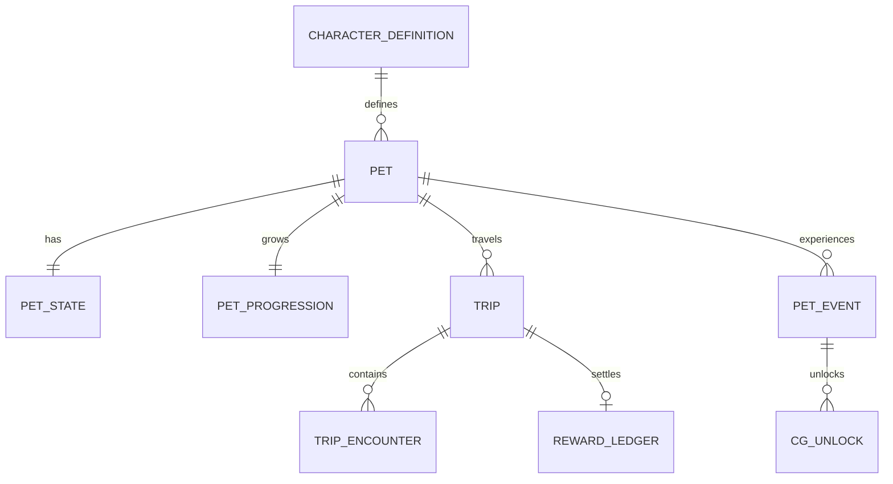

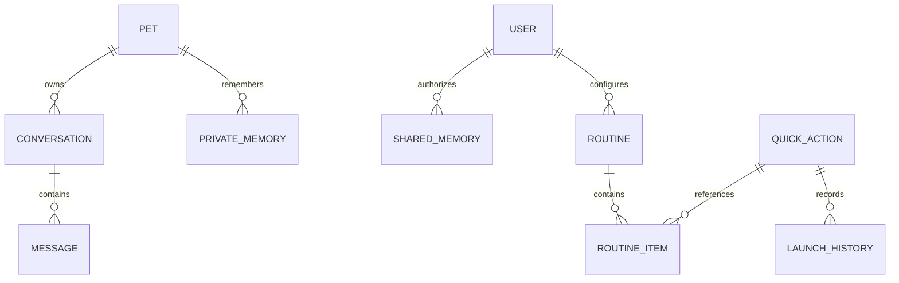

内容定义应拥有稳定 ID 和版本；玩家实例及解锁记录拥有各自稳定 ID，不能因内容包改名而丢失。游戏时间记录使用统一时间格式，显示时再转为本地时区；并发更新记录 revision，避免旧状态覆盖新状态。

### 12.3 服务接口设计

以下为逻辑级接口，不绑定最终语言的实际函数签名。

| 服务 | 建议接口 | 主要作用 |
|---|---|---|
| PetService | listPets、createPet、selectPrimary、getSnapshot、changeVisibility | 角色实例、主宠、显示 |
| PetStateEngine | interact、requestActivity、tick、recoverState | 状态转换、恢复、互动 |
| AdventureService | listRoutes、previewTrip、startTrip、getProgress、recallTrip、settleTrip | 旅行与结算 |
| ProgressionService | getAttributes、equip、upgrade、grantReward、getInventory | 成长与经济 |
| EventEngine | evaluateTrigger、getInbox、chooseEvent、resolveEvent | 随机事件生命周期 |
| GalleryService | listUnlocks、getCG、markViewed、favorite | CG 回放与收藏 |
| ChatService | sendMessage、streamReply、cancel、listConversations | 对话编排 |
| MemoryService | retrieve、propose、confirm、update、delete、export | 记忆控制 |
| VoiceService | startListening、stopListening、speak、interrupt | STT/TTS 与播放 |
| QuickActionService | addAction、saveRoutine、previewRoutine、executeApproved | 用户快捷工具 |
| RecommendationService | collectAllowedSignal、suggest、accept、dismiss、clear | 本地建议 |

### 12.4 消息结构示例

命令统一携带 commandId 和目标 petId；同一次请求重试不创建新命令。事件统一携带 eventId、聚合 ID、revision、因果 ID、发生时间、schemaVersion 和 payload。

```ts
type DomainCommand<T> = {
  commandId: string;
  type: string;
  petId?: string;
  expectedRevision?: number;
  issuedAt: number; // UTC epoch 毫秒
  payload: T;
};

type DomainEvent<T> = {
  eventId: string;
  type: string;
  aggregateId: string;
  revision: number;
  occurredAt: number; // UTC epoch 毫秒
  causationId: string;
  schemaVersion: number;
  payload: T;
};

type PetContext = {
  petId: string;
  characterId: string;
  revision: number;
  level: number;
  presence: 'HOME' | 'AWAY' | 'RETURNING';
  mood: string;
  energy: number;
  bond: number;
  recentAdventureSummary?: string;
};
```

```ts
type ChatRequest = {
  petId: string;
  conversationId: string;
  source: 'TEXT' | 'VOICE' | 'EVENT';
  text: string;
  contextRevision: number;
};

type ChatReply = {
  replyId: string;
  petId: string;
  conversationId: string;
  text: string;
  emotion?: string;
  motionIntent?: string;
  memoryCandidates?: MemoryCandidate[];
  actionProposals?: ActionProposal[];
};

type ActionProposal = {
  proposalId: string;
  petId: string;
  type: 'LAUNCH_ACTION' | 'LAUNCH_ROUTINE' | 'OPEN_APPROVED_URL';
  targetId: string;
  reason: string;
  expiresAt: number; // UTC epoch 毫秒
  confirmationRequired: true;
};
```

MemoryCandidate、动作参数及具体事件 payload 应在正式开发前建立 schema 校验和版本兼容。上面的结构特别约束 AI 只能给出已知目标 ID 和结构化意图，不能把自由文本当作系统执行参数。

### 12.5 重要领域事件

| 事件 | 生产者 | 消费者及联动 |
|---|---|---|
| PetSelected | PetService | 舞台、聊天、语音路由、托盘 |
| PetStateChanged | PetStateEngine | 舞台、详情卡片、通知、事件筛选 |
| PetInteracted | InteractionService | 好感规则、互动事件、动画 |
| TripStarted | AdventureService | 舞台隐藏该宠、地图进度、计时调度 |
| TripCheckpointReached | AdventureService | 旅行进度、明信片、合格事件评估 |
| TripSettled | AdventureService | 已提交的结算结果；更新成长和图鉴显示、返家通知、AI 摘要 |
| LevelUp | ProgressionService | 角色动画、区域解锁、事件、通知 |
| CGUnlocked | Event/GalleryService | 图鉴、未读提示、成就、AI 只读事实 |
| ChatCompleted | ChatService | 会话存档、记忆候选、语音与动作 |
| RoutineSuggested | RecommendationService | 推荐卡片、用户可接受或忽略 |
| ActionExecuted | QuickActionService | 执行反馈、许可统计与推荐 |

数据库事务同时写入关键实体变更和待投递事件；提交后进行订阅分发。消费者按 eventId 去重。任何 UI 订阅失败都不应回滚已经正确完成的游戏结算，下一次读取存档可以恢复显示。

## 13. 离线恢复安全性能与异常

### 13.1 应用启动与恢复流程

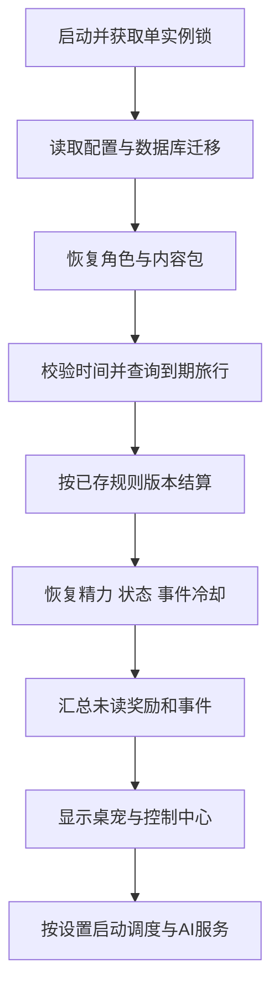

旅行使用持久化 UTC 截止时间，应用运行期间用单调时钟辅助测量，检测系统时间倒退或异常跳变。时间不可证明时采取保守结算，不进行无限自动旅行。离线时间规则只作用于真实存在的任务和可恢复状态。

若角色处于聊天/拖动等瞬态活动时退出，启动后恢复到可用的正常活动，而不是重放中断的语音、用户工具指令或随机动画。资源包升级时保留已开始的旅行规则版本和已解锁收藏记录。

### 13.2 权限与隐私

| 数据或能力 | 默认策略 |
|---|---|
| 游戏存档 | 本地 SQLite，支持备份、恢复和导出 |
| 角色记忆 | 逐宠隔离；选择共享前确认；支持查看和删除 |
| AI 远端请求 | 只有用户配置/同意相应提供方后才发送必要上下文 |
| 麦克风 | 默认关闭，主动录音时显示可见状态 |
| 应用使用统计 | 默认仅使用产品内动作；额外系统统计需单独启用 |
| 快捷工具执行 | 用户预配置目标，主动运行或明确确认 |
| API Key | 保存于 Windows 安全凭据机制或等效保护存储，不进角色包、数据库明文或日志 |
| 第三方内容包 | 验证清单、文件路径、类型和版本，不执行未授权脚本 |

### 13.3 性能策略

- 桌宠显示时采用可调帧率，初期目标可以是常用动画约 30 FPS；隐藏、静止或省电时降低帧率或暂停渲染。
- 大型 CG 缩略图懒加载，模型资源按当前可见角色管理；同屏宠物初期限制数量。
- 离线旅行不依赖每秒逐帧计算，按有限节点与时间差结算；普通调度采用到期时间而非大量高频计时器。
- AI/STT/TTS 使用单独请求队列，网络等待不得阻塞拖动、动画、控制中心或游戏状态更新。
- 监控启动耗时、宿主内存、CPU/GPU、SQLite 慢操作、AI 超时和资源加载错误。在真实 Windows 设备测量后确定最终预算。

### 13.4 典型异常与退化方式

| 场景 | 预期行为 |
|---|---|
| 断网或模型超时 | 桌宠、养成、旅行、快捷和图鉴正常；回复采用本地文案或告知连接失败。 |
| STT/TTS 不可用 | 回退文字输入或显示回复，不影响对话记录。 |
| 模型动作缺失 | 回退到待机或静态立绘，不影响数值和事件。 |
| 到期旅行在结算时崩溃 | 事务回滚或利用唯一键恢复，确保不重复领取。 |
| 角色主宠切换时请求未完成 | 原 petId 会话正确接收或取消；不串台，不自动重复请求。 |
| 快捷应用已卸载 | 标记失效，提供编辑/删除入口；组合其余项按配置继续。 |
| 权限被撤回 | 停止对应语音、统计或执行功能；不自动恢复许可。 |
| 内容包更新不兼容 | 保留旧版本引用或回退通用资源，提示修复，不删除玩家进度。 |
| 数据迁移失败 | 保留迁移前备份，进入明确恢复模式，避免覆盖有效存档。 |

## 14. 开发路线及验收标准

### 14.1 分阶段实现路线

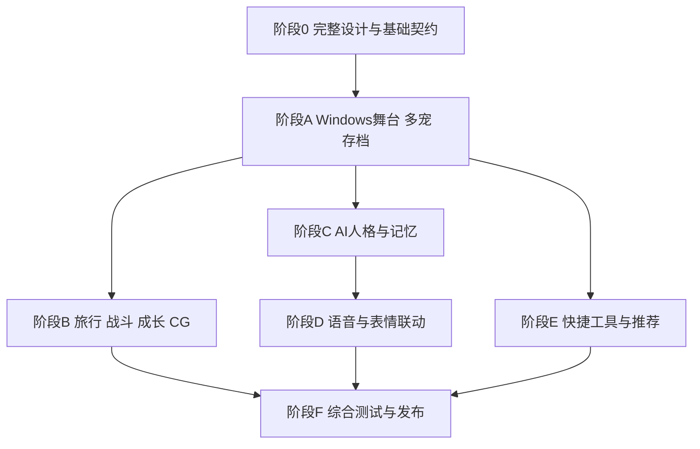

阶段 0 就完成模块骨架、数据库版本、角色与事件契约、Provider 接口、Windows 执行权限边界；后续功能可暂时以 Mock 或 feature flag 关闭。这里的依赖表示开发顺序，不表示 AI、快速工作台或语音要从产品设计中删除。

| 阶段 | 要交付的能力 | 关键验收 |
|---|---|---|
| 0 设计与骨架 | 模块接口、数据模型、事件协议、内容包规范、页面结构 | 所有 V1 模块有清晰归属；可用 mock 测试接口 |
| A 桌面与宠物 | Windows 透明窗口、模型、托盘、穿透/拖动、多宠、SQLite、状态 | 两只宠物可切换；各状态独立；重启位置和进度保存 |
| B 玩法与收集 | 路线、自动战斗、装备、背包、成长、事件、CG | 关机后恢复任务；同旅行不重复奖；新 CG 可回看 |
| C AI 与记忆 | 人格、文字对话、状态上下文、逐宠会话、记忆管理 | 回答真实游戏事实；切宠不串台；删除记忆后不再检索 |
| D 语音 | STT、TTS、音色、语音打断、嘴型、静音 | 不同角色音色；取消与静音正常；音频失败不破坏对话 |
| E 桌面助手 | 常用入口、场景组合、逐项结果、许可统计、推荐 | 一键组合启动；AI 提议须授权；统计可关闭及删除 |
| F 发布与优化 | 全流程集成、性能、升级迁移、异常处理、打包与安装 | 真实 Windows 双屏/高 DPI/休眠/全屏测试；备份可恢复 |

### 14.2 跨模块验收场景

| 编号 | 测试场景 | 可观察结果 |
|---|---|---|
| T01 | 宠物 A 聊天期间宠物 B 出门 | A 正常聊天；B 独立在途；两者经验、装备和记忆不串。 |
| T02 | 一次旅行完成后反复启动和领取 | 同 tripId 最多产生一次奖励流水和对应 CG 解锁。 |
| T03 | 出门后关闭应用，超过截止时间再打开 | 根据冻结快照结算；生成真实战报；宠物返家，不重复自动派遣。 |
| T04 | 获得 CG 后回放十次 | 仅查看历史，收藏及奖励数量不增加。 |
| T05 | 对宠物询问刚才的冒险或掉落 | AI 使用真实记录，不增加任何未获道具。 |
| T06 | 给 A 保存私有记忆，切换 B 对话 | B 不得读取该记忆，除非用户将其明确设为共享。 |
| T07 | 用户说「打开开发工作台」 | 显示已配置清单；确认后受控执行并反馈结果。 |
| T08 | 用户拒绝或撤回麦克风和习惯统计权限 | 对应功能停止；游戏、文本对话和手工快捷项继续可用。 |
| T09 | 进入全屏/免打扰后旅行到期 | 不产生强打扰；后台正常结算；退出后显示汇总提醒。 |
| T10 | 在旅行过程中配置下一次出发装备或更新内容包 | 当前旅行继续使用冻结快照和适用规则版本；新配置仅影响下一次出发。 |
| T11 | 网络断开、语音提供方故障 | 不影响本地游戏和 CG，AI 及语音合理降级。 |
| T12 | 移除外接显示器、变更 DPI、暂停恢复 | 桌宠重新定位到有效屏幕，状态与任务恢复正确。 |

### 14.3 首版测试内容规模建议

| 内容 | 建议数量 | 目的 |
|---|---:|---|
| 可养成角色 | 3 个 | 测试个性、状态隔离、职业差异与资源适配 |
| 地图区域 | 3 个 | 测试不同级别与时长的旅行闭环 |
| 普通敌人 / Boss | 约 12 / 3 | 测试成长、难度、失败和首次胜利 |
| 事件 | 约 30 个 | 日常、旅行、亲密、战斗、节日均有代表 |
| CG | 约 20–30 张 | 覆盖角色专属、区域、关系和稀有收藏 |
| 装备及材料 | 约 20–40 项 | 验证仓库、强化、装备归属、奖励和消耗 |
| 快捷场景示例 | 3 个模板 | 工作、娱乐、学习，用户自行修改目标 |

数字是内容生产和功能验证的参考，并不意味着首次发布必须达到该规模。可以先用占位资源和 2 个角色完成测试闭环，再逐步制作完整的模型、动作、事件及 CG。

### 14.4 设计冻结后的第一批开发任务

1. 建立项目目录、类型契约、角色包 manifest 及 SQLite 初始迁移。
2. 完成 Windows 透明窗口与渲染适配器验证；实现可显示的两只示例角色。
3. 开发逐宠状态机、主宠切换、桌面输入和模式调度。
4. 建立可测试的旅行、奖励与事件引擎；使用模拟时钟测试离线归来。
5. 建立控制中心页面骨架，并接通宠物详情、旅行、背包、图鉴的真实查询。
6. 引入 AI Provider Mock、两只不同人格角色的独立会话与记忆接口。
7. 接入语音管线和 Windows 快捷执行器；为推荐提供可关闭的本地统计。
8. 对全过程执行 T01–T12，再扩大角色与 CG 内容量。

## 产品篇设计结论

V1 系统应将 **Windows 宿主、角色表现、游戏规则、AI 伴侣及桌面辅助** 分开：游戏引擎保存真实的宠物状态与成长，AI 让每只角色以独立人格表达这些事实，Windows 能力只在用户授权范围内执行。这一架构能够同时支持日常陪伴、持续冒险、收藏惊喜以及实用的桌面助手，并允许后续扩展角色、地图、事件、CG 与 AI 能力，而不改变基础存档和核心游戏规则。

---

# 第二篇 技术选型与工程详细设计

## 15. 技术决策总表与统一工程约定

### 15.1 从零开发的技术基线

本项目采用独立代码仓库、独立领域逻辑和独立存档，不继承 AIRI 的代码或运行架构。技术篇按七个相互独立的设计步骤组织：宿主、前端渲染、游戏数据库、AI 记忆、语音、Windows 工具、工程发布。每一步明确候选方案、采用方案、替换边界、官方证据和必须验证的结果。

| ADR | 领域 | 主选技术与设计 | 备选或后置 | 何时冻结 |
|---|---|---|---|---|
| 001 | Windows 宿主 | Electron + TypeScript；独立小窗口、托盘、受控 Win32 适配层 | Tauri / 必要的原生窗口桥 | Windows 透明边缘命中、多屏、焦点 POC |
| 002 | 控制中心 | Vue 3 + Vite + Vue Router + Pinia | React/Svelte 不在同一工程混用 | 双入口生产包、共享契约通过 |
| 003 | 角色渲染 | PixiJS WebGL 序列帧；静态 Canvas2D/DOM 降级 | Live2D Cubism Web；VRM/Three.js；Spine | 序列帧性能通过；其他渲染器各自 POC、授权 |
| 004 | 游戏内核 | 无 UI/宿主依赖的纯 TypeScript，确定性离线模拟、事件与状态机 | 仅视觉小游戏后来可引入 Phaser 等 | 金样回放、离线推进和幂等通过 |
| 005 | 本地存档 | SQLite，better-sqlite3，显式 SQL、版本化迁移 | node:sqlite 备选；Drizzle 可选 | 安装包 native ABI、SQLite 实际版本、备份恢复通过 |
| 006 | 进程架构 | Main + app-service utilityProcess + pet/control-center renderer | 受限 Worker、原生辅助进程 | 独立服务重启和 UI 隔离通过 |
| 007 | 契约 | TypeScript strict、Zod 运行时 schema、版本化 DTO | 不引入通用消息总线框架 | IPC 合法/非法用例、版本兼容通过 |
| 008 | AI | 自有 ModelProvider，openai SDK 初始实现和 Mock；第三方兼容接口按能力适配 | Anthropic/Ollama 原生适配；AI SDK Core 后续评估 | 逐宠路由、结构化校验、取消、隔离通过 |
| 009 | 记忆 | SQLite FTS5 + 结构化事实、短期会话、确认及授权 | 本地向量、sqlite-vec 或其他检索增强 | 中文检索、撤回、删除、备份能力通过 |
| 010 | 语音 | PTT、AudioWorklet、whisper.cpp 多语种、Windows System.Speech、Web Audio + RMS | Azure Speech 云语音；VAD/viseme/实时语音后续 | 本地识别/音色可用性、语音取消通过 |
| 011 | 快捷入口 | 已授权目标 ID、Main 受控启动接口、SQLite 本地规则推荐 | AUMID 原生激活、用户独立授权的增强能力 | 已批准目标准确启动、未批准目标不执行 |
| 012 | 工程发布 | pnpm workspace + electron-vite + electron-builder NSIS + electron-updater；Vitest / Vue Test Utils / Playwright | Forge 为完整替代链，不混用两种 updater | 真实 Windows 安装、重启、升级迁移通过 |

这些是选型建议基线，不是已安装的软件清单，也不是已通过的测试报告。原则上选择仍受维护的稳定版本；禁止把未经测试的最新版本号、SDK 能力或示例跑分直接当成系统承诺。最终锁定的 Electron、内嵌 Node、pnpm、依赖、SQLite 引擎、SDK/模型版本必须记入工程的技术锁定记录和 lockfile。

### 15.2 最终进程拓扑图

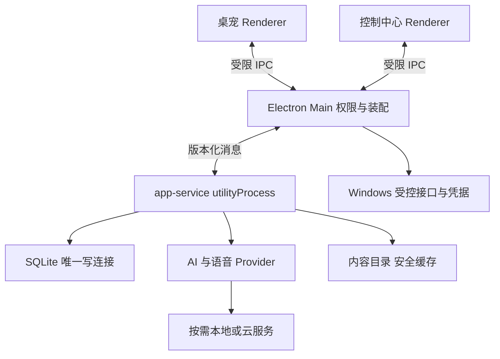

- 单实例 Main 管理宠物窗口、控制中心、托盘、系统权限、真实用户确认、凭据保护、受控程序启动和版本更新。Main 不运行 SQLite 写事务，也不进行战斗循环、重型模型推理或逐帧绘制。
- 独立 app-service 在第一版就建立，而不是后期拆分。它拥有唯一持久化写连接，负责所有业务用例、事务、调度、状态、事件、AI 编排、长期记忆、推荐和 VoiceCoordinator。网络请求是异步的，较重的纯计算或本地语音推理经受限 Worker/辅助进程完成；它们不得自行写游戏存档。
- 桌宠 renderer 只拥有可序列化的业务投影及动画资源；控制中心处理页面、表单、会话展示和用户操作。录音/播放只给可信控制中心的指定角色或专用可信音频 renderer。Main 校验窗口角色与上下文后路由消息。
- 按需的 Windows 原生桥和语音辅助程序属于基础设施，不是第二套业务服务器。仅支持固定版本、窄接口、预定义功能；不接收任意自由文本命令。API Key 在 Main 的凭据保管模块保护，由受信 Provider 按需取得必要凭据，绝不经过 renderer。

### 15.3 跨模块统一契约

| 约定 | 统一定义 |
|---|---|
| 实体身份 | `characterId` 为角色模板；`petId` 为独立实例；`tripId` 为旅行；`eventInstanceId` 为事件实例；`cgId + variant` 为图鉴条目版本标识 |
| 业务命令 | `commandId` 用于数据库幂等，同 ID 不同 payload 拒绝；`expectedRevision` 用于并发检验；UI 不直接更新真实值 |
| 非命令请求 | `requestId` 路由查询、AI、动画、资源等异步请求；不得拿它替代跨重启业务幂等键 |
| 对话与语音 | `conversationId` 按宠隔离；`turnId` 标识一次对话轮；`generation` 作废同轮旧语音、旧嘴型或其他迟到结果；消息带所属 `petId` |
| 事件 | `eventId`、聚合 ID、`revision`、`occurredAt`、`causationId`、`schemaVersion`、payload；持久消费者各自有消费位置；通知至少一次送达，业务效果由事务去重 |
| 时间 | 持久化及 IPC 时间统一使用 UTC epoch 毫秒整数；展示时转换当地日期；模拟另持单调经过时间、逻辑时间水位和规则版本 |
| 状态 | `Presence`、`Activity`、`Mood`、`Health` 为独立大写枚举；`activity` 在非 HOME 时为空或受限；`visibility` 独立，`doNotDisturb`/`pausedRender` 可同时开启 |
| 数值 | `energy`、`bond`、`moodScore`、`healthPoints` 显示/规则量表 0–100，持久化采用固定点整数 0–1000（十分之一单位）；保持数值与状态枚举独立 |
| 旅行 | 只持久化 `TRAVELING`/`SETTLED`；返程 `checkpoint.phase=RETURNING` 与 Presence 对应；`PREPARING`、`RESOLVING` 是瞬态。旅行快照冻结，下一次出发装备修改不影响当前旅行 |
| 动画 | 小写语义动作 `idle`、`sleep`、`talk` 等映射业务状态，动画不是真相源；动作完成不得决定是否发放奖励 |
| 系统执行 | `ActionProposal` 仅针对已授权快捷对象；模型给出的内容是候选，可信服务生成 `proposalId`、宠物、版本、到期时间，Main 接收真实用户批准后复核执行 |

所有跨边界 DTO 都以 `packages/contracts` 的运行时 schema 作为传输契约；领域对象和第三方 SDK 类型通过各自适配器转换，禁止将两者直接透传。应用版本、DB schema、消息 schema、内容包、玩法规则、模型协议版本彼此独立。

### 15.4 数据所有权和扩展边界

| 数据 | 逻辑所有者 | 持久化与维护 |
|---|---|---|
| `petId` 及偏好 | pet-domain / preferences | 昵称、获得信息、当前外观、主宠、可见集合、屏幕锚点和缩放；Pinia 仅为投影 |
| 成长、冒险、资源 | game-domain / progression / adventure | 固定快照、事务、唯一结算、通用奖励账本、库存/装备/货币，完整支持日常非旅行奖励 |
| 事件和 CG | event-domain / gallery | 事件定义版本、事件实例、一次选择及效果提交、`petId+cgId+variant` 唯一解锁；不依赖动画回放 |
| 对话、共享偏好 | ai-companion / memory | 逐宠私有，授权到具体宠物；账号共享偏好也需明确范围，新宠默认不继承未授权私有事实 |
| 快捷与推荐 | quick-tools / recommendation | 快捷目标、场景、用户配置；统计默认关闭，启用后仅记录应用内发起事件；执行结果按授权策略存储 |
| 内容和缓存 | content | 资源目录保存数据包及历史版本；运行中旅行、已解锁 CG、有效历史内容的必要版本固定保留，只有可重建缓存可自动清理 |
| 凭据与批准 | Main | OS 保护凭据；授权票据短时有效且绑定目标与版本；模型无直接系统调用权。业务记录仅经 app-service repository 写入 |

在首期测试中默认显示一只宠物，真实多宠 POC 验证 3 只同时存在时的窗口与性能；发布默认和技术容量不混淆。系统没有 AI 或语音时，游戏照样运行；没有 Live2D 时使用序列帧，缺资源时使用静态占位。AI 自由叙述可能不准确，因此等级、掉落、战报与库存等重要事实应同时提供由实际数据渲染的事实卡片或确定性文案，不依靠模型自述证明正确。

### 15.5 依赖方向与设计实施顺序

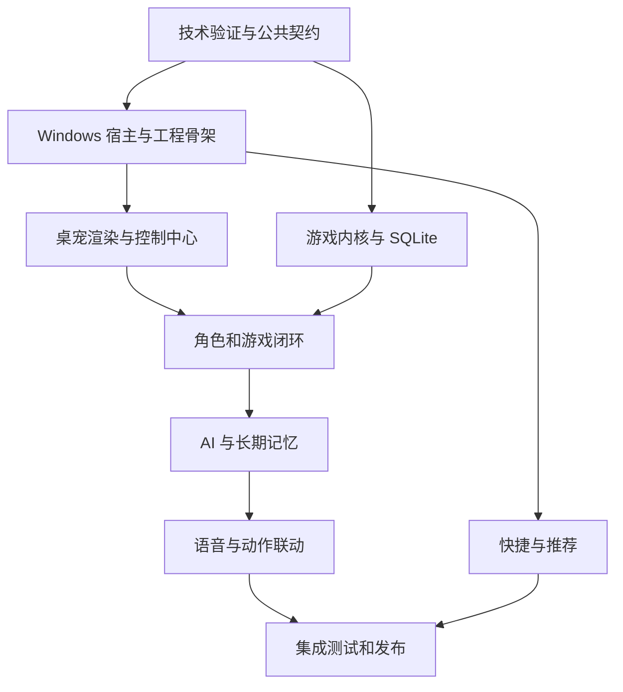

七步是研究与技术设计的划分，实际开发按依赖与风险推进。宿主和真实安装包的最小验证、角色渲染、游戏确定性及数据库首先进行；AI、语音、推荐均可用 Mock 或禁用的 feature flag 接通接口，先不强制启用真实服务。第 16–22 章分别记录各技术步骤的详细研究和独立选择。

---

## 16. 第1步 Windows 宿主与进程架构

**选型决定：以 Electron + TypeScript 为首版宿主，保留一个很薄的 Win32 原生适配层；先通过真实 Windows 桌面交互原型，再锁定工程框架。** 选择不是为了让桌宠成为网页，而是利用统一、可锁定的 Chromium 渲染环境和 Node.js 主进程（有利于后续多种角色渲染及本地服务），同时将 Windows 窗口特性与业务逻辑隔离。下列评分、架构和验收阈值均为项目建议，并非官方性能测试结果。

### 16.1 候选框架比较

按产品优先级评分（1–5 分，5 分最符合；总分为加权后百分制）：

| 评价因素 | 权重 | Electron | Tauri | Flutter | WPF |
|---|---:|---:|---:|---:|---:|
| 透明置顶、桌面命中与多屏集成 | 30% | 4 | 3 | 3 | 5 |
| Live2D/Sprite/VRM 的 Web 渲染复用 | 25% | 5 | 4 | 2 | 2 |
| 统一 TS 领域核心、首版迭代成本 | 20% | 5 | 3 | 1 | 1 |
| 安装体积及运行时部署负担 | 10% | 2 | 5 | 3 | 4 |
| 系统 API、隔离与工程生态 | 15% | 4 | 4 | 3 | 4 |
| **综合评分** | **100%** | **85** | **72** | **47** | **64** |

- **Electron（推荐）**：官方提供透明无框窗口、置顶、整窗鼠标穿透、屏幕坐标转换、托盘、全局快捷键；同一套 TS 可覆盖宿主、UI 与业务规则。代价是内置 Chromium/Node 及多窗口渲染开销，不能假定多个宠物的资源成本很低。尤其要注意：透明区域默认不自动穿透，必须另做命中策略。[E1–E3]
- **Tauri（备选）**：Rust 核心 + Windows 系统 WebView2，提供透明窗口和 `setIgnoreCursorEvents`，并支持按窗口配置权限；系统 WebView 不随应用打包，体积方面有优势，但前后端分别使用 Rust/TS，WebView2 实际版本也需纳入兼容矩阵。官方整窗忽略鼠标 API 不等于角色轮廓穿透。若 Electron 实测资源超预算，在 Tauri 上重新跑同一 POC，不先迁移业务。[T1–T3]
- **Flutter**：适合 Dart 主导的自绘桌面界面，官方支持 Windows 与 FFI；本项目仍需解决宿主透明/命中行为及现有 Web 角色渲染的集成，多一层技术栈，首版不划算。[F1]
- **WPF**：Windows 专属能力与 HWND 互操作有吸引力，官方 `AllowsTransparency` 要求无边框；但核心是 C#/XAML，三种 Web 渲染方案需另接引擎或 WebView，难以保持统一 TS。若精确 Windows 轮廓/宿主行为成为首要目标且 Electron 方案无法达标，可考虑仅替换宿主，并保留 TS 逻辑与渲染协议，而不是重写整个产品。[W1]

### 16.2 运行时、窗口与职责划分

首版建议一个应用实例、一个 `Main`、一个独立 app-service utilityProcess、每个可见宠物一个小尺寸透明 `BrowserWindow`、一个按需打开的普通控制中心窗口。不创建覆盖整个桌面的巨大透明窗口：它扩大了误拦截鼠标的范围，也增加多屏坐标和渲染资源问题。宠物数量增长后再评估同屏合批，不为未验证规模提前改结构。

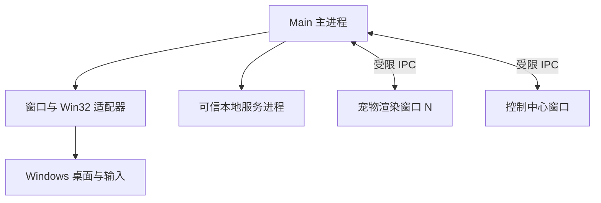

| 层 | 职责与边界 |
|---|---|
| Main | 单例锁、petId 到窗口的映射、托盘/快捷键、窗口创建/销毁/显示、重建策略、权限与 IPC 路由；不拥有宠物领域实例注册表，不执行重型推理、逐帧渲染或阻塞 I/O |
| `domain-core` | 纯 TS，领域状态、命令与事件契约；不导入 Electron、DOM、Win32。状态修改统一由权威服务处理；UI 不直接改共享状态 |
| `PetWindow` | 宠物视觉、点击语义、拖拽手势、命中轮廓输出；不访问 OS、磁盘、数据库或 API 密钥 |
| `ControlCenter` | 普通可聚焦窗口，管理宠物和设置；关闭仅关闭/隐藏界面，不退出驻留应用 |
| 可信本地服务 app-service | 首版即使用独立 Node `utilityProcess`，拥有 SQLite 唯一写入权威及业务协调；服务启动随应用生命周期，异常重启，从存档恢复；重型模块可另用窄协议 worker/辅助进程，不直接写库 |
| `DesktopHost` / `Win32Adapter` | 统一窗口、命中、显示器、免打扰、快捷键接口；底层为 Electron API，POC 证明不足时才加入窄功能的 Node-API 原生模块或辅助进程 |

Electron 官方定义 Main/Renderer 与 preload 隔离路径；`utilityProcess` 提供带 Node 与消息端口的子进程。它是故障隔离手段，不能认为可信 Node 服务自身就是不可信插件的安全沙箱。[E4]

### 16.3 桌面窗口关键行为

**窗口策略。** 初始化宠物窗口使用 `frame:false`、`transparent:true`、`alwaysOnTop:true`、`skipTaskbar:true`、`resizable:false`，先隐藏，首帧就绪后 `showInactive()`。不自动抢走正在工作的应用焦点；默认非聚焦模式和需要交互时的焦点行为必须实测，文本输入交给控制中心。角色大小由逻辑缩放/边界更新处理，而非系统边框缩放；透明窗口开启 DevTools 时表现可能变化，验收必须在关闭 DevTools 的打包版本完成。[E1,E2]

**透明绘制与鼠标穿透是两件事。** 统一定义渲染器的命中轮廓（局部有效区、透明区、可拖动区），而不是将整个 canvas 当作可点击区。首选用 `setIgnoreMouseEvents(true,{forward:true})` 让空白区事件传到底层窗口，移动时更新宠物窗口输入态；命中角色可见区时关闭忽略。建议以最新的低成本命中蒙版/轮廓配合游标位置校验，宠物动画移动而鼠标静止时也须重新判断；按需同步有限频率的脏轮廓，不在 Main 中每帧读 GPU 像素。拖拽开始即锁定目标与窗口输入状态，释放/取消/焦点丢失后恢复自动命中，防止经过透明区时突然失去拖拽。CSS `app-region:drag` 是矩形区域，不适用于全身动态轮廓。[E1,E2]

这不是保证毫无竞争窗口的逐像素鼠标穿透。`forward:true` 在前台为更高权限程序时可能失效（UIPI）；并且鼠标快速越界后立刻按下存在状态同步竞争。POC 必须验证。若核心要求失败，评估 Windows 的 `setShape(rects)`（官方标为实验性；会同时裁剪绘制和输入，不能无损表达所有动态半透明边缘）。原生备选是呈现真正支持 alpha 命中的分层窗口/匹配实际输入区域：微软明确说明某些分层窗口的零 alpha 像素可放行输入；这不代表 Electron 的透明窗口天然如此。`WM_NCHITTEST` 的 `HTTRANSPARENT` 涉及同线程限制，不能把它当作跨任意外部应用的穿透保证；`hookWindowMessage` 也不是通用返回值覆写 API。[E2,W2,W3]

**交互失败时保守处理**：命中蒙版过期或渲染失联即整窗穿透 + 托盘/热键显式进入交互模式，或直接隐藏宠物，不提权、不注入鼠标到其他应用，不接受长期阻塞用户鼠标的实现。该降级只保证可用性，若逐轮廓点击是首版必需项，不能把降级误当验收通过。

**多屏 DPI。** 窗口位置、显示器 `workArea`、用户偏好统一用 Electron DIP（设备无关像素），物理像素仅在 Win32 边界或渲染缓冲转换。监听 `display-added/removed/metrics-changed`，在屏幕切换时更新缩放、轮廓与窗口边界；保留相对于显示器工作区的锚点偏移。显示器 ID 失效时回落最近/主屏并夹紧可见范围；支持左侧屏负坐标、横竖屏、任务栏位置变化、休眠恢复。避免所有值统一乘当前主屏缩放系数。[E3]

**全屏免打扰。** Main 的 `FullscreenPolicy` 从 Win32 前台窗口及其 DWM 边界、目标屏幕范围估算全屏；辅助参考 `SHQueryUserNotificationState` 的演示、忙碌、独占 D3D 等状态。微软明确没有全屏开始/结束的统一事件，故须低频检测、去抖，不能声称识别所有游戏或现代专注助手状态。区分普通最大化和无边框全屏，只隐藏目标屏宠物（可设全局隐藏），静音、暂停动画派发；退出时非激活恢复。锁屏/休眠、无法确定前台状态时关闭打扰；用户可手动开关免打扰。不记录前台标题/屏幕内容，不要求覆盖独占全屏、UAC 安全桌面或获得管理员权限。[W4]

### 16.4 生命周期、IPC 与安全

- 启动：`requestSingleInstanceLock` → 初始化状态与适配器 → 创建常驻托盘及快捷键 → 恢复各有效宠物 → 按需显示控制中心。再次启动仅唤出控制中心；托盘至少包含显示/隐藏、全穿透开关、控制中心、退出。快捷键注册失败提示冲突并允许改键；即使全部 UI 窗口关闭，也通过 `window-all-closed` 策略保持托盘，只有显式退出才释放快捷键与资源。[E5]
- 状态：隐藏/免打扰/锁屏为可恢复状态，不等同删除宠物。监听 `powerMonitor` 休眠/恢复与锁屏事件；关闭前分批保存已确认状态，不能依赖系统关机回调执行最后一次完整保存。`render-process-gone`/`child-process-gone` 记录原因；回退重建单个失效窗口并从权威状态恢复，连续失败停止自动重启，给用户诊断入口。GPU 反复失败时使用轻量静态形象或隐藏，控制中心仍可管理。[E4,E6]
- Renderer 全部显式启用 `contextIsolation:true`、`sandbox:true`、`nodeIntegration:false`；preload 使用 `contextBridge` 暴露窄方法（例如请求切换可见状态、提交拖拽意图、订阅状态）。IPC 的请求/响应采用 TS 类型和运行时校验，校验发送方窗口身份、所属宠物、允许命令、参数范围；仅结构化可序列化数据，无任意文件路径、任意 SQL、命令执行或通道透传。状态推送附修订号，处理超时、取消、重连与过期结果。
- 仅加载应用自带资源；生产环境使用受控本地协议及 CSP，拒绝非白名单导航/新窗、远程脚本及默认不必要的权限。模型资源仅作为数据加载；不在本地应用的高权 renderer 中展示任意远程页面。密钥、数据库与持久化只由可信后端访问，日志不含凭证。原生模块限于已验证 Windows API，兼容失败时返回明确错误，不自动提升权限。[E7]

### 16.5 开发路线与必须过关的 Windows POC

工程主选按第七步统一为 electron-vite + electron-builder + NSIS，使用 TypeScript 搭建 Main、app-service、preload 和两个 renderer 的构建入口。Electron Forge + Vite 是完整替代链；官方 Forge Vite 插件仍标记实验性，需要在对照 POC 中锁定兼容版本，不与主选混用。Electron 官方仅维护最近三条稳定主版本线；立项时选择仍维护且实测支持目标 OS 的稳定版及精确依赖版本。原生 Node 模块必须匹配 Electron ABI，打包流程执行目标架构重建。macOS 可迭代纯 TS 和 UI，最终桌面能力、Windows CI 构建、安装包及真实设备验收都在 Windows（非 WSL）完成。[E8]

首版建议明确 Win10 22H2 x64（兼容验证，注明常规支持已于 2025-10-14 结束，ESU/LTSC 另计）及仍受支持的 Win11 x64；ARM64 只有在 native 依赖和真机通过后才纳入。Electron v23 起官方规定 Windows 10 或更新，但这不是任意未来版本/Windows 构建的兼容承诺。升级 Electron 时重跑下列 POC。[E9,W5]

| POC 锁定顺序 | 可观察的验收标准（均为拟定目标） | 未达标处理 |
|---|---|---|
| P0 窗口与命中 | 三个动态宠物独立置顶；背景无黑/白矩形；点透明区至少 100 次不吞底层点击，点角色 100 次命中；快速进入后点击、鼠标静止角色经过、宠物重叠、拖拽越界；文本编辑器工作时不抢焦点 | 优先修命中/轮廓策略；实验性形状或原生 POC；不达核心要求不锁宿主 |
| P0 DPI/显示器 | 100%/125%/150%/200%，混合双屏负坐标、屏幕拔插、主屏切换、休眠；无偏移/失踪、命中与画面一致 | 重新锚定主屏、暂挂异常宠物，显式提供重置位置 |
| P0 免打扰和恢复 | 普通最大化、浏览器视频全屏、无边框游戏、独占全屏、任务管理器、锁屏；预计 1 秒内停止打扰，退出不抢焦点 | 覆盖不了的场景公开列为限制，手动免打扰仍有效 |
| P0 独立故障 | 强制结束一个 renderer/本地服务，托盘可用、其他宠物继续，重启后状态一致；快捷键冲突、Explorer 重启、第二实例、退出均可恢复/正确清理 | 有限重试、禁用故障组件并显示状态；不能丢失已确认的数据 |
| P1 性能与发布 | 打包实际模型，记录 1/3/5 个宠物的冷启动、工作集、CPU/GPU、帧率和 30 分钟稳定性；隐藏后帧活动明显降低。Win10/11 普通用户安装、升级、卸载测试 | 根据实测调帧率、资源上限、静态 fallback；若仍无法满足后续性能预算，开启 Tauri 对照 POC |

### 官方资料（核验截至 2026-11-25；仅支撑所引 API/说明，具体桌宠效果待验证）

- E1 Electron 透明无框/限制及 CSS 交互：[Custom Window Styles](https://www.electronjs.org/docs/latest/tutorial/custom-window-styles)、[Window Customization](https://www.electronjs.org/docs/latest/tutorial/window-customization)。
- E2 Electron 窗口方法、穿透转发/UIPI、实验性形状、原生句柄：[BrowserWindow](https://www.electronjs.org/docs/latest/api/browser-window)。
- E3 Electron DPI 转换及显示器事件：[screen](https://www.electronjs.org/docs/latest/api/screen)。
- E4 Electron 多进程及可信服务进程：[Process Model](https://www.electronjs.org/docs/latest/tutorial/process-model)、[utilityProcess](https://www.electronjs.org/docs/latest/api/utility-process)。
- E5 Electron 单实例、托盘和快捷键：[app](https://www.electronjs.org/docs/latest/api/app)、[Tray Menu](https://www.electronjs.org/docs/latest/tutorial/tray)、[globalShortcut](https://www.electronjs.org/docs/latest/api/global-shortcut)。
- E6 Electron 休眠等事件与崩溃事件：[powerMonitor](https://www.electronjs.org/docs/latest/api/power-monitor)、[app](https://www.electronjs.org/docs/latest/api/app)。
- E7 Electron 隔离、权限及 IPC 设计：[Security](https://www.electronjs.org/docs/latest/tutorial/security)、[Context Isolation](https://www.electronjs.org/docs/latest/tutorial/context-isolation)、[IPC](https://www.electronjs.org/docs/latest/tutorial/ipc)。
- E8 构建及版本维护：[Forge Vite + TypeScript](https://www.electronforge.io/templates/vite-%2B-typescript)、[Native Node Modules](https://www.electronjs.org/docs/latest/tutorial/using-native-node-modules)、[Electron Releases](https://www.electronjs.org/docs/latest/tutorial/electron-timelines)、[First App](https://www.electronjs.org/docs/latest/tutorial/tutorial-first-app)。
- E9 Electron 历史 Windows 最低系统变更：[Breaking Changes](https://www.electronjs.org/docs/latest/breaking-changes)。
- T1 Tauri Rust Core 与 OS WebView：[Process Model](https://v2.tauri.app/concept/process-model/)。T2 [Window API](https://v2.tauri.app/reference/javascript/api/namespacewindow/)。T3 [Capabilities](https://v2.tauri.app/security/capabilities/)。
- F1 Flutter Windows 及 FFI：[Building Windows apps](https://docs.flutter.dev/platform-integration/windows/building)。
- W1 Microsoft WPF：[Overview](https://learn.microsoft.com/en-us/dotnet/desktop-wpf/overview/index)、[AllowsTransparency](https://learn.microsoft.com/en-us/dotnet/api/system.windows.window.allowstransparency?view=windowsdesktop-8.0)。
- W2 微软分层窗口 alpha 命中：[Window Features](https://learn.microsoft.com/windows/win32/winmsg/window-features)。W3 [WM_NCHITTEST](https://learn.microsoft.com/en-us/windows/win32/inputdev/wm-nchittest)。
- W4 微软前台、DWM 和显示器及通知状态：[GetForegroundWindow](https://learn.microsoft.com/en-us/windows/win32/api/winuser/nf-winuser-getforegroundwindow)、[DWM composition](https://learn.microsoft.com/en-us/windows/win32/dwm/composition-ovw)、[MonitorFromWindow](https://learn.microsoft.com/en-us/windows/win32/api/winuser/nf-winuser-monitorfromwindow)、[SHQueryUserNotificationState](https://learn.microsoft.com/en-us/windows/win32/api/shellapi/nf-shellapi-shqueryusernotificationstate)。
- W5 微软系统生命周期：[Windows 10 end of support](https://learn.microsoft.com/en-us/lifecycle/announcements/windows-10-end-of-support)。

---

## 17. 第2步 前端 UI 角色渲染 资源包与 CG

**建议基线：TypeScript + Vue 3 + Vite + Vue Router + Pinia；DOM 做控制中心与交互面板，独立 Canvas 做桌宠。** [Vite](https://vite.dev/guide/build.html) 构建本地静态前端包，目标浏览器版本按宿主实测锁定。先交付序列帧渲染器及统一角色协议，并行做 Live2D 官方 SDK 接入和授权核验；待通过后即可支持同一宠物在序列帧与 Live2D 间切换。保留 VRM 3D 与 Spine 适配口，不提前引入相应运行时。Electron / Tauri 的最终宿主方案沿用第1步；此处前端不直接依赖任何一种宿主 API。

### 17.1 技术选型与决策依据

| 候选 | 已确认事实（官方资料） | 本项目决策 |
|---|---|---|
| Vue 3 | [单文件组件与 TS](https://vuejs.org/guide/typescript/overview.html)；[Router](https://router.vuejs.org/introduction)、[Pinia](https://pinia.vuejs.org/introduction) | 首选。适合大量表单、列表、面板和响应式展示；渲染对象不放进响应式数据 |
| React | [组件与 UI 状态](https://react.dev/learn/thinking-in-react) | 有 React 团队经验时可等价替换；不能仅凭框架断言帧率优劣 |
| Svelte | [编译型组件框架](https://svelte.dev/docs/svelte/overview) | 备选；适合轻量面板，但不为缩小 UI 运行时而另用第二套框架 |
| PixiJS + 序列帧 | [渲染器](https://pixijs.com/guides/components/renderers/)、[AnimatedSprite](https://pixijs.download/release/docs/scene.AnimatedSprite.html)、[资源系统](https://pixijs.com/8.x/guides/components/assets) | 序列帧正式方案；WebGL 为生产基线，WebGPU 非首发前提；Canvas2D 单独实现简单降级，不假定 Pixi 全功能 Canvas 兼容 |
| Live2D Cubism SDK for Web | [官方 SDK](https://docs.live2d.com/en/cubism-sdk-manual/cubism-sdk-for-web/)、[Web 模型](https://docs.live2d.com/en/cubism-sdk-manual/model-web/) | 适合看向鼠标、呼吸、表情、口型；独立 Cubism Canvas 适配，不绑死社区 Pixi 插件或其版本 |
| Spine | [官方 Pixi 运行时](https://us.esotericsoftware.com/spine-pixi)、[导出格式](https://esotericsoftware.com/spine-runtimes/) | 第二种 2D 骨骼备选；适合画师已有 Spine 资产库，不作为 MVP 新制作工具；编辑器/运行时导出版本需匹配 |
| Three.js + @pixiv/three-vrm | [GLTFLoader](https://threejs.org/docs/pages/GLTFLoader.html)、[AnimationMixer](https://threejs.org/docs/pages/AnimationMixer.html)、[three-vrm](https://github.com/pixiv/three-vrm)、[VRM 1.0 规范](https://github.com/vrm-c/vrm-specification/tree/master/specification/VRMC_vrm-1.0) | 3D 阶段首选；加载 VRM 1.0，独立相机/灯光/骨骼动画/表情适配；VRM 0.x 与动画重定向作为兼容性 POC |

上述 API 能力已核验，透明合成效果、GPU 占用和多模型并发帧率尚未实测。依赖由锁文件固定版本，结合第1步的 Windows/WebView 环境做可重复 POC，不先许诺“所有模型均兼容”。

**商用发布闸门（重要）：** [Live2D Core](https://docs.live2d.com/en/cubism-sdk-manual/cubism-core/) 为专有运行库，官方开发包可取得 Core，而开源 Framework 仓库并未包含它。[SDK 发布许可](https://www.live2d.com/en/sdk/license/) 分游戏、AI 聊天等用途及发行方式；[Expandable Applications](https://www.live2d.com/en/sdk/license/expandable/) 对增加/组合不定数量模型、聚合多个作品设置特殊审核与许可要求，不因个人或小企业身份自动免除。先把“内置多宠、官方新增包、用户导入模型、AI 陪伴、免费/付费发行”完整告知 Live2D 并取得书面适用判断，再决定是否随产品分发 SDK；未确认则对外仅启用序列帧。Spine 同样须核对当前 [运行时许可](https://en.esotericsoftware.com/spine-runtimes-license) 及编辑器许可第2节，不将可读取源码视为无限授权。VRM 运行库的 MIT 与模型授权是两回事，须检查每个模型的 [VRM 1.0 meta](https://github.com/vrm-c/vrm-specification/blob/master/specification/VRMC_vrm-1.0/meta.md) 商用、修改、再分发、角色使用条件；开源依赖声明与素材来源分别归档。CG、立绘、动作、贴图、字体的发行权同样独立核查。

### 17.2 界面和跨窗口视图状态

同一代码库分轻入口：`pet-shell` 仅加载角色 Canvas、气泡及快捷面板；`control-center` 加载主导航及业务页面。避免桌宠窗口常驻整个控制中心和 3D 运行时。路由用本地 hash 模式，页级懒加载；聊天长列表、宠物馆、图鉴、背包用虚拟列表，CG 大图在打开时解码，DOM 界面支持键盘导航、缩放、中文和减少动态效果选项。

| 页面 / 路由 | 视图责任（不在 UI 定义玩法规则） |
|---|---|
| 首页 `/home` | 当前宠物、旅行/物品摘要、未读事件、常用入口 |
| 宠物馆 `/pets` | 角色卡、预览、当前显示宠物、资源下载/装载进度、启用/换宠 |
| 冒险地图 `/adventure/map` | 地点、出行准备、旅途进度、可用操作 |
| 旅行报告 `/adventure/reports` | 已完成旅行记录、报告详情与关联事件 |
| 背包与装备 `/inventory` | 物品筛选、穿戴/使用入口、确认结果 |
| 商店 `/shop` | 商品、余额、购买确认与结果 |
| 事件与 CG `/gallery` | 锁定剪影、解锁记录、角色/事件筛选、大图与重播 |
| 对话中心 `/chat` | 当前宠物身份、消息及流式显示、可取消操作 |
| 快捷工作台 `/workspace` | 常用互动与快捷操作配置，桌宠快捷面板复用相关组件 |
| 设置 `/settings` | 显示/交互/音量/性能、模型资源与偏好设置 |

Pinia 只持有可序列化投影：`petsById`、`activePetId`、`visiblePetIds`、`sessionVM`、`inventoryVM`、`galleryVM`、`pendingCommands`、用户显示偏好等。每个宠物实例的 `petId` 与素材 `characterId` 分离，允许多个实例共享资源但动作、表情、位置独立。`RendererRegistry`、GPU 纹理、音频节点、动画时钟为独立对象；每帧参数不触发 Vue 整树更新。

通过统一 `AppBridge` 从权威业务层订阅快照及带 `revision` 的变更，所有窗口采用同一状态源；业务操作发命令（带 `commandId`/`petId`），确认后更新，版本断档时重取快照。`commandId` 是权威业务命令的幂等标识；视觉动画与资源请求另用 `requestId`，不混用。正式发布默认一宠可见，初版限制 `visiblePetIds.length <= 1`，换宠保留旧画面直到新素材成功；3 宠同屏用于底层架构/性能 POC，将来按产品决定开放并发，UI/资源协议不变。逻辑与渲染状态不可相互冒充，切换或关闭窗口不代表养成状态丢失。

### 17.3 渲染适配器与动作契约

前端业务只发语义动作，SDK 格式和 Canvas 生命周期封装在各自适配器。下面为拟定 TS 契约（非第三方 API）：

```ts
interface PetRenderer {
  init(canvas: HTMLCanvasElement, profile: RenderProfile): Promise<void>;
  loadPack(pack: ResolvedPack, signal: AbortSignal): Promise<void>;
  resize(wCss: number, hCss: number, dpr: number): void;
  setPose(pose: {x: number; y: number; scale: number; facing: -1|1}): void;
  play(action: ActionRequest): Promise<ActionResult>;
  setExpression(id: string, weight: number): void;
  setMouth(sample: {generation: number; open: number; viseme?: string; atMs: number}): void;
  tick(dtSeconds: number): void;
  hitTest(xLocal: number, yLocal: number): HitRegion|null;
  setQuality(profile: RenderProfile): void;
  setPaused(paused: boolean): void;
  destroy(): void;
}
// ActionRequest: requestId, semanticId, loop, priority, blendMs
// ActionResult: requestId, completed|interrupted|unsupported|failed
```

`SpriteRenderer`（图集/帧动画）、`CubismRenderer`（官方 Core/Framework）、`StaticRenderer`（Canvas2D 或 DOM 立绘）；后续注册 `VrmRenderer`、`SpineRenderer`。一个可见宠物对应一份独立实例与渲染 surface，支持一个宿主窗口内多个 surface，或每宠独立窗口；同类型多宠未来可按实测合并图集/Canvas。创建失败或 GPU 上下文丢失时原位降级，恢复时重载已校验包，角色 ID 与逻辑状态不变。

所有包至少提供 `idle`；`walk`、`sleep`、`happy`、`tap.head`、`talk` 等为语义名，映射具体模型文件/分组/帧段。优先级由前端表现调度器协调（基础循环→一次性交互→打断/恢复），业务方不等待某一片段播放完才提交权威结果。用 `requestId` 防止旧动作完成回调恢复错误角色；一次性片段结束回到当前基础动作，缺动作退到 `idle`，失败不能卡住 UI。

动作、表情、注视、物理、嘴型是可组合通道；口型消息携带播放轮次 `generation` 与基于实际音频播放时钟的相对时间 `atMs`，按当前位置消费标准化 `open`（0–1）及可选 viseme，做短时平滑。开始新播放或取消时更新轮次，特定轮次的迟到、过期采样直接丢弃，取消/静音/结束立即闭口归零。Live2D 根据 [Lip-sync 参数组](https://docs.live2d.com/en/cubism-sdk-manual/lipsync/) 解析 `.model3.json` 的配置，不把某个参数名写死；序列帧以闭/半开/张口的子图层或说话序列近似；VRM 对应其 [Expressions](https://github.com/vrm-c/vrm-specification/blob/master/specification/VRMC_vrm-1.0/expressions.md)，仍须验证具体模型的可用表情。模型不支持口型时只显示对话气泡，不阻断对话。宿主、语音系统只传标准化播放时钟及采样，不让渲染器决定音频来源。

### 17.4 角色资源包、加载、缓存

包为版本化数据目录（`manifest.json + assets/`），不执行包内 JS、插件或任意 HTML。以下是结构示意，实际字段用 JSON Schema 验证并生成 TS 类型：

```json
{
  "schemaVersion": 1,
  "characterId": "cat-demo",
  "packVersion": "1.0.0",
  "minAppVersion": "0.1.0",
  "displayName": {"zh-CN":"小猫"},
  "thumbnail": "assets/card.webp",
  "variants": [
    {"id":"sprite", "renderer":"sprite", "entry":"assets/atlas.json"},
    {"id":"still", "renderer":"static", "entry":"assets/idle.png"}
  ],
  "anchor": {"x":0.5,"y":1},
  "logicalSize": {"w":300,"h":340},
  "hitRegions": [{"id":"head","rect":[0.2,0.1,0.6,0.4]}],
  "actions":{"idle":{"sprite":"idle","still":"idle"},"talk":{"sprite":"talk"}},
  "lipSync":{"sprite":{"mode":"frames","clips":["mouth.0","mouth.1","mouth.2"]}},
  "cgIds":["cat-demo.intro"],
  "license":{"owner":"[权利人]","reference":"[许可记录ID]"},
  "files":[{"path":"assets/atlas.json","bytes":1234,"sha256":"[64位摘要]"}]
}
```

示意未穷举文件清单；实际须完整列出依赖。Live2D variant 指向 `.model3.json`、完整 `.moc3`/贴图/物理/动作从模型清单解析，并记录 SDK/数据格式兼容范围；VRM variant 指向 `.vrm` 及允许的本地动画资源。图集统一锚点、裁剪边框/旋转元数据和帧时长；高清与轻量包以 variant 标识。升级保持 `characterId`、已发布动作/CG ID 稳定，资源缺失不覆盖旧包。

加载过程：暂存下载（或内置目录）→校验清单/大小/hash/签名策略，禁止越界路径、未知可执行格式、网络引用、过多解压数据及过大贴图→按 `characterId@packVersion` 安装可读缓存→加载封面/idle→按需预载常用动作→原子替换实例。hash 校验完整性，来源可信性由受信目录/发行方签名与权利审核另行证明。资源请求可取消，加载超时展示可用旧版/静态封面。

磁盘按文件内容摘要及版本索引去重，权威数据层提供 `pinnedAssets`（不可变版本和哈希），覆盖运行中旅行规则引用、已解锁 CG 的历史版本、已生效故事素材及当前激活包。LRU 只能淘汰未被引用且可按原版本重建的缓存；清缓存不能清这些 pin、业务快照、历史素材或规则，无法保证原版取得时保留本地副本。内存/GPU 使用引用计数，释放未使用纹理、材质、动画及 WebGL context，独立窗口的 GPU 实例不能假定共享；已 pin 资产仍可卸载 GPU 副本而保留磁盘原版。默认贴图预算 2048² RGBA8 约 16 MiB/张（不含 mipmap 等），不要把完整序列全部解码。内存紧张先卸下 CG、大动作、不可见宠物，再降分辨率、30→15 FPS、静态图；资源回滚或清可重建缓存均不影响存档和历史展示。

### 17.5 CG 与事件图鉴、窗口协作

CG 目录数据与宠物包分离：`cgId, characterId, eventId, assetVersion, thumbnail, image, optionalLayers, captions, presentationTimeline`；仅展示业务快照授权的 CG，锁定项剪影/提示不请求高清正文。点击事件通知打开独立 DOM 叠层，支持渐显、字幕、跳过、回看、缩放；已解锁图鉴按 `cgId + assetVersion` 解析当次记录固定历史版本与可见状态，不擅自替换成新版，不在前端把“播完片段”当成解锁。已解锁但资源损坏时显示错误占位和重试，不重新发奖。CG 支持静态图为基线，分层视差/短视频可后续新增，均可关闭动效。

鼠标命中分两级：宿主负责是否接收窗口鼠标输入、全局屏幕坐标与 DPI；适配器负责 Canvas 局部坐标内的头/身体等区域。维护屏幕→窗口 DIP→Canvas CSS 像素→模型坐标变换；DPR 仅用于绘图缓冲与必要的像素转换。先用包定义的归一化矩形/多边形，Live2D 使用可用模型命中区，序列帧可离线生成 alpha mask 判断轮廓；避免每帧 GPU `readPixels`。气泡和快捷面板自身 DOM 区域也加入交互区。

宿主桥返回光标位置、窗口区域/DPI 变化，接受入参 `interactiveRects` 或期望穿透状态。透明渲染并不表示原生窗自动点击穿透；[Electron API](https://www.electronjs.org/docs/latest/api/browser-window/#winsetignoremouseeventsignore-options) 为全窗忽略鼠标并可在 Windows 转发移动事件，[Tauri Window API](https://v2.tauri.app/reference/javascript/api/namespacewindow/#setignorecursorevents) 提供 `setIgnoreCursorEvents`。需用宿主适配层完成区域切换或原生命中。拖拽期间保持捕获，释放/失焦必恢复；穿透状态仍需能察觉鼠标重新进入（原生检测/宿主光标采样）。同时测试跨屏 100%/150%/200% DPI、负屏幕坐标、快速移动点击、宠物叠层及桌面下方应用可点击。具体原生 API 路径依第1步 POC。

### 17.6 POC 及上线验收门槛（拟定目标，非实测）

参考 Windows 10/11 受支持设备、8 GB 内存、集显、1080p/150% DPI；固定同一份真实素材、锁定宿主/运行库版本。分别测单宠序列帧、Live2D、3 宠同屏、控制中心、聊天/CG 切换以及 GPU 恢复；性能采集包括进程树 CPU（系统总核数归一化）、私有内存、GPU/纹理估算、frame time p95。

| 场景 | 验收目标（预算待 POC 校正） |
|---|---|
| 单宠常驻 | 正常 30 FPS，帧间隔 p95 ≤ 34 ms；稳态整应用 CPU ≤ 5%、私有内存 ≤ 350 MB |
| 低功耗/隐藏 | 15 FPS 或停绘；窗口隐藏时不持续渲染，后台 CPU ≤ 1% |
| 三只可见 2D（底层 POC，非默认发布模式） | 各自 30 FPS 优先，压力下自动降至 15 FPS；整应用 CPU ≤ 12%、私有内存 ≤ 650 MB |
| 资源/交互 | 本地缓存角色切换 p95 ≤ 1 s，触摸反馈 ≤ 100 ms；CG 离开后释放高清纹理 |
| 稳定性 | 连续运行 8 小时，换宠/销毁 100 次；CPU/GPU 不因泄漏持续攀升，空闲内存增长 ≤ 10%，GPU 丢失 3 s 内降级或恢复 |

落地顺序：①透明窗 + 静态/序列帧 + 控制中心骨架 + manifest 测试包；②动作/命中/切换、资源缓存和 CG 图鉴；③Live2D 的命中、口型、GPU 与授权验收，通过后开启；④真实多宠并发底层 POC（默认仍一宠可见）；⑤VRM/Spine 选一按素材成本接入。阶段间保持接口、稳定 ID 和资源格式一致，避免重写整套前端。

---

## 18. 第3步 游戏领域内核 离线模拟与数据库

### 18.1 选型决策

**推荐：纯 TypeScript 领域核心 + 离散事件模拟 + SQLite + better-sqlite3 + 手写版本化 SQL 迁移。** 游戏逻辑脱离桌面窗口、动画帧与 AI，运行在宿主控制的独立逻辑进程；SQLite 是游戏事实的唯一权威。Electron 为候选宿主时，优先使用专属 `utilityProcess` 持有数据库连接，不在渲染器或每个桌宠窗口分别启动模拟。以下为 2026-11-25 调研后的技术建议，非现有项目实现或跑分。

| 领域方案 | 匹配程度 | 结论 |
|---|---|---|
| 纯 TS 状态机与规则函数 | 多宠持久化、确定性旅行、离线补算、单测均不需要 DOM 或每帧刷新 | 主选；命令和事件使用可判别联合类型，穷尽检查 |
| Phaser | 提供场景、游戏循环、物理、渲染；与浏览器帧生命周期关联 | 仅未来复杂可视化小游戏候选，不成为存档与旅行的权威 |
| Godot 等完整游戏引擎 | 适合物理、场景编辑、地图和复杂实时游戏 | 本阶段不引入，避免第二套运行时及 TS 核心跨进程集成 |

依据：[TypeScript 类型收窄](https://www.typescriptlang.org/docs/handbook/2/narrowing.html)、[Phaser 游戏循环](https://docs.phaser.io/phaser/concepts/game)、[Godot 引擎介绍](https://docs.godotengine.org/en/stable/getting_started/introduction/introduction_to_godot.html)、[Electron UtilityProcess](https://www.electronjs.org/docs/latest/api/utility-process)。即使以后引入引擎，也只消费领域事件，不通过引擎 tick 推进旅行。

| SQLite 驱动 | 官方支持情况与风险 | 决策 |
|---|---|---|
| better-sqlite3 | 同步、预编译语句、事务与备份接口；原生 addon 有 Electron ABI、架构打包成本 | 主选，隔离在逻辑进程 |
| node:sqlite | Node 内置，无须额外安装第三方原生 addon；Node 24 文档自 24.15 标为 release candidate，不能仅凭 Node 版本推定 Electron 实际暴露的接口 | 备选；若打包验证明显更优可反转 |
| node-sqlite3 | 官方仓库已标 deprecated / unmaintained | 排除 |
| sql.js | WASM，默认内存库，需自行处理持久化导入导出、原子落盘及恢复 | 不作为权威存档库 |

来源：[better-sqlite3 API](https://github.com/WiseLibs/better-sqlite3/blob/master/docs/api.md)、[Electron 原生模块](https://www.electronjs.org/docs/latest/tutorial/using-native-node-modules)、[Electron 发行版宿主映射](https://releases.electronjs.org/releases/stable)、[Node 24 sqlite](https://nodejs.org/docs/latest-v24.x/api/sqlite.html)、[node-sqlite3](https://github.com/TryGhost/node-sqlite3)、[sql.js](https://github.com/sql-js/sql.js)。注意 Electron 官方[多线程指南](https://www.electronjs.org/docs/latest/tutorial/multithreading)对 Web Worker 加载原生模块的风险提示，不用渲染器 Web Worker 挂载数据库 addon。

数据访问首选薄适配器（prepare/get/all/run、transaction、backup）与显式 SQL，业务层只见 repository / UnitOfWork 接口。备选 Drizzle ORM：官方支持 better-sqlite3、node:sqlite、libSQL，可提供类型化查询；SQL 仍应人工审查、固化到版本库。Prisma 支持本地 SQLite 及驱动适配器，但生成客户端与附加迁移流程不解决本项目的核心并发难点。首版不引入重 ORM；不得让 schema push 直接修改用户存档。

依据：[Drizzle SQLite](https://orm.drizzle.team/docs/sqlite/get-started-sqlite)、[Drizzle migrations](https://orm.drizzle.team/docs/migrations)、[Prisma SQLite](https://www.prisma.io/docs/orm/overview/databases/sqlite)。

### 18.2 领域模型、数据隔离

模块建议：`game-core`（纯类型、状态机、战斗/成长/库存规则、PRNG）；`game-application`（命令校验、时钟、调度、事务协调、只读查询）；`game-storage`（SQLite 适配与迁移）；宿主 IPC 仅转发命令和读取快照。所有交互通过稳定 `petId` 定位，不使用角色名、显示窗口 ID 作主键。昵称、获得时间、当前外观归宠元数据；主宠/陪伴位及屏幕锚点由偏好模块独立持有（引用 petId，校验有效与槽位唯一），游戏核不重复保存。

每宠独立 Pet 聚合：

- 在场状态 Presence 固定 HOME / AWAY / RETURNING；activity 使用 IDLE / WALK / DRAG / INTERACT / CHAT / EAT / REST / SLEEP / CELEBRATE，约束合法组合，在 AWAY / RETURNING 可为空或仅允许适用活动。visibility 独立于 Presence；DND、暂停为两个独立布尔 flag，不能用隐藏、免打扰或暂停替代在场状态。窗口视觉位置由宿主/渲染另管。
- mood（CALM 等）与 health_status（NORMAL 等）采用原设计枚举；另存 mood_score、health_points、energy、bond 数值，按 0–100 量表展示与配置，数据库以十分之一单位的固定点整数 0–1000 存储，统一转换与舍入，枚举按规则计算或经受约束的状态迁移，不与数值混用。各自维护角色经验/等级、属性、装备、状态版本及逻辑时间；等级由经验和内容表计算，一处定义。
- 共享库存按物品记录数量，coin 共用账户余额；穿戴装备实体有唯一实例 ID、所属宠与槽位约束，不能把同一实例同时配置给两宠。允许在途调整下次出发的实时装备方案，但不回写当前旅行快照。
- 私有记忆由后续记忆子系统管理，按 `petId` 分区，游戏域不存聊天回忆、不拼接其他宠的记忆。AI 读取限定宠物的结构化事实与相关已提交事件，可描述心情和旅途；不能直接改属性、凭空增加物品或决定真实战斗掉落。游戏关键信息来自数据库，不以模型输出为准。

```mermaid
stateDiagram-v2
    [*] --> HOME
    HOME --> AWAY: 出发且消耗成立
    AWAY --> AWAY: 路线事件与自动战斗
    AWAY --> RETURNING: 路线完成或撤退
    RETURNING --> HOME: 到达且原子结算
```

HOME 可互动、训练、装备、出发；AWAY、RETURNING 可查看、调整下一程装备及进行显式支持的撤退操作，但不允许改变已冻结的旅行输入。实时装备方案的唯一占用约束不改写历史快照，也不使旅行重新计算属性。每宠只能有一条进行中旅行；失败也可进入返程而不是令宠永久丢失。多个宠可并行在外，但库存操作需共同仲裁。旅行生命周期与 Presence 分离：trip 的持久化 status 为 TRAVELING / SETTLED；返程用 checkpoint.phase=RETURNING 表示，PREPARING 为出发准备 UI 瞬态，RESOLVING 为结算逻辑瞬态，均不作为已提交的旅行状态。

### 18.3 旅行与离线计算：相同输入得到相同结果

#### 旅行快照

`StartTrip` 命令首先按宠版本检查 HOME、健康与精力门槛、路线可用性以及共享库存；一次事务扣除精力和消耗品，创建 TRAVELING trip、更新宠 Presence 为 AWAY 及 outbox。快照冻结出发时间、种子、角色统计量/装备、路线节点顺序/时长、关联敌人/事件/掉落表、规则算法版本和内容哈希。内容表用稳定 ID，保存引用的数据快照，升级不允许用新数值重新抽签；保留旧算法实现直到旧旅行结束，缺版本时提示修复而非另算。

领域推进函数设计为 `advance(snapshot, checkpoint, targetTime) -> {checkpoint, facts, rewardDraft}`，纯计算，不调用 Date.now、Math.random、网络、数据库或渲染 API。统一 UTC epoch 毫秒（TS 安全整数），概率用整数基点、属性固定点，显式排序/舍入。PRNG 可初选版本固定的 xorshift32（非零 seed，无符号 32 位，移位参数 13/17/5），抽样映射与顺序固定并有金样测试；它不是安全随机数。持久化随机状态、抽数计数、事件序号；抽样顺序不能依赖 UI、批次大小或对象遍历顺序。

#### 离散事件推进

不按每秒、每帧循环模拟过去的时间；每个旅行只处理实际到期的计划事件。

1. 检查点包含 phase、nodeIndex、round、当前 HP/消耗/奖励草稿、PRNG 状态和 `nextDueAt`。调度取到期行程，按 `nextDueAt, petId, tripId` 排序；相同时刻次序固定。
2. 若 `nextDueAt > targetTime` 停止。到达节点触发遭遇、休憩或剧情；自动战斗由冻结属性决定先手，平局稳定排序；示意整数伤害公式 `max(1, attack-defense+roll)`，再处理 HP 和技能效果。每回合只消耗规定抽数；HP 归零、胜利或到达最大回合数即退出。
3. 胜利记录经验与掉落候选；剧情记录事件/CG 解锁候选；失败按规则返回，走过的收益规则固定。每生成一个事实，以 `tripId:sequence` 为稳定事件 ID；下一事件时间为上一计划时间加内容持续时长，而非当前唤醒时间。
4. 路线最后一个节点或提前撤退时，checkpoint.phase 与 Presence 转 RETURNING，trip.status 仍为 TRAVELING，并设返程抵达时间。startAt 为出发时刻、expectedReturnAt 为预计归来时刻、nextDueAt 为下次模拟事件时刻；结算写入逻辑上的 actualReturnedAt（离线启动时间不是实际归来时刻）。抵达触发结算命令并停止收益；报告 readAt 未读状态仅用于展示，不影响真实入账。绘制旅行进度只读快照，渲染器可以关闭，回来后仍能在记录中看到经过的节点。

初版参数假设：每条路线 2–12 节点、每战斗最多 20 回合、行程总长有界；确切数值需策划与 POC 定。达到单批 200 事件预算时持久化检查点、让出执行权后继续而非丢弃事件。计算复杂度随已到期事件数增长；离线数天无需生成数十万空 tick。

#### 时钟与启动

启动/唤醒后读已提交的逻辑时间水位：有效时间不小于该水位；进程内用单调经过时间计算，启动/恢复参考系统 UTC。回拨不能反向扣状态或重放收益；前拨可以触发有限旅行完成，本地单机无法可靠证明真实经过时间，因此异常时钟提示、禁止自动反复出发，必要时设计单次离线收益上限。不得把每批计算上限当成离线收益上限。HOME 恢复与消耗按时间差、规则与上下界惰性计算，睡眠等活动只存计划节点；长时间离线避免无限扣健康。在线定时器只是唤醒信号，挂起、关窗、崩溃和关机均走同一种补算逻辑。

核心判据：给定相同快照和目标时间，从 A 一次推进到 C，或者 A→B→C 分批推进，规范化结果、事件序列和奖励均相同；重启不改变未来随机数。

### 18.4 SQLite 模式与事务边界

本地单数据库、单写者队列、短事务。下表为建议 schema，字段名为设计草案；所有主键非空，数值用 CHECK 约束，引用用 FK，重要 JSON 在入库/读取时校验其 schemaVersion。固定内容 ID 可比对版本，内容资源文件不存为大 BLOB。pets、pet_states、pet_progression 拆表存储，但以同一 petId 聚合查询、同一聚合版本更新。

| 表 | 核心字段 / 约束 | 主要索引 |
|---|---|---|
| pets | pet_id PK、character_id、nickname、acquired_at、appearance_id/version、version、created_at | PK |
| pet_states | pet_id PK/FK、presence/visibility/activity/mood/health_status 枚举 CHECK、mood_score/health_points/energy/bond CHECK 0–1000、last_sim_at | presence |
| preferences | user_id PK、primary_pet_id、visible_slot 配置、do_not_disturb/paused_render 独立布尔 CHECK、桌面屏幕锚点缩放、用户偏好版本 | PK |
| pet_progression | pet_id PK/FK、xp CHECK >= 0、成长属性、selected_title_id、progression_version | PK |
| trips | trip_id PK、pet_id FK、route_id、status CHECK TRAVELING/SETTLED、seed、snapshot_json、checkpoint_json、start_at、expected_return_at、actual_returned_at（结算后非空）、next_due_at、rules_version | 活动旅行唯一 pet_id；活动到期 (next_due_at, pet_id, trip_id) |
| trip_events | (trip_id, seq) PK、event_id UNIQUE、scheduled_at、type、payload | (trip_id, scheduled_at) |
| settlements | trip_id PK/FK、settled_at、summary_json | trip_id 的唯一性 |
| trip_reports | trip_id PK/FK、read_at（NULL 为未读），内容由已提交摘要与事件投影 | read_at |
| event_definitions | (event_def_id, version) PK、content_pack_id/version、trigger、conditions、weight、cooldown、limit、choice/effect_schema 的只读索引；真实规则来自校验过的版本化内容包 | (trigger, version) |
| event_occurrences | occurrence_id PK、pet_id FK、trigger_key UNIQUE、event_def_id/version、seed、optional trip_id、status CHECK PENDING/RESOLVED/EXPIRED、choice_id、choices_snapshot_json、deadline_at、result、read_at | (pet_id, status, deadline_at) |
| reward_ledger | reward_key PK、source_type、source_id、pet_id FK、kind、target_id（均非空）、amount CHECK > 0；UNIQUE(source_type, source_id, pet_id, kind, target_id) | (source_type, source_id)；(pet_id, reward_key) |
| wallet | currency PK（coin）、balance CHECK >= 0；单用户共享 | PK |
| inventory | item_id PK、quantity CHECK >= 0 | PK |
| item_instances / pet_equipment | 实例 ID PK、强化等级/属性；(pet_id, slot) PK，instance_id UNIQUE、FK | 按拥有者/槽查询 |
| cg_unlocks | (pet_id, cg_id, variant) PK、source_type/source_id、asset_version/hash、unlocked_at、viewed_at、favorite；默认 variant 非空，历史资产引用不可自动淘汰 | (pet_id, unlocked_at) |
| pet_codex | (pet_id, entry_type, entry_id) PK、source_type/source_id、unlocked_at，记录事件条目；CG 从 cg_unlocks 联合查询 | (pet_id, unlocked_at) |
| achievement_unlocks | (pet_id, achievement_id) PK、source_id、unlocked_at | (pet_id, unlocked_at) |
| relationship_milestones | (pet_id, milestone_id) PK、source_id、reached_at；阈值反复跨越不重复发放 | (pet_id, reached_at) |
| pet_tasks / pet_titles | 任务 (pet_id, task_id, cycle_id) PK、progress/claimed_at；称号 (pet_id, title_id) PK | pet_id |
| interaction_cooldowns | (pet_id, action_id) PK、ready_at；使用逻辑时间 | pet_id |
| commerce_operations | operation_id PK、command_id UNIQUE、operation_type、cost/output、catalog_version；商店购买/装备强化/回收记录 | command_id |
| content_packs | (pack_id, version) PK、manifest_hash、内容定义版本与本地索引路径；行程引用快照 | (pack_id, version) |
| resource_cache | content_hash PK、local_path、bytes、last_access_at；资源可重建缓存 | last_access_at |
| commands | command_id PK、payload_hash、result_json、created_at | created_at |
| outbox | seq PK、event_id UNIQUE、aggregate_id、revision、causation_id、schema_version、pet_id、type、payload、created_at | seq |
| event_consumer_cursors | consumer_id PK、last_seq、updated_at；持久消费者各自维护消费位置，临时 UI 断连重取快照 | PK |
| schema_migrations / game_meta | version PK、checksum、applied_at；逻辑时间等 | PK |

进行中旅行唯一索引示例：`CREATE UNIQUE INDEX one_active_trip ON trips(pet_id) WHERE status = 'TRAVELING';`；库存与 coin 扣除用参数化 UPDATE 且条件 `quantity >= :cost` 或 `balance >= :cost`，确认变更行数，不能先读后无条件写。宠版本 compare-and-swap，过期命令返回最新快照。宠 Presence 与旅行 status/phase 一致性由同事务更新、恢复审计保障。settlements 是每次旅行唯一结算批次，reward_ledger 是所有奖励来源的逐类型入账明细，二者并非重复记账。CG 图鉴以 (petId, cgId, variant) 的 cg_unlocks 为唯一解锁记录源，pet_codex 存事件条目，跨宠汇总由查询实现。content_packs 固化内容身份/版本；resource_cache 仅索引可重下或重建文件，清理缓存不修改游戏事实或解锁记录。

仓储接口预留 Wallet/Inventory/Equipment、Commerce、Achievement/Task、Title、InteractionCooldown 与 Content；未在 MVP 实现的强化、回收、商店、任务/称号通过 capability flag 禁用命令和界面，不写虚拟成功记录。商店目录/定价及强化配方来自内容版本，命令原子扣费、验实例所有权/槽位、记录操作及产出；回收解除实时装备引用后才销毁实例，不改在途快照。任务仅首次领取给奖、称号必须先解锁才能装备；互动冷却通过 readyAt 与逻辑时间检查，重复事件不能刷新失败操作。

#### 奖励结算与消息投递

以 `commandId` 和有效负载哈希去重；相同 ID 和内容直接返回持久化结果，同 ID 不同内容拒绝。普通命令和补算都通过同一写者；先推进该命令有效时刻之前的到期事件（特别是影响共享库存的结算），再处理命令。同一逻辑时刻的到期事件先于用户命令，其他命令按接收序列处理：

1. `BEGIN IMMEDIATE`，读现状/版本，验证允许的状态变化。
2. 到期返程时尝试插入 `settlements(trip_id)`，只允许首次成功者执行奖励分录、增加共享 coin/库存/实例、更新该宠经验与属性、写 cg_unlocks、pet_codex 和未读 trip_reports，并将 trip 标 SETTLED、记录 actualReturnedAt、清空 nextDueAt，pet Presence 标 HOME。已结算返回原记录，无重复入账。
3. 同事务保存检查点或最终状态、事实、命令回执和 outbox；COMMIT 后才向窗口、主面板或 AI 事实订阅器派发。
4. 若提交前进程退出，全部回滚；提交后但派发前退出，重启重放未确认 outbox。订阅者按 eventId 去重、断线按 seq 补读快照；持久订阅方（如记忆模块）分别保留消费游标，不能用某一窗口的 ACK 代表所有消费者。只有账本入账具有一次性业务效果，IPC 通知是至少一次，不能承诺全链路 exactly-once。

#### 统一奖励账本与日常/亲密事件

- 每条奖励收入由 `(sourceType, sourceId, petId, kind, targetId)` 的规范化组合派生稳定 rewardKey，并以组合 UNIQUE 再约束；同来源同类型同目标先合并数量。旅行来源 TRIP 的 sourceId=tripId，日常/亲密选择来源 EVENT 的 sourceId=occurrenceId，成就/里程碑、任务领取及回收收益分别使用其独立来源。targetId 用稳定非空标识（coin、物品 ID、CG ID+variant 等）。多态 sourceId 不能直接 FK 同时指向多表，由事务验证来源存在。首次插入成功才执行对应库存、钱包、XP 或解锁增量；冲突读取原分录并核对数量，不重复执行。
- 随机日常/亲密事件使用稳定 triggerKey（含 petId、触发种类、计划时点/序号）、版本化事件定义和固定 seed 创建唯一 occurrence；即使重启、重复触发，事件内容不重新抽选。自动事件一次事务 RESOLVED 并给奖；选择事件先记录 PENDING 及合法选项/截止时刻，提交选择时验证合法选项和未到截止时间，再以 `WHERE status='PENDING'` 原子切换 RESOLVED、冻结 choiceId/结果，然后同事务写奖励、图鉴、事实和 outbox；重复或迟到选择返回既有结果/过期状态，无额外收益，无论 commandId 是否不同。
- 与在途旅行关联且会影响战斗/奖励的选项必须在预定时点确定分支，超时则原子标 EXPIRED 并执行固定默认分支、记录最终结果；已确定的选择或默认分支进入旅行检查点，成为确定性回放输入。已 SETTLED 的旅行禁止追加或改写奖励与战斗结果。无关的返程后日常/亲密选择只能作为独立 EVENT 来源结算，不能回溯影响旅行。成就和关系里程碑达到首次唯一条件才解锁，若带奖励则在原事务内追加对应来源的唯一分录。

有关 SQLite 机制：[事务](https://www.sqlite.org/lang_transaction.html)、[唯一部分索引](https://www.sqlite.org/partialindex.html)、[外键](https://www.sqlite.org/foreignkeys.html)、[UPSERT](https://www.sqlite.org/lang_upsert.html)。

### 18.5 持久化、迁移与恢复

- 数据路径使用宿主管理的本地用户数据目录（与安装目录、资源目录分离），不在网络盘/同步文件夹直接运行 WAL；唯一逻辑进程持有写连接，界面不持数据库句柄。
- 初始化并回读验证 `journal_mode=WAL`、`foreign_keys=ON`、`synchronous=FULL`、适量 `busy_timeout`。WAL 允许读写并行但仍只有一个写者；优先 FULL 保持提交的奖励耐久性，是否改变必须经实测和产品决策。事务内不等待 LLM、IPC 或网络；计算过重时分批持久化，避免阻塞队列。
- 锁定 SQLite 实际版本并记录 `SELECT sqlite_version()`。官方 WAL 文档记录 2026 年 WAL-reset 修复，要求运行含修复的版本（3.51.3 或之后、官方指定回移版）；维持单 writer/受控 checkpoint。监测 WAL 增长，空闲期 checkpoint。
- 编号 SQL（001、002…）及校验和不可改写已发布历史，首次启动串行升级；迁移前在线备份到独立文件，逐个事务应用并记录版本。SQLite 不兼容的 ALTER 使用受审查的新表搬迁步骤，检查行数、约束和 FK。应用遇到更高 schemaVersion 应拒绝写入，而非降级或抹库。
- 定期快照和升级前备份使用 SQLite Online Backup API（或 VACUUM INTO），不在活跃 WAL 时只复制主 db。恢复先暂停写入、保留故障原件，验证 `integrity_check` 与 `foreign_key_check`、schema 及领域不变量，再以一致备份恢复并重启补算。磁盘满或备份失败时停止相关写入，给出可恢复提示；绝不自动新建空档覆盖原档。

依据：[WAL 与版本修复](https://www.sqlite.org/wal.html)、[PRAGMA](https://www.sqlite.org/pragma.html)、[SQLite Online Backup](https://www.sqlite.org/backup.html)、[ALTER TABLE](https://www.sqlite.org/lang_altertable.html)。

### 18.6 开发验证与 POC 门槛

下列为验收设计目标，**尚未在 Windows 目标机实测**，不得作为现有性能报告。真实发行包优先于仅 Node 开发环境验证。

| 测试面 | 用例/建议门槛 |
|---|---|
| 纯领域、属性测试 | 固定 seeds 金样与随机生成合法状态；整段/分段/离线结算一致，属性不出界、HP/库存不负、旅行最终结束 |
| 事务幂等 | 1000 次重复及乱序命令、同一 trip/日常事件重复结算、重复或迟到亲密事件选择、成就/关系阈值反复跨越、CG 多 variant、两宠争同一消耗品/coin，重复奖励=0、丢失已提交奖励=0 |
| 故障注入 | COMMIT 前后强杀逻辑进程、出站 ACK 前强杀、磁盘满、旧档迁移中断、备份还原；数据库完整性及结算账本一致 |
| 时间与兼容 | 休眠/关机 72h、时区/DST、系统回拨/前拨；升级规则或在途调整下一程装备后，当前旧快照结果一致 |
| 宿主打包 | Win x64（arm64 如支持）、中文/空格路径；安装版本实际加载驱动、事务/FK/WAL/backup；记录 Electron/Node ABI/SQLite 版本，测试更新后旧库。原生 addon 按 Electron rebuild 和资源 unpack 流程构建 |
| 性能 | 10/50/100 宠同时活跃及 72h 补算；记录真实机型上补算 wall time、队列长度、事务 p50/p95/p99、WAL/DB 大小、进程 CPU/RSS、主线程阻塞。暂设 10 宠补算 p95 < 1s、普通交互端到端 p95 < 100ms 作为迭代目标，100 宠压力测试可调，不冒充测量结果 |

实施顺序：先纯函数与假时钟、固定旅行快照；再 SQLite schema/事务/结算故障测试；接宿主逻辑进程与 IPC；最后打包和离线压力 POC。通过 determinism、奖励幂等和装机三项硬门槛后才锁驱动与版本。

---

## 19. 第4步 AI 人格 对话 模型适配与长期记忆

### 19.1 结论与技术边界

推荐 **TypeScript 应用自有 Provider 接口 + 官方 SDK 薄适配器 + SQLite 本地记忆**。AI 是桌宠的表达层与陪伴层，游戏领域层是唯一事实权威：宠物的精力、经验等游戏数值及任务和物品由确定性规则修改；AI 只能读取当前宠物的只读投影，以角色身份回答、提出建议和选择表现动作。模型是否联网、是否成功回复、是否出现幻觉，都不能影响游戏存档的正确性。

```mermaid
flowchart TD
  E[用户对话或主动互动事件] --> O[AI 编排器]
  S[游戏快照] --> O
  M[当前宠物的授权记忆] --> O
  O --> P[模型适配器]
  P --> V[结构与领域校验]
  V --> R[话语与表现动作]
  V --> C[建议或记忆候选]
  C --> U[用户确认]
  U --> G[领域服务或权限 broker]
```

Electron Main 负责协调并持有凭据保管及权限 broker，独立可信 `app-service` 持有 SQLite 单写连接，AI 编排与记忆仓库也在此服务内，通过 repository 或受控消息访问，不另开写连接。Main 的凭据 broker 按需将范围最小的 credential 交给对应 Provider，模型和渲染进程均不接触密钥；渲染进程经类型化 IPC 订阅聊天事件，不直接请求数据库。建议不等于命令；系统快捷行为由独立授权执行模块负责，模型无 shell、文件、浏览器或任意 IPC 调用能力。

### 19.2 模型接入策略

| 方案 | 优点 | 限制与适用范围 |
|---|---|---|
| `openai` 官方 TS SDK | Responses 原生流式事件、结构化结果、错误处理；可配置超时、重试及取消 [1–3] | 新接口和结构化输出受具体模型约束；第三方不能默认兼容 Responses |
| `@anthropic-ai/sdk` 官方 TS SDK | Messages API 原生流式、结构化输出 [4–6] | 消息结构、停止原因、JSON Schema 子集和输出格式不同；单独适配 |
| OpenAI-compatible | 通用 Chat Completions 适合其他云厂商、本地兼容服务；通过独立 `baseURL` 接入 | 兼容的是 API 子集，不能假设流式、结构化、用量统计、工具、参数和错误语义全部一致 |
| Ollama 本地 | 本地模型可免云端调用，支持兼容 API；原生 `/api/chat` 的 `format` 可接收 JSON Schema [7–8] | 兼容 Responses 为无状态，不支持 `previous_response_id`、`conversation`；官方也说明 Ollama Cloud 不支持结构化输出；本地性能与模型能力实测，不能保证所有机器可用 |
| Vercel AI SDK Core | 已有 Provider 抽象、生成/流式接口、`Output.object` 等结构化策略、取消信号 [9–11] | Provider 特有功能仍需能力探测及附加配置；官方兼容适配器的 `supportsStructuredOutputs` 需确认后启用；额外依赖与升级成本 |

**选型**：首个垂直切片用 `openai` 官方 SDK（OpenAI 走 Responses，第三方走 Chat Completions）及模拟 Provider；随后接入 Anthropic 和 Ollama 原生接口。对外始终由自有很薄的 `ModelProvider` 屏蔽供应商差异，内部按需选择 Vercel AI SDK Core 作为实现之一，不引入 Agent 框架、云端会话系统或供应商内置记忆。若商业需求扩充到大量 Provider，再评估 AI SDK Core 减少适配成本；不把其类型暴露给游戏领域。

应用配置并保存 `providerId、endpointKind、modelId、credentialRef、maxContextTokens、maxOutputTokens、capabilities`；能力至少覆盖 `streamText/nativeStructured/jsonMode/usage/embeddings`。连接测试需以小请求验证文本、完成/错误、结构化、取消，不能仅因模型列表可返回而声称兼容。每个模型分别记录能力；配置失效时降级，不自动通过其他厂商泄露上下文。用户可按宠物选择模型或继承全局默认，后台总结/候选抽取可显式选轻量模型；不隐式改换本地/云端隐私边界。Key 由 Main 凭据 broker 系统加密保管（Windows Electron `safeStorage` 使用 DPAPI，但不是对同一用户进程的隔离）[12]，按需仅交付目标 Provider 所需凭据，短暂存在受控服务内存，不进入模型提示、IPC 广播或日志；云 STT/TTS 同样遵守此原则。自定义端点只接受设置页明确配置、远程 HTTPS 或用户认可的本机 HTTP，不从聊天内容采纳地址或密钥；不同 Provider 凭据完全隔离。

### 19.3 人格、会话与运行契约

人格数据采用可版本化的角色档案（名字、背景、价值观、口癖、表达风格、关系设定、语言偏好、允许的情绪/动画 ID、禁忌），定义模板与实例 `petId` 解耦；相同角色模板创建的两个实例都拥有独立关系与记忆。游戏快照按需含可公开的当前状态、时间和最近事件，带 `snapshotRevision`；不复制完整存档、不暴露系统路径和敏感数据。角色性格不由模型输出直接改写。人格规则中明确：无法确认事实时承认不确定；当前状态只能依照快照，建议执行后才有新状态。

输入契约 `TurnRequest{requestId,petId,conversationId,trigger,personaRevision,snapshotRevision,context,deadline}`；输出事件统一为 `textDelta、final、error、cancelled`，所有事件携带请求与宠物 ID；可信服务校验归一化后的最终结构 `ChatReply` 示例（概念契约，非工具调用）：

```json
{
  "text": "精力有点低了，我们休息一下吧！",
  "emotion": "calm",
  "motionIntent": "idle_tired",
  "actionProposals": [],
  "memoryCandidates": []
}
```

使用 Zod 单一运行时 schema 推导 TS 类型并生成兼容 JSON Schema，限定字段、枚举、长度、数组数量、无额外属性。原生 schema 输出优先（OpenAI、Anthropic 均明确有 schema 约束和异常路径）[2,6]；支持 JSON 模式的服务发送精简 schema 指令，完整文本解析后 `safeParse`；仅支持普通文本则只允许回复文本，情绪/表现由本地默认规则选择，禁止产生可执行建议或自动存储。原生结构化也不能取代应用校验：拒答、截断、取消、错误必须走独立结束状态。结构合法后再校验动画是否在本宠资源白名单、提议是否适用于当前快照、内存候选是否含明确来源。失败时清除提议与候选，展示安全的中性回复或本地文案；最多一次受控重试。

流式过程中只展示解码出的 `text` 片段（或纯文本 delta），不得把未完成 JSON 或部分动作当作指令；最终校验才发布情绪、表现意图和建议。所有渲染按文本展示，不执行 HTML/脚本，不自动打开链接。休息等游戏建议仅为自然语言，`motionIntent` 只改变表现，不改数值；必须由用户经正常游戏交互完成真实操作。

`ActionProposal` 专用于 Windows 快捷行为，区别于游戏建议。模型只输出待验证的结构化提议草案 `type, targetId, reason`，不允许路径、命令行等自由执行参数。可信层依据允许类型及目标白名单建立 `ActionProposal{proposalId,petId,type,targetId,reason,expiresAt,confirmationRequired:true}`，其中 `proposalId`、`petId`、`expiresAt`、确认要求由可信层生成/绑定，拒绝模型自填身份、过期时间或取消确认的要求。用户确认后，权限 broker 校验实际目标、有效期、发起宠物及权限，再交给专用执行模块；实际结果再回传给 AI。任何模型提供的游戏数值与执行结果都不视为真实。

每宠最多一个正在生成的回复，活动对话优先于自动互动和总结等后台任务，全局并发上限可配置；用户新发言可取消或排队，旧 `requestId`/已释放宠物的结果不得串回新会话。正常游戏时钟推进无需取消所有回复，但状态依赖的建议必须重新检查最新快照，过期建议不可执行。用 `AbortController` 串联取消、总截止时间及流空闲超时，服务收到停止时立即停止 UI 输出并丢弃迟到事件；取消连接不保证远端停止计费。POC 可设首片段 10s、片段间 15s、总时限 45s，针对本地模型首次加载单列更长限额；禁用或统一 SDK 重试次数，429/暂时性网络/5xx 才考虑退避，部分内容已显示时不悄然发第二遍。失败对话标为未完成，不生成长期记忆。

主动互动由本地事件/定时规则触发（精力低、长时间未互动等），AI 只是根据事件拟定一句话；无需持续轮询模型。免打扰、冷却、每日配额、同类事件去重、正在交互时抑制；本地静默或未开启 AI 时仍能播放合适动作和内置台词。用户消息、主动消息和后台抽取按不同队列优先级与费用预算控制。

### 19.4 短期上下文与长期记忆

完全由应用管理会话，不依赖供应商端对话 ID；存储全部允许保存的轮次，调用时按预算拼装。优先顺序：可信系统边界与角色档案 → 最新游戏快照 → 当前输入及必要近轮 → 已授权长期记忆 → 历史摘要。将快照、召回文本、用户输入以独立数据区交给模型，而非命令；裁剪时先去低相关记忆及旧轮，永不裁切安全规则和当前输入。建议首版按实际模型上下文窗口取更小应用预算（初始目标输入约 3k token、输出约 400 token，留安全余量），用模型计数接口（例如 OpenAI `/responses/input_tokens`、Claude token counting）或模型匹配的估算并记录真实 usage [13–14]；上下文溢出时压缩/降级，不盲目加长。总结只覆盖已完成历史轮，保留来源轮次和版本，不能作为事实权威或自动永久记忆。

SQLite 单文件作为权威存储，由独立可信应用服务持有单写连接，记忆服务与游戏领域分别通过 repository/消息访问自己的逻辑表及仓库；AI 不得另开写连接或直接改游戏数据。POC 用以下逻辑表（字段示意）：

| 表 | 核心字段与职责 |
|---|---|
| `personas` / `pet_persona` | `personaId, revision, profile, petId`；模板版本与实例绑定 |
| `conversations` / `messages` | `petId, conversationId, messageId, role, text, createdAt, status, requestId`；请求幂等唯一键；逐宠隔离 |
| `summaries` | `petId, conversationId, sourceStart/End, version, content`；源删除时可失效重建 |
| `memories` / `memory_candidates` | `memoryId, ownerPetId, type, text, sourceMessageId(s), timestamp, importance, consentStatus, privacyClass, expiresAt, supersedesId`；明确区分待确认与已生效 |
| `memory_grants` | `memoryId, recipientPetId, grantedAt, revokedAt`；每条事实授权指定宠物，不共享原始对话 |
| `memory_fts` / `memory_vectors` | FTS `rowid ↔ memoryId`、向量 `modelId, dimension, version, embedding BLOB`；索引只服务已授权生效记忆 |

**写入**：只有经过完整用户对话产生的候选可进入待确认，不让模型从自己生成的故事或游戏数据中造出用户事实。首版默认所有长期记忆候选必须获确认；UI 列出候选、来源与共享范围，用户确认/修改/拒绝；用户明确选择保存某条事实等同确认，模型对“请记住……”的理解本身不能代替该选择。只抽取用户自述的稳定偏好、明确历史事项或约定；密码、凭据、私人敏感内容默认禁止提取。重复事实归并；冲突时提示用户确认新版、保留可管理的历史；模型置信度不等于同意。定期清理暂存候选，抽取失败不影响当前聊天。

**检索**：先在查询层限定当前 `petId` 的生效私有记忆与明确授权给它的事实，再排序与限制条数；跨宠原始消息/摘要永不进入候选。首版 FTS5（内置 BM25，分值越小越相关）按关键词、时间、固定重要度召回，中文可用 `trigram` 子串匹配，但少于三 Unicode 字符无法用全文 MATCH 命中，因此对短词采用限量、参数化的普通文本匹配，或引入经过测试的分词索引 [15]。FTS 查询表达式由程序构造并绑定参数；更新与删除同一事务维护源记录和索引，启动检查 FTS5 能力、数据库迁移与索引一致性。

长记忆规模增大或关键词召回不够时，再加入向量：本地 embedding 优先（Ollama 支持 embedding API [16]），云端 embedding 需单独获准；小规模可先在工作进程对已授权 BLOB 做精确余弦排序，性能以实际语料基准为准。`sqlite-vec` 可做下一阶段候选，其官方仓库标注尚未到 v1 [17]，要验证 Windows/Electron ABI、安装签名、扩展加载和迁移；不把它列为首发硬依赖。固定 embedding 模型、维度和版本，模型更换后重建，不混比不同空间。FTS 与向量可用排名融合而非相加原始异质分数，再去重、衰减久远事实、限制总 token；没有向量时完整回退 FTS。首版不需要单独向量数据库。

### 19.5 隐私、遗忘和提示注入防护

默认本地保存、默认不跨宠；云调用时明确展示哪些对话/记忆发送给指定厂商，提供关闭 AI、禁用持久记忆、仅本地模式和逐条查看/导出/删除。OpenAI 可选择无状态请求并指定 `store:false`，这并不等同于零留存；不同厂商、端点和账户的数据处理政策须按官方说明提示 [18–19]。若使用 Ollama 本地模式，应核验本地模型、禁用云功能（官方支持 `disable_ollama_cloud` / `OLLAMA_NO_CLOUD`）并阻止外部路由，不能仅因地址为 localhost 就承诺从未联网 [20]。日志只留 requestId、provider/model、耗时、错误类别和用量；不默认记录原始提示、完整聊天、Key 或向量。

记忆撤回应立即移出检索权限并取消使用其上下文的生成，但无法收回已发送给远端供应商的请求；删除事务清除源记忆、索引、向量、授权、候选、缓存，关联摘要失效重建。若原始聊天保留，记忆删除后通过来源 ID 抑制自动重建；另提供包含相关原始消息的彻底遗忘选项并解释影响。SQLite 普通表和 FTS5 各有 secure-delete 设置，删除物理痕迹还可能受 WAL、备份、文件系统影响 [15,21]；应验证部署 SQLite 的相应能力和安全修复，按需 checkpoint/压缩维护，不承诺 SSD/备份/云服务中的不可恢复擦除。普通 SQLite 不是默认加密数据库，高敏场景应另评估加密方案；加密密钥、备份和导出同样受保护。

记忆、用户输入、外部资料和模型文本一概视为不可信数据。可信指令与数据分离，使用明确的来源标签与长度预算，检索权限在模型调用前完成，服务端严格白名单及领域重新授权（参考 OWASP 防御建议 [22]）。模型无法访问全局数据库、凭据或真实系统工具，无权在对话中变更权限或共享范围；不要把“识别提示注入”的模型判断当作安全边界。记忆候选不含命令、权限设定或自我修改条目，确认界面显示原始来源。用户、宠物或远端文字声明的授权一律无效，必须来自真实 UI/服务层用户操作。

### 19.6 POC 验收与分期

第一期：模拟 Provider + 首个官方 SDK，逐宠人格/会话和确定性游戏，短期历史、schema 校验与取消；第二期：FTS5 私有记忆、确认和遗忘、共享授权、批量检索测试；第三期：Anthropic/兼容 API/Ollama 与向量评估；主动互动先采用自然语言建议与正常游戏交互，Windows `ActionProposal` 再与独立授权执行器集成。

| 验收场景 | 通过条件（测试目标，不是实测性能） |
|---|---|
| 人格/事实 | 同一事件两宠不同语气；输入欺骗状态，不得直接改变存档；提议须经过用户操作与真实领域校验 |
| 隔离 | A 记住偏好、B 不得召回；授权后 B 可读该条事实，撤权/删除后新请求及残留缓存均不可用 |
| 流式/兼容 | 云、兼容、可用本地模型各验证文本、schema/JSON/纯文本降级、截断、429、无网、中止、超时；迟到结果不串宠，不写记忆 |
| 检索 | 中文长/短词、跨主题、重复和矛盾事实；确认、拒绝、删除和重启均正确；包含一组人工标注查询，记录召回质量和实际耗时 |
| 主动互动/预算 | 免打扰及频控正确；压力测试多宠生成、取消、加载中 UI 和游戏仍可用；记录首片段时间、取消延迟、p50/p95、token、失败率和成本，按目标 Windows 机器调参 |
| 防御与恢复 | 不可信文本不能造成擅自共享、调用命令或修改数值；日志不泄露 Key；模型服务完全断开时游戏仍正常保存、加载、互动 |

### 官方来源（查阅于 2026-11-25）

1. [OpenAI 官方 JS/TS SDK](https://github.com/openai/openai-node)
2. [OpenAI Structured Outputs](https://developers.openai.com/api/docs/guides/structured-outputs)
3. [OpenAI Streaming API](https://developers.openai.com/api/docs/guides/streaming-responses)
4. [Anthropic TypeScript SDK](https://platform.claude.com/docs/en/cli-sdks-libraries/sdks/typescript)
5. [Anthropic Streaming Messages](https://platform.claude.com/docs/en/build-with-claude/streaming)
6. [Anthropic Structured Outputs](https://platform.claude.com/docs/en/build-with-claude/structured-outputs)
7. [Ollama OpenAI compatibility](https://docs.ollama.com/api/openai-compatibility)
8. [Ollama Structured Outputs](https://docs.ollama.com/capabilities/structured-outputs)
9. [AI SDK OpenAI-compatible providers](https://ai-sdk.dev/providers/openai-compatible-providers)
10. [AI SDK Generating Structured Data](https://ai-sdk.dev/docs/ai-sdk-core/generating-structured-data)
11. [AI SDK Settings](https://ai-sdk.dev/docs/ai-sdk-core/settings)
12. [Electron safeStorage](https://www.electronjs.org/docs/latest/api/safe-storage)
13. [OpenAI Responses Input Tokens](https://developers.openai.com/api/reference/cli/resources/responses/subresources/input_tokens/methods/count)
14. [Anthropic Token Counting](https://platform.claude.com/docs/en/build-with-claude/token-counting)
15. [SQLite FTS5 官方文档](https://www.sqlite.org/fts5.html)
16. [Ollama Embeddings](https://docs.ollama.com/capabilities/embeddings)
17. [sqlite-vec 项目仓库](https://github.com/asg017/sqlite-vec)
18. [OpenAI API 数据控制](https://developers.openai.com/api/docs/guides/your-data)
19. [Anthropic API 数据留存](https://platform.claude.com/docs/en/manage-claude/api-and-data-retention)
20. [Ollama Local FAQ](https://docs.ollama.com/faq)
21. [SQLite secure_delete](https://sqlite.org/pragma.html#pragma_secure_delete)、[WAL](https://sqlite.org/wal.html)
22. [OWASP LLM Prompt Injection Prevention](https://cheatsheetseries.owasp.org/cheatsheets/LLM_Prompt_Injection_Prevention_Cheat_Sheet.html)

---

## 20. 第5步 语音识别 合成 录音与嘴型联动

### 20.1 V1 技术路线与取舍

采用串联式「录音 → STT 文字 → 聊天模块 → TTS 音频 → 播放/嘴型」，而不是端到端实时语音模型。聊天上下文、宠物人格和文字历史仍由聊天模块唯一管理；语音只是输入和输出适配层。应用只允许一个宠物占有全局语音通道，默认按住说话、松开提交，任意阶段都能取消。保留文本模式，即使没有麦克风、模型或网络也不影响使用。

| 组件 | 推荐 V1 | 可选升级/替代 |
|---|---|---|
| 采集 | Electron/Chromium `getUserMedia` + `AudioWorklet` | MediaRecorder（只针对云录音文件场景简化实现） |
| STT 本地 | whisper.cpp 多语种 base/small，CPU 起步、模型按需安装 | 更大/量化模型，经目标机实测再定 |
| STT 云 | Azure Speech Fast Transcription（整段文件） | OpenAI 文件转录；后续可换实时 STT |
| TTS 本地 | Windows `System.Speech.Synthesis` 小型 .NET 辅助进程 | Piper（许可核验后可选安装） |
| TTS 云 | Azure Speech 神经语音，按语言/区域列举声音 | 其他可遵守同一 PCM/时间戳契约的服务 |
| 播放/嘴型 | Web Audio + 实际波形 RMS，驱动模型统一嘴型接口 | 可选 viseme（音素口型）时间戳 |

默认选本地录音/识别与系统音色：首次使用引导下载 STT 模型、选择已安装音色；未配置则继续文字聊天。独立的云语音开关经用户主动授权后才生效，禁止识别失败时悄悄上传。高质量多音色是可选的 Azure TTS 路线，不把云服务、GPU 或特定声音当作基础功能依赖。

**候选依据与限制**：whisper.cpp 支持 Windows、纯 CPU 推理、量化及 VAD；上游 Whisper 的代码及权重为 MIT，中文须用非 `.en` 多语种模型。模型下载页列出的非量化 base/small 文件分别约 142 MiB/466 MiB；速度、中文识别率、内存以用户机型实测为准，不把 README 中的示例性能写成 SLA。第一版可用独立 CLI（一次识别一个临时 WAV），避免 Electron 原生模块 ABI 问题；若冷启动慢，再改常驻推理辅助进程。[whisper.cpp](https://github.com/ggml-org/whisper.cpp) · [模型清单](https://github.com/ggml-org/whisper.cpp/blob/master/models/README.md) · [Whisper 上游许可](https://github.com/openai/whisper)

系统 TTS 通过 `GetInstalledVoices` 实时发现可用声音，`SelectVoice` 选择，`SetOutputToWaveStream` 得到 WAV，由应用统一播放，不让系统 API 直接播扬声器。Windows 的语音包和可用声音因机器而异；不能承诺每只宠物都有不同声音，允许显式共用或设定替代。Web Speech `speechSynthesis` 虽容易实现，但没有标准接口返回所生成的 PCM，难以同步真实波形，故不作 V1 主方案。[微软：语音枚举](https://learn.microsoft.com/en-us/dotnet/api/system.speech.synthesis.speechsynthesizer.getinstalledvoices) · [WAV 目标流](https://learn.microsoft.com/en-us/dotnet/api/system.speech.synthesis.speechsynthesizer.setoutputtowavestream) · [Web Speech](https://developer.mozilla.org/en-US/docs/Web/API/SpeechSynthesis)

云端 Azure Speech 有实时、快速同步、批量转录三类接口；PTT 采用 Fast Transcription，实时字幕未来再做。TTS 使用 Speech SDK 的内存音频输出、声音列表和事件接口（不让 SDK 直接播放），或先用 REST 获得完整 WAV。Azure 音色、区域、语种和 viseme 支持随产品变化，选择前按地区查询服务清单。[Fast Transcription](https://learn.microsoft.com/en-us/azure/ai-services/speech-service/fast-transcription-create) · [合成 SDK](https://learn.microsoft.com/en-us/azure/ai-services/speech-service/how-to-speech-synthesis) · [TTS REST](https://learn.microsoft.com/en-us/azure/ai-services/speech-service/rest-text-to-speech) · [语言及音色](https://learn.microsoft.com/en-us/azure/ai-services/speech-service/language-support)

OpenAI 的文件转录亦适合松手后识别（官方目前推荐 `gpt-transcribe`，旧 Whisper/4o 转录 API 已有退役计划）；不要把本地 Whisper 与云端 `whisper-1` 的生命周期混为一谈。截至 2026-11-25，OpenAI 文档还宣布旧独立 TTS 模型将在 2027-01-06 退役，建议迁移到 Realtime API，故不以旧 `/audio/speech` 作为新项目默认实现。更换云供应商不改变宠物或聊天接口。[OpenAI 文件转录](https://developers.openai.com/api/docs/guides/speech-to-text) · [TTS 迁移说明](https://developers.openai.com/api/docs/guides/text-to-speech)

### 20.2 模块与契约

```mermaid
flowchart TD
  A[录音工作线程] --> B[语音协调器]
  B --> C[STT Provider]
  C --> D[文字聊天接口]
  D --> E[TTS Provider]
  E --> F[统一播放器]
  F --> G[扬声器]
  F --> H[嘴型采样]
  H --> I[当前宠物模型]
```

独立 `app-service`（Electron `utilityProcess`）持有唯一 SQLite 写连接与领域服务，包括 `VoiceCoordinator`（通道所有权、Provider、超时、取消及任务编排）。主进程只负责系统权限、Windows 辅助进程生命周期与凭据 vault，受信 Provider 按需通过受限 IPC 获取调用所需最小凭据，不将凭据交给 renderer。可信控制中心 renderer 或专用固定音频 renderer 管设备采集、Web Audio 与播放，宠物 renderer 只接收表情状态/嘴型标量，不能直接录音、读密钥或调用云服务。PCM 使用有长度限制的二进制 IPC，不用 JSON/Base64 逐帧传输；重采样及推理不阻塞 UI。厂商实现不进入模型渲染层。

```ts
type VoiceJob = { petId: string; conversationId: string; turnId: string; generation: number; requestId?: string };
type Audio = { bytes: Uint8Array; codec: 'wav' | 'pcm_s16le'; sampleRate: number; channels: number };
type VoiceRef = { providerId: string; voiceId: string; locale: string; rate?: number };
type Viseme = { offsetMs: number; id: string };
interface STTProvider {
  transcribe(audio: Audio, opts: {locale?: string; signal: AbortSignal}): Promise<{text: string}>;
}
interface TTSProvider {
  listVoices(): Promise<VoiceRef[]>;
  synthesize(text: string, opts: {voice: VoiceRef; signal: AbortSignal}):
    Promise<{audio: Audio; visemes?: Viseme[]}>;
}
```

Provider 暴露健康状态、是否需联网及支持能力，并统一错误（`permission_denied`、`unavailable`、`no_speech`、`timeout`、`network`、`voice_missing`、`canceled`）。每宠物通过 app-service 持久化 `VoiceRef`、静音、音量；运行时校验列表，找不到音色则提示用户选替代，禁止按笼统名称猜测。提交识别结果后关联聊天模块的 `requestId/petId/conversationId`，语音任务另以 `turnId/generation` 核验录音、合成和播放回调；切宠后旧响应不可串入新宠。

### 20.3 录音与状态机

```mermaid
stateDiagram-v2
  [*] --> Idle
  Idle --> Listening: 开始PTT/授权
  Listening --> Transcribing: 松开/时长上限
  Transcribing --> Thinking: 最终非空文字
  Thinking --> Synthesizing: 有可朗读句子
  Synthesizing --> Speaking: 音频已解码
  Speaking --> Synthesizing: 下一句
  Speaking --> Idle: 全部结束
  Listening --> Idle: 取消/无语音
  Transcribing --> Idle: STT失败/取消
  Thinking --> Idle: 失败/取消
  Synthesizing --> Idle: TTS失败/取消
  Speaking --> Idle: 取消/切宠
```

状态只由通道所有者推进。松开说话后立即停止所有采集 tracks；权限申请若迟到返回，也须校验代号并停止已过期轨道。UI 显示录音中（含时长、设备/云状态）、识别中、思考中、合成中、说话中。PTT 按钮使用 pointer capture 和 `pointerup/pointercancel`，窗口失焦、休眠、设备断开时主动释放；Electron `globalShortcut` 回调仅提供触发而没有按键松开事件，因此全局快捷键 V1 可作为开始/结束切换，真正全局按住/松开需另行验证 Windows 原生监听，不以轮询或全局钩子硬塞进 V1。[Electron globalShortcut](https://www.electronjs.org/docs/latest/api/global-shortcut) · [释放采集轨道](https://developer.mozilla.org/en-US/docs/Web/API/MediaStreamTrack/stop)

采集请求单声道，尝试 `echoCancellation/noiseSuppression/autoGainControl`，并检查真实设备设置；`AudioWorklet` 得到浮点 PCM，在工作线程下混、抗混叠重采样为 **16 kHz 单声道、16-bit signed little-endian PCM、WAV 封装**。30 秒为建议初始最长录音（约 960 KB PCM），允许设置；不要在按下时无界累计。用简单能量门限识别空录音、提示环境过吵，不能将其当成高精度语音检测；后续选经过实测的本地 VAD，PTT 不需一直监听。仅在云文件接口方案才考虑 MediaRecorder WebM/Opus，并由 `isTypeSupported()` 检查；不将压缩分片直接传给本地 Whisper CLI。[getUserMedia](https://developer.mozilla.org/en-US/docs/Web/API/MediaDevices/getUserMedia) · [AudioWorklet](https://developer.mozilla.org/en-US/docs/Web/API/AudioWorklet) · [录音格式探测](https://developer.mozilla.org/en-US/docs/Web/API/MediaRecorder/isTypeSupported_static)

V1 全局切换当前宠物、取消/重新 PTT 时先增代号并中止上一语音任务，立即请求停止音源、清队列、关闭嘴、释放采集轨道，随后才能开启新任务。针对仍在等待的语音发起聊天请求，按原始 requestId 尽力取消，不取消无关文字会话；已经提交的聊天记录按聊天模块规则保留。Provider 尽力终止 HTTP/子进程；即使远端已计算且迟到，也不得继续朗读或污染新的会话。已发送远端的内容不可收回，不能保证取消后未计费。新 PTT 中断当前播放再录音，采用半双工规避自说自听；AEC 仅辅助，不能保证消除所有扬声器回声。STT 错误/空文本直接回到可编辑文字输入，不向聊天发送空消息；TTS 错误只停止朗读、保留已生成文字，不重发聊天、不重复播上一句。

### 20.4 播放与嘴型：以实际音频为时钟

首版采用「完整短句 WAV → `decodeAudioData` → `AudioBufferSourceNode` → `GainNode` → `AnalyserNode` → 输出」；统一记录实际采样率，云端优先明确选择 RIFF 24 kHz/16-bit/单声道 PCM，系统本地声音可返回其原生采样率，由 Web Audio 解码重采样。播放器开启时由用户交互恢复 AudioContext；设置每宠物音量，避免同时播放两处。

最先收到聊天最终完整句时才提交 TTS；V1 可先整段合成，再做分句队列（稳定标点或合理长度切分，保序、最多预合成下一句、取消即丢弃）。这是**分句低等待**，不冒称全双工实时语音。HTTP 分块返回或 SDK `Synthesizing` 有音频片段，不代表任意块能独立解码；`decodeAudioData()` 只接受完整文件。真正字节流需要协商原始 PCM 格式、环形缓冲、重采样、欠载/背压管理，例如 AudioWorklet 播放和以消耗样本为准的播放位置，列为后续 POC。[decodeAudioData](https://developer.mozilla.org/en-US/docs/Web/API/BaseAudioContext/decodeAudioData) · [Azure SDK 合成事件](https://learn.microsoft.com/en-us/azure/ai-services/speech-service/how-to-speech-synthesis)

嘴型用播放器分析节点读取**正在播放**的时域样本：`rms=sqrt(mean(x²))`，门限与增益归一化并 clamp 到 0..1，再做攻击/释放平滑；以约 30 Hz 发送 `{petId, turnId, generation, atMs, mouthOpen, speaking}`（建议值，实测调节），atMs 是当前音频实际已播放时间而非系统墙钟。模型 Adapter 将 `mouthOpen` 映射到 Live2D/VRM 或关键帧嘴张开程度，和表情动画协商优先级；无嘴型参数的模型只做说话动作。停顿降低嘴型、静音/结束/取消立即归零，旧 generation 采样丢弃。支持 viseme 的 Provider 另返回时间戳，按真实播放时钟匹配其口型（Azure offset 单位为 tick，除 10,000 得毫秒），并根据模型参数映射；中文和具体音色的 viseme 能力必须动态核验。缺失时继续 RMS，不要求模型支持完整音素动画。[AnalyserNode](https://developer.mozilla.org/en-US/docs/Web/API/AnalyserNode/getFloatTimeDomainData) · [Azure viseme](https://learn.microsoft.com/zh-cn/azure/ai-services/speech-service/how-to-speech-synthesis-viseme)

### 20.5 隐私、安装与验收

- 录音只在用户请求时打开，不做常驻监听。不默认保存或日志记录原音、转录内容、TTS 音频；临时 WAV 出错、取消、启动清理，文件置应用专属临时目录；文字聊天历史沿用已有设置。云 STT/TTS 分别告知音频/文本将发送给指定厂商，说明费用、地区/保留政策与关闭方式。密钥持久化仅由主进程 vault 管理，不嵌入安装包，受信 Provider 仅按需短期持有必要凭据，不记录、不向界面转发。
- Electron 同时设置 `setPermissionCheckHandler` 与 `setPermissionRequestHandler`，只允许可信应用录音来源和 audio，不授权相机；采音需要安全上下文。Windows 麦克风权限可能由系统阻断，提示「设置 → 隐私和安全性 → 麦克风 → 允许桌面应用」，不要绕过系统限制。[Electron session](https://www.electronjs.org/docs/latest/api/session) · [Windows 麦克风授权](https://support.microsoft.com/en-us/windows/privacy/turn-on-app-permissions-for-your-microphone-in-windows)
- whisper.cpp 打包可核验的 Windows 构建产物及第三方声明；模型下载单独授权、固定上游版本/哈希、校验文件、可删除。系统 TTS 用自包含 .NET Windows 辅助进程，检查运行机器架构和语音包；不能将微软已安装音色当自由分发素材。[.NET 发布](https://learn.microsoft.com/en-us/dotnet/articles/core/packages)
- Piper 当前官方引擎 GPL-3.0-or-later，声音模型的训练链/模型卡也须逐一审核，不能因引擎开源就认定模型可商业分发；未经许可审核不随安装包捆绑，不以独立进程当然规避开源义务。V1 不复制真人音色、不支持声音克隆。[Piper 许可说明](https://github.com/OHF-Voice/piper1-gpl/blob/main/docs/LICENSING.md) · [商业用途模型清单](https://github.com/OHF-Voice/piper1-gpl/blob/main/docs/COMMERCIAL_USE.md)

| POC 检查 | 通过条件（项目拟定，并非服务承诺） |
|---|---|
| 真实 Win11 低配/主流机及 Win10 兼容机 | 本地 base/small 各跑普通话、混合中英、短句、噪声、静音样本；记录 CER、峰值内存、耗时分布，选默认模型；已安装至少一个可用系统音色时验证离线录音/本地语音闭环，缺音色时正确降级 |
| 语音延迟 | 记录松手→最终 STT、聊天首个完整句→首声、音频欠载；初始目标按低配/主流分别约定，提供 p50/p95，不以单次演示代替测试 |
| 多宠竞争 | 至少 3 宠、100 次交错切宠/PTT/取消；零串音、零迟到响应污染、零重复播放；建议取消到静音 ≤200ms，需实测 |
| 设备与降级 | 权限拒绝、无麦、蓝牙切换、拔插、睡眠恢复、断网/错误凭据/声音缺失；界面可恢复，始终可用文字，不暗中上传 |
| 嘴型与资源 | 实际发声才开嘴，停播立即闭嘴；口型无卡滞、无明显音画漂移；连续 30 分钟和反复运行后无失控 CPU/内存/残留录音 |

交付门槛：先通过「本地 PTT → 文字 → 本地 WAV → RMS 嘴型」闭环，再接云 Provider 和第二种音色；实时 STT、全双工、精细 viseme 与本地神经 TTS 均为增强项，不阻碍基础桌宠上线。

---

## 21. 第6步 Windows 快捷入口 习惯推荐与系统辅助

**结论（建议）**：将桌宠定位为用户自己维护的本地启动器；TS/Electron 足以实现首版。先做已安装应用、文件夹、HTTPS 收藏及场景组合，后扩展开始菜单发现和 Microsoft Store 应用。所有桌宠共享主进程的 `LaunchService`；`app-service` utilityProcess 承载收藏、场景、推荐和统一数据库 repository，且是唯一数据库写者；角色、AI 对话和动画均无启动权限。以下是设计方案而非已实测结果。

### 21.1 目标识别与启动路线

| 目标 | 添加方式 | 执行方式 / 取舍 |
|---|---|---|
| Win32 应用 | 主进程原生文件选择器，用户选中本机 `.exe` 后确认应用名与位置 | Node `spawn` 指定已批准的绝对路径，`shell:false`、无自定义参数；监听 `spawn` / `error`。也可用 `shell.openPath`，但不如前者便于报告创建进程结果。 |
| 文件夹 | 原生目录选择器，显示绝对路径 | `shell.openPath`，交由资源管理器打开。 |
| HTTPS 网页 | 手动录入完整网址，预览域名及目标后确认 | URL 解析和规范化，严格仅允许 HTTPS，拒绝用户信息及其他协议，然后 `shell.openExternal`；仅表示交给默认浏览器，不保证网页安全或加载成功。 |
| `.lnk` 快捷方式 | 用户手选或从开始菜单候选列表选择 | `shell.readShortcutLink` 解析；仅导入明确的本机应用或文件夹，无参数及特殊工作目录，向用户展示解析结果后以普通目标保存；不直接执行原始 `.lnk`，不支持 `.url`、脚本或复杂链接。 |
| 商店/打包应用 | 后续读取当前用户开始菜单 AppID 列表，经用户选择确认 | 小型受限原生适配器使用 `IApplicationActivationManager::ActivateApplication`，仅接受已批准的 AUMID、无附加参数；失败时请用户重新添加。 |

**文档事实**：Electron 的 `dialog.showOpenDialog` 在 Windows 上需分别提供文件选择、目录选择对话框；`shell.openPath` 返回空字符串表示调用成功，有错误则返回错误描述；`shell.readShortcutLink` 在 Windows 上返回目标、参数、工作目录等详情，解析异常会抛错。[1][2] Microsoft 的 `Get-StartApps` 仅列出当前用户开始菜单中出现的应用，AUMID 不依赖显示名或安装路径；`ActivateApplication` 的官方适用范围是 Windows Store 应用，成功返回 HRESULT 和 PID，并非任意 Win32 AppID 的通用启动保证。[3][4]

后续发现功能只读取 Windows Known Folders 的用户/公共 Programs 目录并解析候选快捷方式，不扫描整个硬盘、不自动收藏。通过 `SHGetKnownFolderPath` 获取目录，不硬编码本地化路径。[5] 可将 AUMID 查询作为独立兼容性研究；如果需要原生组件，首选随包签名、仅暴露枚举/指定应用激活接口的小组件，禁止透传自由命令。Node `exec` 会调用 shell，而 `spawn` 默认无需 shell，Windows 的 `.bat`/`.cmd` 本身需要命令解释器，故不纳入支持范围。[6] 不以命令行拼接或注册表全量反查作为应用启动方案。

### 21.2 授权、数据和执行流

复用项目统一数据库，由 `app-service` repository 独占持久化操作，主进程不直接打开数据库、不另建 JSON 存储。主要实体如下：

| 实体 | 主要字段 |
|---|---|
| `QuickAction`（`quick_actions`） | `id` UUID、`kind`、`label`、`locator`（规范化路径/HTTPS URL/AUMID）、`fingerprint`、`revision`、`approvedAt`、`enabled` |
| `Routine`（`routines`） | `id`、`name`、`revision`；有序 `targetIds`（关联 `QuickAction.id`）、可选间隔、失败策略 |
| `launch_history`（可选） | `targetId`、时间桶、`source`（手动/场景/建议）、`runId`、`outcome`；无原始路径、页面内容、进程信息；推荐仅计算 `accepted` |
| 统一设置表 | 推荐开关、留存天数、忽略目标、冷却时间 |

用户添加目标时主进程验证类型、选择来源、路径规范化及实体存在性；对应用保存文件身份/内容指纹（若更新导致变化则要求复核），目录保存规范路径、文件身份；AUMID 检查仍属当前用户安装。经批准后调用 `app-service` repository 持久化。执行前通过 repository 的受控进程间接口取最新目标，确认启用、版本匹配且未更换；异常、服务不可用或权限不足即停止。Windows 路径、链接/重解析点有系统特性，不能仅比较字符串；使用真实路径和文件类型校验，首版拒绝网络/设备路径、无法安全解析的重解析点与特殊路径，禁止命令解释器、脚本宿主和通用系统执行工具作为目标。文件类型选择过滤仅为 UI 提示，不能替代主进程验证。检查与启动之间并非原子操作；此设计减少误启动，不宣称可防御宿主上具有同用户权限的恶意程序。[7]

```mermaid
flowchart TD
    U[用户收藏或场景] --> V[主进程验证与批准]
    V --> R[app-service repository]
    A[桌宠 / AI 建议] --> P[目标 ID 提议]
    P --> C[用户确认实际目标]
    U --> C
    R --> G[执行服务复核]
    C --> G
    G -->|通过| L[对应启动适配器]
    G -->|失败| E[展示原因与修复入口]
    L --> H[调用结果]
    H -->|统计已开启| R
```

**权限边界**：桌宠渲染进程使用 `sandbox:true`、`contextIsolation:true`、`nodeIntegration:false`，仅暴露受控收藏管理/确认/启动接口；主进程验证 IPC 发送窗口、顶层来源、schema、ID、权限状态和请求有效期，不暴露 `ipcRenderer`、文件系统、通用命令或 shell API。窗口只加载可信本地页面，限制导航与新窗口。Electron 明确建议不要把不可信内容直接交给 `shell.openExternal`。[8]

推荐/AI 只接收已批准、可推荐目标的 ID 和必要显示名，不接收实际路径与 URL，不允许创建新收藏、生成参数、修改场景或自行运行。用户在主进程控制的原生确认界面查看目标列表和数量，不信任渲染层提交的“已确认”标记；修改目标或场景后旧确认失效，批准票据与目标版本、调用来源绑定、限时一次有效，仅留在主进程 `LaunchService` 内存，不由 `app-service` 或 AI 签发。对于用户主动点击自己已配置的固定快捷按钮，该点击即为一次明确的启动指令；推荐卡片仍须另行确认。不得后台自动执行、读取其他应用内容、注入输入或申请管理员权限；应用清单采用 `asInvoker`，不调用提升权限的操作，若目标本身触发 UAC 则由 Windows 与用户处理，不代替确认。[9]

### 21.3 场景执行与可靠性

以“开始工作：编辑器→项目文件夹→项目网址”为例，预览清单，一次用户确认后按顺序执行。建议默认串行发起（目标间隔可设 300–800 ms），每次最多 8 项，执行前检查剩余项是否仍获授权；同一运行内相同目标去重。主进程用互斥/队列协调不同桌宠请求，`runId` 防止双击及重复确认。结果分为 `accepted`（系统接收/进程创建）、`failed`、`skipped`、`unknown`（等待超时），不将启动接收误称为“窗口已经就绪”。

默认失败继续下一项，最终 UI 逐项仅显示 `accepted`、`failed`、`skipped`、`unknown` 四种状态及对应说明；可选择遇错停止；取消只阻止尚未发起的项目，不结束用户程序；不因超时、重启或网络恢复而自动重试。已运行应用由自身决定复用现有窗口还是新开实例，桌宠不探测是否已运行、不检查其他进程、不自动置前或找窗口，提示可能新开窗口；用户可手动“重新运行失败项”并再次确认。桌宠自身通过 `app.requestSingleInstanceLock()` 管理同一用户数据目录的单实例，多角色在该实例内实现。[10]

### 21.4 本地规则推荐与隐私

V1 无需训练模型，仅采用应用内统计：用户启用后，经 `app-service` repository 将桌宠发起的结果写入 `launch_history`，推荐只计算被系统接收的 `accepted` 事件；不开启时，仅在内存显示本次临时结果，不另外留存启动日志或审计记录。V1 不检查系统全局启动历史、前台窗口、键盘、文件内容或浏览器历史；系统全局启动统计只作为后续独立选项，须另行取得明确授权和隐私评估。推荐候选限于仍启用且获批准的收藏；优先做可解释的三个规则：最近 7/30 天累计次数、工作日/周末及本地时段（如上午/下午/晚间）中的重复使用、同一场景或连续 10 分钟内共同打开的目标。示例评分：`0.5×归一化频次 + 0.3×时段相关性 + 0.2×共现强度`；无共现上下文时对剩余权重归一化。至少三次独立手动使用再推送，建议每日最多两次，关闭弹窗或选择“不再推荐”后降频/排除；场景批量启动避免多计数造成自强化。冷启动展示固定收藏，无需收集更多数据。

可解释提示：“你过去两周工作日上午常从桌宠打开编辑器，是否打开？”用户可在设置中查看、删除历史、关闭推荐、清空统计；默认关闭统计，启用时说明 30 天滚动删除，关闭时停止记录，提供删除已有历史入口，删除目标同步清理事件。数据统一由 `app-service` repository 存入 Electron `userData` 下的数据库（本机当前用户），不默认同步或上传。URL 可能含机密查询参数，提醒用户不要收藏含令牌的链接；仅使用脱敏字段进行统计。必要时对敏感定位信息使用 Electron `safeStorage`，但 Windows DPAPI 保护不能隔离同一用户下的其他应用，不是万能安全边界。[11]

### 21.5 POC、兼容性与验收

**待测**（建议按顺序）：① 主进程模拟适配器验证全套收藏、场景、拒绝越权、恶意/畸形输入不触发真实启动。② 在 Windows 测试环境用无害已安装应用、中文/空格路径、文件夹、HTTPS 网页和简单 `.lnk` 验证添加和状态返回；覆盖移动、卸载、更新指纹变化、权限拒绝、路径失效、URL 不合规、取消、连击及多个角色同时点击。③ 验证场景失败策略、重启不自动重放、本地统计正确删除；检查关闭统计后没有事件或上传。④ 可选原生适配器 POC，用当前用户的 Store 应用验证 AUMID 生命周期、启动错误，签名打包后在不同架构测试。

目标矩阵 Windows 11 仍受支持版本（x64 首发、ARM64 后续）× Windows 10 22H2 x64 明确标注兼容性测试；标准用户和管理员日常非提升运行、不同默认浏览器、普通/迁移后的已知文件夹。微软公告 Windows 10 22H2 常规支持已于 2025-10-14 结束，ESU/LTSC 生命周期另计；不能以桌宠兼容性宣称系统仍受安全支持。发布时核对锁定的 Electron/内嵌 Node 版本及 OS 支持范围，不为旧版系统长期固定不受支持的运行时。[12]

验收建议：所有不合规/未批准/变更且未复核目标均在任何适配器调用前拒绝；20 次重复提交同一启动请求无重复队列项，拒绝或关闭建议无副作用，场景每项反馈可追踪，P50 本地推荐计算 <50 ms（1,000 条记录，按真实设备基准测定），关闭统计后事件数不增加。

**官方参考**（API 文档为事实，其他阈值、选型与规则均为本方案建议，截至 2026-11-25 查阅；未做 Windows 实机运行验证）：

1. Electron [dialog](https://www.electronjs.org/docs/latest/api/dialog)
2. Electron [shell](https://www.electronjs.org/docs/latest/api/shell/)、[ShortcutDetails](https://www.electronjs.org/docs/latest/api/structures/shortcut-details)
3. Microsoft [Find AUMID](https://learn.microsoft.com/en-us/windows/configuration/store/find-aumid)、[Get-StartApps](https://learn.microsoft.com/en-us/powershell/module/startlayout/get-startapps)
4. Microsoft [ActivateApplication](https://learn.microsoft.com/en-us/windows/win32/api/shobjidl_core/nf-shobjidl_core-iapplicationactivationmanager-activateapplication)
5. Microsoft [Known Folder IDs](https://learn.microsoft.com/en-us/windows/win32/shell/knownfolderid)、[Start Menu shortcuts](https://learn.microsoft.com/en-us/windows/win32/shell/how-to-add-shortcuts-to-the-start-menu)
6. Node.js [Child process](https://nodejs.org/api/child_process.html)
7. Node.js [File system](https://nodejs.org/api/fs.html)、[URL](https://nodejs.org/api/url.html)；Microsoft [File naming](https://learn.microsoft.com/en-us/windows/win32/fileio/naming-a-file)、[Reparse Points](https://learn.microsoft.com/en-us/windows/win32/fileio/reparse-points)
8. Electron [Security](https://www.electronjs.org/docs/latest/tutorial/security/)、[Sandbox](https://www.electronjs.org/docs/latest/tutorial/sandbox/)、[IPC](https://www.electronjs.org/docs/latest/tutorial/ipc)
9. Microsoft [Application manifests](https://learn.microsoft.com/en-us/windows/win32/sbscs/application-manifests)
10. Electron [app](https://www.electronjs.org/docs/latest/api/app)
11. Electron [safeStorage](https://www.electronjs.org/docs/latest/api/safe-storage)
12. Microsoft [Windows 10 release information](https://learn.microsoft.com/en-us/windows/release-health/release-information)

---

## 22. 第7步 工程结构 构建 测试与发布

### 22.1 工程工具链决策

**主选：pnpm workspace + electron-vite + electron-builder（NSIS）+ electron-updater。** 第 1 步中的 Electron Forge 是宿主工程工具链候选，此处完成装配选型。脚手架只作为启动模板，业务代码、进程边界和契约均不依赖其实现。首个迭代先打通安装包和更新验证，再扩充宠物功能。

| 方案 | 适配性与代价 | 决策 |
|---|---|---|
| electron-vite + electron-builder | main/preload/renderer 分入口、Vite 热更新、多 HTML/多 preload 配置；NSIS、签名与 updater 配套。需自己约束 native 依赖、workspace 打包、发布策略 | **主选** |
| Electron Forge + Vite 插件 | Electron 生态的集成工具链；具有多 renderer、自动 native rebuild、maker、publisher 和 fuses 插件。官方明确 Vite 插件仍为实验性，小版本也可能有不兼容改动；默认 Windows maker 走 Squirrel.Windows | **备选，不与 NSIS 更新体系混用** |
| Electron Forge + webpack 插件 | 若 Vite 装配持续阻塞交付，可避免实验性 Vite 插件，但改动 Vue 前端工具链且有额外配置成本 | 最后退路 |

electron-vite 文档同时提供 electron-builder 与 Forge 发布说明，说明构建工具和打包工具可以分离。Forge 支持 Squirrel.Windows 的安装/更新产物；electron-updater 的 Windows 简化更新路径是 NSIS，不是 Squirrel.Windows。因为项目需要 Vue/Vite、多窗口及 native SQLite，选择主选并冻结经 POC 验证的稳定依赖组合；不自动跟进 major 或预发布版本。若主选在固定 Windows 工具链下无法稳定打包、重建 native 模块或完成升级，则在 POC 阶段切换备选，而非上线后更换安装器。官方依据：[electron-vite 多窗口](https://electron-vite.org/guide/dev)、[发布指南](https://electron-vite.org/guide/distribution)、[Forge Vite 状态](https://www.electronforge.io/config/plugins/vite)、[Squirrel.Windows](https://www.electronforge.io/config/makers/squirrel.windows)、[NSIS 更新](https://www.electron.build/v26/docs/features/auto-update/)。

### 22.2 目录、模块与装配

采用单仓库、单桌面产品、多个内部 workspace 包。早期不需要 Nx/Turborepo 或微服务；只有构建规模确实成为瓶颈才追加任务编排。

```text
pet-desktop/
  apps/desktop/
    src/main/
      bootstrap.ts           # 宿主生命周期、app-service 启停
      windows/               # 窗口注册/权限/生命周期
      ipc/                   # 权限校验、路由、service 客户端
      vault/                 # 凭据存储及受限访问
      windows-executor/      # 受控 Windows 操作
      release/               # 更新、宿主诊断
    src/app-service/
      index.ts               # utilityProcess 独立入口
      bootstrap.ts           # 应用服务/领域端口装配
      transport/             # 消息校验、响应/事件
      services/              # domain 用例、AI/记忆/推荐、VoiceCoordinator
      adapters/              # SQLite、LLM、STT/TTS、helper 客户端
    src/preload/             # pet、control-center 两个受限入口
    src/renderer/            # 两个 HTML 入口及 Vue UI
      pet/                   # Pixi 画布与交互
      control-center/        # 聊天/照料/设置页、可信音频模块
      common/                # UI 基础设施
    resources/               # 随安装包分发的资源
    build/                   # 图标、安装器配置资源
    electron.vite.config.ts
    electron-builder.yml
  packages/contracts/        # IPC DTO/schema、事件、错误、版本
  packages/domain/           # 纯 TS 状态、规则、领域端口
  packages/render-core/      # 渲染适配器、资源清单
  packages/ui/               # 跨窗口 Vue 组件（确有复用再拆）
  tests/{integration,e2e,fixtures}/
  docs/{adr,qa,release}/
  .github/workflows/         # CI、Windows 发布
  pnpm-workspace.yaml
  pnpm-lock.yaml
  tsconfig.base.json
```

**第一版即固定进程拓扑**：Electron Main 仅负责宿主窗口/IPC/权限、凭据 vault、受控 Windows 执行与更新，并在 app ready 后启动唯一 `app-service` utilityProcess。app-service 对业务状态负责，持唯一 SQLite 写连接、执行 domain 用例、编排 AI/记忆/推荐及 VoiceCoordinator；需要语音外部 helper 时仅以窄类型协议对接，不赋予数据库、凭据或通用宿主操作权限。Main 以 `utilityProcess.fork` 加载独立构建入口，通过消息通道与 `process.parentPort` 交换请求/事件，并等待 ready 握手后再开放业务接口。service 崩溃时暂时禁写、显示故障，由 Main 在确认旧进程已经退出后恢复唯一 service，重取快照；退出/更新前先停收命令、取消语音与后台任务、提交有效事务并关闭连接。Electron 官方：[进程模型](https://www.electronjs.org/docs/latest/tutorial/process-model)、[utilityProcess API](https://www.electronjs.org/docs/latest/api/utility-process)。

依赖约束：`renderer → contracts / ui / render-core`，`preload → contracts`，`main → contracts`，`app-service/services → domain / contracts`，`app-service/adapters → domain 端口`；domain 不依赖 Electron、Vue、Pixi、数据库或模型 SDK。contracts 不依赖 domain 实现，由 service 映射 DTO。Main 与 service 互不导入实现，通过契约和消息交互；各自独立装配根。Main vault 仅向受信 service 提供本次 provider 调用所需凭据，禁止向 renderer/helper 暴露；Windows 执行仍由 Main 校验、授权及执行，而非 service 自行发命令。禁止跨包深层路径、跨进程实现导入，以 ESLint import 限制和 CI 校验。各宠物窗口共用 pet 入口与运行时参数，控制中心包含设置页，无需额外设置窗口。

契约建议采用 **Zod** schema（[官方基础用法](https://zod.dev/basics)），从 schema 推导 TS 类型；IPC、service 消息、命令、事件、provider 结果与资源清单用稳定 DTO。TS 类型只在编译期有效，Main 入参必须 `safeParse` 并核对发送者/窗口角色、实例所有权；service 再验证消息和业务规则。拒绝多余字段、超限负载及未知协议版本。各 preload 只暴露显式方法，不传递整个 ipcRenderer/任意 channel；订阅可注销。`requestId` 标记传输请求、异步任务与流相关性（用于取消/丢弃迟到事件）；`commandId` 是权威业务变更的持久幂等标识，同一命令重试保留 commandId，不以 requestId 代替。IPC 错误为稳定 `{code, message, retryable, requestId}`，不传堆栈、路径或凭据。契约、存档、资源清单各自独立版本。

音频属于专用可信 renderer 角色，可由控制中心的音频模块承载，而非额外必需窗口；仅该角色允许按明确授权采集/播放，不开放宠物窗口的录音权限。VoiceCoordinator 位于 service，负责会话代号、取消和状态；Main 校验授权后建立限长的二进制音频通道，renderer 仅负责设备/Web Audio。中止时取消任务、通知可信音频 renderer 停播/释放采集，并将停播状态通知对应宠物 renderer 闭嘴；窗口失效时同样停止，拒绝旧代号结果。

工程配置：锁定 Node 开发版本、pnpm `packageManager` 及依赖锁文件；`workspace:*` 引用本地包，CI 使用 `pnpm install --frozen-lockfile`。公共 tsconfig 开启 `strict`，隔离 Node/Electron、浏览器/DOM、纯领域三组类型环境；内部纯 TS 包用 TS project references、`composite` 与声明输出，`tsc -b` 按依赖顺序构建，Vue SFC 独立 `vue-tsc` 校验。Vite 构建不替代类型检查。main、app-service（Node 目标独立入口）、两种 preload、两种 renderer HTML 各自构建；沙箱 preload 优先打成无外部业务依赖的单一 CJS 文件，不能通过关 sandbox 解决包解析。开发时 renderer 访问本地 Vite 服务，发布时仅从包内 HTML/受控协议加载，绝不把 dev 地址放进生产配置。参考 [pnpm workspace](https://pnpm.io/workspaces/)、[TS project references](https://www.typescriptlang.org/docs/handbook/project-references)、[Vue TypeScript](https://vuejs.org/guide/typescript/overview)、[electron-vite 依赖处理](https://electron-vite.org/guide/dependency-handling)。

### 22.3 构建、原生依赖与开发习惯

- Mac 是主要开发机：通用 UI、领域、模拟时钟、provider mock、IPC 与存储适配器本地开发；Windows 特有鼠标穿透、显示器/DPI、焦点、系统托盘/启动器等必须真机复核。共享 Windows 测试机/VM 及 CI 是项目必要资源；不得以 Mac 测试代替 Windows 验收。
- 根目录提供统一脚本：`dev`、`lint`、`typecheck`、`test`、`test:integration`、`test:e2e`、`build`、`package:win`、`smoke:win`；打包命令由 desktop workspace 负责。开发数据库、资源缓存、日志和测试临时目录隔离，避免覆盖真实存档。写 ADR 记录选型和 POC 假设，依赖升级单独 PR。
- 原生 `better-sqlite3` 必须作为 desktop 的运行时依赖，在 app-service 构建中 external；仅 app-service 运行时加载，Main 和 renderer/preload 禁止导入。Electron 与普通 Node 的 ABI 可能不同，即使开发机 npm install 成功仍要针对目标 Electron/架构 rebuild；以 Windows CI 上 `electron-builder install-app-deps` / `@electron/rebuild` 的明确流程保证，必要时安装 Windows C++ 工具链与 Python。升级 Electron 或 SQLite 驱动须重新构建及测试；普通 Node 测试不应复用或覆盖 Electron ABI 二进制，隔离运行或由实际 utilityProcess 执行数据库集成测试。
- pnpm 的软链接/hoist 和 packager 生产依赖收集是高风险交点。纯 TS workspace 代码由打包入口明确 bundle；原生模块由实际应用 runtime dependencies 收集。保持标准 `node_modules` 布局，优先以锁定版本验证默认 pnpm layout；若 packager 漏收依赖，采用经过验证的 `node-linker=hoisted` 或独立 staging 应用目录，不提交盲目拷贝 node_modules 的技巧。Forge 文档要求 pnpm hoisted；builder 的 pnpm 修复持续演进，以选定版本真实产物为准。每个目标架构分别构建、验收，不搭用 Mac `.node` 文件或错误架构的缓存。
- 包装配置明确 `files`、`extraResources`、`asarUnpack`（native `.node`、必要二进制及不能由 ASAR 内直接读取的文件），确保 app-service 入口及依赖可解析；数据库永远位于 Main 明确传给 service 的可写 userData 路径，不写安装目录/ASAR。用已安装应用验证 service `require()`、创建/读写数据库、退出、再次启动及单写者恢复。ASAR 是归档，不是加密。参考 [Electron Native Node Modules](https://www.electronjs.org/docs/latest/tutorial/using-native-node-modules/)、[builder native rebuild](https://www.electron.build/v26/docs/tutorials/two-package-structure/)、[Forge CLI 打包要求](https://www.electronforge.io/cli)、[builder 更新记录](https://www.electron.build/changelog/)。

### 22.4 Windows 安装、版本、更新与存档迁移

首期产物为 Windows x64 的 NSIS 离线安装包，默认每用户安装、不申请管理员权限；确认目标 Windows 版本支持矩阵，ARM64 等有需求再纳入实测。固定 appId、应用名称、可执行文件名及数据目录标识；不要在发布后随意改变。安装器支持卸载、开始菜单入口，桌面快捷方式、开机启动由用户选择。默认卸载保留用户数据，清除需单独明确确认。安装器在无开发工具、无 Node.js 的干净 Windows 环境测试中文路径、标准用户、重装/覆盖升级。

应用版本遵循 SemVer，beta/stable 两个发布渠道；内测初期允许手工下载已签名安装包，完成更新 POC 后开启自动检查（HTTPS），提示版本、下载/失败状态，不在交互或保存进行中强制重启。使用 `electron-updater` 处理 NSIS 更新，发行产物包含安装包及匹配的 `latest.yml` 等元数据；先上传并验证文件，再暴露该渠道元数据。发布服务器不得下发可执行脚本作为更新；保持签名验证，不因内测或证书轮换关闭它。正式版本使用受信任的 Windows Authenticode 签名与时间戳、统一 publisher，并对最终 exe/安装包验证签名（例如 `signtool verify /pa`）；签名密钥由 CI 受保护环境或托管签名服务保管，绝不分发到开发仓库。签名不能保证 SmartScreen 不报警，仍需实际下载验证。参考 [NSIS 配置](https://www.electron.build/v26/docs/nsis/)、[自动更新](https://www.electron.build/v26/docs/features/auto-update/)、[Microsoft SignTool](https://learn.microsoft.com/en-us/windows/win32/seccrypto/using-signtool-to-verify-a-file-signature)、[SmartScreen 信誉](https://learn.microsoft.com/en-us/windows/apps/package-and-deploy/smartscreen-reputation)。

安装版本与存档 schema 独立，由 app-service 独占迁移：检查 schema 版本→备份一致数据→事务执行逐级 migration→完整性验证→提交。任何一步失败阻止新版本继续写入并提供恢复指引；不要简单覆盖数据库或盲目降级。至少测试空库、前一稳定版和仍承诺支持的历史数据库，从更新下载失败/安装中断/迁移失败恢复。发布前备份恢复演练；有不兼容 schema 时暂停渠道推送、优先向前修复或按兼容策略恢复备份，而非直接让旧版打开新库。

### 22.5 CI 与测试组合

| 层级 | 工具选择 | 覆盖范围与限制 |
|---|---|---|
| 单元 | Vitest（备选 Node test/Jest） | 共享 Vite/TS 配置；纯领域规则、随机/时钟注入、schema、provider mock。Node test 更轻但前端集成较少，Jest 需额外转译配置。 |
| 组件 | Vitest + Vue Test Utils | Vue 交互、事件/状态映射、错误与加载态；DOM mock 不证明真实 Electron 窗口或 GPU 行为。 |
| 集成 | Vitest + 运行时适配测试/真实 Electron harness | SQLite 保存/迁移、IPC 验证与权限、假响应 provider、资源解析、启动器的 mock adapter；native 文件在 Electron 运行时验收。 |
| E2E | Playwright Electron | 启动真实应用、操作多个 renderer、等待窗口并检查结果；官方仍标记 Electron 支持为实验性，封装 fixture 并固定版本。无法替代系统层焦点、鼠标穿透、DPI 实测。 |
| 系统 | Windows 安装包 smoke + 人工/真实桌面测试 | 安装、升级、卸载、托盘、任务栏、多屏、睡眠恢复、真实麦克风以及显卡差异；CI 无交互桌面时迁移至受控 Windows VM/专用设备验证。 |

参考 [Vitest](https://vitest.dev/guide/features)、[Vue Test Utils](https://test-utils.vuejs.org/guide/)、[Playwright Electron](https://playwright.dev/docs/api/class-electron)、[Electron 自动化测试](https://www.electronjs.org/docs/latest/tutorial/automated-testing)。

推荐 GitHub Actions（若使用其他 Git 平台沿用同样流水线）：PR 触发 Mac 与 Windows 矩阵，依次安装锁定依赖→lint/类型检查→单测→集成→Windows 原生重建→非签名安装包→E2E/smoke。缓存包管理器下载 store，按 OS/架构/锁文件及 Electron 版本隔离，不跨平台缓存 native node_modules。主分支 nightly 做安装升级回归、长时运行和资源趋势；Tag 发布由受保护环境批准，重新从同一 commit 构建（或签署已验证的同一产物）、签名、校验 hash/签名、生成发布说明/SBOM/第三方许可清单，再发布 beta；人工通过 Windows 验收后提升 stable。PR 不接触签名私钥、真实用户数据或生产 AI 密钥。默认最小 CI 权限，依赖/Action 固定并审阅升级，记录 commit、工具链、架构和文件哈希，禁止“重新构建未经验证的包”直接发布。

### 22.6 POC 顺序与可量化门槛

以下均为**拟定验收目标，不是已测结果**。预先记录 Windows 实测机 CPU/RAM/GPU、系统版本、屏幕 DPI、宠物数量、资源版本、测试时长。先测发布构建，再以同场景比较开发构建；性能以真实硬件修订。失败先修工程边界，避免叠加业务变量。

| 顺序 | 最小验证 | 拟定通过标准 |
|---|---|---|
| P0 工程骨架 | Mac/Windows clean checkout、pet/控制中心、独立 preload、app-service 启动/握手；Windows NSIS 安装 | 两个平台 lint/typecheck/test/build 全通过；Windows 连续 3 次 clean 安装/启动/退出成功，且不依赖 dev server；非法 IPC/跨角色请求 100% 被拒绝（列明用例） |
| P1 原生集成 | app-service 内 SQLite 真包、保存、重启、历史库迁移与故障注入 | 安装版读写 DB 正常；至少 20 次重启数据一致；历史迁移样本全部通过；故障迁移不丢原数据，service 崩溃恢复始终无第二写者 |
| P2 桌面运行基线 | 1、3、5 宠物及多屏/DPI/睡眠，在空闲及动画中采样 | 真实物理机无黑底/错误遮挡/点击异常等阻断缺陷；最低目标机器 3 宠动画目标 30fps；空闲/活动 CPU、RSS、GPU、掉帧量建立独立预算；30 分钟测试无崩溃，8 小时稳定性测试无持续上涨趋势（设定允许区间） |
| P3 服务贯通 | AI 流式 mock、取消/超时、可信音频 renderer 录音/停播、语音故障、受控快捷启动 | 模拟失败全部可取消/重试且 UI 不假死，无未授权启动、停播后无迟到音频/嘴型；连续多宠请求仍能正常关闭/退出 |
| P4 更新发布 | 签名安装包 A→B、下载中断、重启、重复安装与卸载重装 | 干净机完成三轮安装/升级；升级后设置、存档及宠物 ID 一致，签名验证成功；下载中断/坏包被拒绝；回滚或前向恢复演练成功 |

若 P0/P1 在约定时限内无法稳定打包 native，先检查 Electron ABI、external、pnpm 依赖收集；主选与备选使用同一最小场景对照决定，而非仅凭脚手架流行度。若 P2 不达标，应先量化窗口、帧率和素材开销，不盲目换框架。

### 22.7 日志及发布安全

main 集中收集结构化日志与分级轮转（可选 electron-log 或自有薄适配）；包含 app/schema 版本、进程/窗口角色、请求 ID、错误类别与耗时，默认仅本地保存且有容量/保留期限。避免记录聊天正文、完整录音、API key、任意本地文件路径；故障导出需要用户选择并脱敏，不默认上传崩溃明细。发布包禁止打入 `.env`、测试数据库、调试证书、源映射与开发脚本；禁生产 DevTools/任意导航不等同于安全保障，仍以 IPC 隔离、CSP、sandbox 和最小权限为基础。构建期评估 Electron Fuses 与 ASAR 完整性（包括 `OnlyLoadAppFromAsar`），在签名前配置并在最终包验证；不关闭 Electron 安全机制以规避打包错误，跟踪官方稳定版安全更新。参考 [Electron 安全指南](https://www.electronjs.org/docs/latest/tutorial/security/)、[Fuses](https://www.electronjs.org/docs/latest/tutorial/fuses)、[ASAR 完整性](https://www.electronjs.org/docs/latest/tutorial/asar-integrity)。

**第一个提交即定义工程边界；第一阶段退出条件是 Windows 的可安装、可诊断、可升级最小程序，而不只是 Mac 上运行成功的效果演示。**

---

## 23. 独立审核结论及 POC 冻结清单

### 23.1 技术设计分工和复核结果

七个范围分别独立完成候选方案调研、架构设计和建议验收标准。另进行跨模块独立审核，重点检测模块间的概念混用、产品需求遗漏、数据归属冲突及没有实测依据的承诺。已将审核发现交还相应模块修订，再以第 15 章统一工程约定消除剩余歧义。

| 设计范围 | 主要依赖与核查重点 | 复核后决策 |
|---|---|---|
| 1 Windows 宿主 | Electron / Tauri 桌面能力、Win32、混合 DPI | Electron；真实动态轮廓穿透为阻塞 POC |
| 2 前端渲染 | Vue、Pixi、Cubism、VRM、角色包授权 | 序列帧基础，Live2D 不经许可不分发 SDK；历史资源固定 |
| 3 游戏与数据库 | 状态、SQLite 原子事务、离线时间、事件与 CG | 单写者、通用事件/奖励流水、冻结旅行快照、独立 CG variant |
| 4 AI 与记忆 | SDK、结构化输出、FTS5、对话与授权 | 自有 Provider；候选确认、私有/共享授权；AI 非事实权威 |
| 5 语音 | 录音、STT/TTS、播放、取消及设备 | 全局单通道、真实播放时钟、迟到 generation 失效、文本降级 |
| 6 快捷与推荐 | 用户授权、目标 ID、执行状态、可选统计 | Main 受控执行，持久化统一；不探测全局历史，不自动启动 |
| 7 工程与发布 | 项目目录、native ABI、安装器、CI、测试 | electron-vite + builder/NSIS 主选；单一安装更新体系 |

### 23.2 核心风险及未完成验证

| 风险 | 目前依据 | 处理方式 |
|---|---|---|
| Electron 透明窗能否精确点击角色轮廓 | 官方支持透明窗及整窗事件穿透，无法直接保证所有半透明轮廓和焦点条件 | Windows 真实窗口对照测试；必要时启用窄原生替代或显式交互模式。不能将降级误算为完整命中功能通过 |
| Live2D 多宠/AI/扩展应用许可 | 官方发布许可及 Expandable Applications 说明 | 明确发行形态、模型数量/导入方式、商业用途并取得适用授权；未确认时只分发序列帧，不分发 Cubism SDK |
| SQLite 在 Electron 中的可用性和可靠性 | SQLite 事务/WAL/外键和 Electron native ABI 官方资料 | 打包程序真实加载驱动，核对 SQLite/FK/FTS5/WAL 及版本修复；原子迁移与故障恢复演练 |
| 多宠实时性能 | 仅设计预算，尚无本项目实测 | 在固定硬件上记录单宠、三宠及压力场景，不承诺未经测量的 FPS/内存 |
| AI 接口和模型能力差异 | 各官方 SDK/Provider 支持的功能不同 | 按实际模型探测能力、Mock/异常测试、保留纯文本回退，不默认跨供应商发送上下文 |
| 本地语音及中文音色 | Whisper 本地模型和 Windows 系统语音接口存在，实际音色与速度取决于机器和语言包 | 安装检查、实际中文语音样本、无本地音色时选替代或文本；云端必须主动授权 |
| 快捷目标启动结果 | Windows/Node/Electron 能提交启动请求，不代表应用已就绪 | 反馈 accepted/failed/skipped/unknown，不假冒已运行检测；调用前授权复核 |
| 自动升级及签名 | 工具链支持安装/更新，有原生依赖和迁移风险 | 真实签名包 A→B、坏包拒绝、备份恢复；不依靠开发服务器演示通过 |

### 23.3 冻结前 POC 任务表

以下是建议进入开发阶段首先完成的验证。P0 表示不能在缺少该验证时锁定底层框架；P1 表示相关模块正式开放前必要通过，低优先级增强能力可维持 feature flag 关闭。具体数值预算应以实际目标机测量后校正。

| POC | 最小测试内容 | 通过门槛 | 阻塞范围 |
|---|---|---|---|
| P0-01 | Electron 透明窗、可交互轮廓、拖动、托盘、跨 DPI、全屏免打扰；1→3宠 | 真实 Windows 下点击不错误吞噬，非激活显示，失效可恢复，核心桌面体验成立 | 宿主框架冻结 |
| P0-02 | 从空工程用主选工具链生成 Windows 安装包，启动后运行 app-service、两个 renderer 和受限 IPC | 干净机器无需开发环境，三轮安装启动成功，禁止未授权 IPC，服务重启可恢复 | 工程装配冻结 |
| P0-03 | better-sqlite3 安装版建库、写入、WAL、FTS5、原生 ABI 及 SQL 迁移 | 实际版本合规、事务回滚与恢复成功、20次重启无数据问题；否则复测备选 | 数据库冻结 |
| P0-04 | 纯 TS 假时钟、固定 seed、旅行全段/分段、关机补算、同一奖励重复提交 | 同一输入结果一致、原子结算且重复奖励为零，旅行与事件结果可追溯 | 游戏核心冻结 |
| P0-05 | 配置数据包、局部命中、序列帧、GPU 回退、动作切换、CG 版本 | 单宠流畅、切换不串宠、关闭不删档、低配降级正常；多宠性能另行采样 | 基础渲染冻结 |
| P1-01 | 双宠 Mock/真实 Provider、结构化回复、游戏事实卡、记忆权属中文检索 | 逐宠隔离、取消迟到事件、撤回/删除后不召回，AI 无直接数值/系统执行权 | AI和记忆开放 |
| P1-02 | 中文 PTT、whisper.cpp、System.Speech、播放时钟及嘴型 | 至少一个本地可用音色的测试机完成闭环；切宠/取消不串音，无设备时可文字使用 | 语音开放 |
| P1-03 | 快捷目标、场景、推荐、失效/权限拒绝、重复发起 | 仅用户批准目标可执行、四种真实反馈、关闭统计无历史积累 | 桌面工具开放 |
| P1-04 | Live2D 独立适配、动态命中、口型、许可确证 | 独立性能和素材兼容通过，书面适用许可明确 | 仅 Live2D 发布；序列帧不受阻 |
| P1-05 | 已签名 NSIS 更新、重启、存档迁移、坏包、卸载重装 | 升级后宠物和 CG 均保留；签名检查和故障恢复通过 | 对外正式发布 |

### 23.4 跨模块联合验收补充

除了第 14 章 T01–T12，增加以下根据技术设计独立审核形成的联合用例：

| 编号 | 场景 | 必须满足 |
|---|---|---|
| T13 | 同一次日常事件或关系事件重复呈现/选择/断电恢复 | 效果只提交一次；不依赖 tripId；CG variant 只解锁一次 |
| T14 | 在途宠物重新配置下次旅程，内容包同步升级 | 当前冻结的规则、装备及随机序列保持，未来行程才读新快照 |
| T15 | 历史 CG 的当前资源包已更新，点击回放 | 保留历史资产和解锁记录；无法读取时占位，不新增或删除收藏 |
| T16 | 两宠同时对话，切宠时语音刚合成完成 | 文本按原 petId/conversationId 路由，旧音频和嘴型 generation 作废，不串音 |
| T17 | AI 产生快捷建议，用户拒绝，或确认后目标版本变更 | 不执行；用户重新确认当前目标的版本和清单才可执行 |
| T18 | 用户撤回共享记忆、禁用统计、关闭麦克风 | 后续检索/统计/采音停止，取消仍在本机进行的相关操作；已发远端数据不可宣称被收回 |
| T19 | app-service 写入奖励后、事件投递前崩溃 | 重启恢复已提交账本和待派发事件；UI 重建、不重复发奖 |
| T20 | Windows 软件关闭、安装新版本，旧旅行随后到期 | 保持规则版本、存档迁移和离线结算；控制中心显示未读报告 |
| T21 | AI 自述错误 XP、道具或状态 | 界面事实卡与实际游戏状态正确；模型文字不能改变数据库 |

## 技术篇设计结论

从零开发方案已经形成全功能架构基线。下一步不直接进行完整业务开发，而是以第 23.3 节的 P0 清单创建一份最小可运行的工程：能够在实际 Windows 上显示并操作角色、启动独立应用服务、读写存档、验证确定性旅行并安装运行。通过相应实际验证后再记录精确版本并冻结技术栈，随后按第 14 章的实施阶段补齐各功能。

