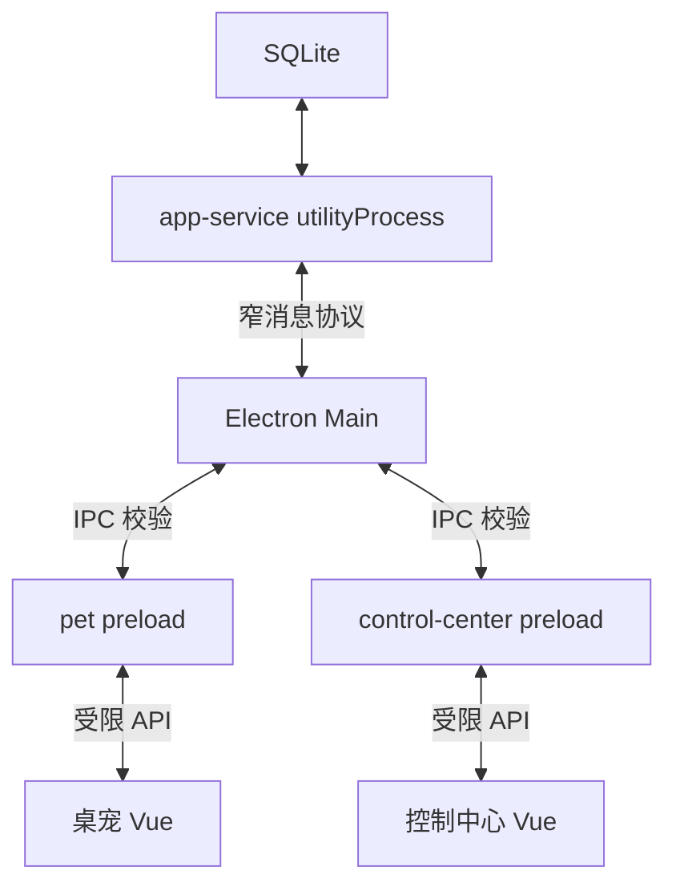

# 003 Electron 宿主、独立服务与双窗口原型

日期：2026-11-25；设计基线：[V1.1](../design/V1.1.md) §13、15–17、18.4、22；前置：[002C](002c-process.md)、[003-V](003-visibility-alignment.md)。本步骤目标是可构建并可进入平台 POC 的工程原型，不是 V1.1 全部功能，也不冻结生产依赖版本。

## 实施顺序与责任边界

| 子步骤 | 实现位置 | 设计对应 | 本次范围 |
|---|---|---|---|
| 003A 构建与装配 | `apps/desktop/package.json`、`electron.vite.config.ts`、`electron-builder.yml`、`scripts/verify-build.mjs`、`src/shared/protocol.ts` | §15.2、15.3、16.5、22 | 真实锁文件、六个入口、独立沙箱 preload、Windows 安装配置；构建时检查可达模块图 |
| 003B 可信本地服务 | `src/app-service/`、`main/service-client.ts` | §16.2、16.4、18.4–18.6 | utilityProcess 启动、原生 SQLite 连接适配、版本探针、请求关联与超时、退出确认、故障重启 |
| 003C Windows 宿主通用层 | `src/main/bootstrap.ts`、`boundary.ts`、`window-policy.ts` | §16.2–16.5 | 单实例、窗口注册、托盘、DIP 坐标、状态恢复、发送方与角色/宠物归属校验、透明与穿透降级 |
| 003D 窄 preload | `src/preload/` | §15.3、16.4 | 每窗口独立桥、固定 IPC 方法、运行时校验、请求 ID、订阅解除、脱敏错误 |
| 003E 两个 renderer | `src/renderer/` | §17.2、17.3 | Pinia 只读权威投影、角色交互与 CSS/SVG 轻量占位、控制中心全部路由、实际命令与明确待开发页 |
| 003R 独立复核 | 本文、`tests/` | §23 | 审核唯一写权威及权限边界；修正失败隐藏、失效窗口发送、退出流程、命中过期、CSP、打包前验证 |

工序由独立子代理分别实施、定向检查和交叉复核；主开发者集中整合依赖、构建、端到端入口验证及 Git。各入口必须同时存在才能构建，故 003A–E 与复核形成一个可构建提交；003-V 已单独提交。

## 数据流与唯一权威

- 服务在开启用户存档前用内存数据库验证 SQLite 实际版本不低于 3.51.3；持久库仅服务进程打开，仓库负责迁移、PRAGMA 与事务。开发存档与正式 userData 分离。主进程仅持有权威快照、窗口映射和 IPC 路由。
- `READY` 消息握手之后完成初始快照请求才对 UI 宣告可用；快照修订号不得回退。Main 端生成独立转发请求 ID，拒绝来源不符、参数结构不符和跨宠物命令。启动或请求超时返回明确信息，业务命令不静默重放，异常退出只在确认旧子进程实际退出后创建下一代，连续失败有上限。
- 服务每秒查询应到领域事件及快照修订；主动推送只发送新修订。各 renderer 以 Pinia 投影呈现，处理加载、失联、错误、版本冲突和服务代际变化，不直接写库、不在客户端执行领域结算。
- 两个 preload 均为独立 CJS，sandbox、contextIsolation、禁用 nodeIntegration；只暴露最少方法，不暴露通道、shell、文件系统或数据库。生产页面拒绝外部导航和新窗口，CSP 不开放任意本机 WebSocket。当前生产资源来自应用构建目录 file URL；V1.1 中更严格的自定义本地协议需在安装验收前完成。
- 宿主托盘保留控制中心、显示/隐藏、穿透、有限时长显式交互、窗口恢复及退出。窗口/服务故障或暂停/锁屏/休眠采用保守降级；服务退出确认前保留诊断入口，避免无界面残余单例。鼠标命中仍是轻量 DOM 轮廓原型：renderer 每 500ms 重新判定并续约，Main 以 DIP 光标位置核实本窗口边界、授予最长 2 秒命中租约，失联/过期/隐藏/销毁/切换模式立即清除；完整 alpha 轮廓与拖动策略另行验收。

## 控制中心与功能呈现

| V1.1 路由 | 当前实现 |
|---|---|
| `/home` | 真实主宠、状态、钱包、旅行进度及快捷导航 |
| `/pets` | 独立宠物列表、当前主宠、陪伴位切换、互动及旅行入口 |
| `/adventure/map` | 区域/路线的服务原型投影与出发、召回相关操作 |
| `/adventure/reports` | 实际旅行报告与结果 |
| `/inventory`、`/shop` | 独立入口与真实共享金币；完整物品、交易待实现 |
| `/gallery` | CG 与事件图鉴占位，未伪造已解锁内容 |
| `/chat` | AI、语音、逐宠记忆入口；未接入模型或麦克风 |
| `/workspace` | 快捷入口与习惯推荐占位；尚无外部应用执行权限 |
| `/settings` | 支持当前免打扰/动画等已有服务设置；后续设置明确标注 |

首版单陪伴位（单可见宠）与主宠、旅途中、其他角色各自独立。切换可见宠由服务原子处理，不中断旅行，不依赖窗口数量或 renderer 本地字段。SVG 仅为自建的占位资源，不代表序列帧、Pixi、Live2D、CG 的正式资源包。

## 审核及仍未完成的 POC

- 静态审核发现并整改：每窗口发送失败应隔离、穿透设置失败须隐藏且不能重新显示、停止时保留托盘与中心直至旧 writer 实际结束、生产 CSP 移除任意本机 WS、打包流程必须先通过构建入口检查。
- `electron-vite` 实装类型显示 Main 不支持 `isolatedEntries`；允许 Main 与服务共用无状态契约 chunk，沙箱 preload 依然必须独立；构建脚本递归检查 Main 可达输出不得加载数据库代码或 native driver。better-sqlite3 通过窄 SqliteConnection adapter 绑定标量与 Buffer，未以类型断言掩盖接口不匹配。
- 尚未实现/验收：运行中服务持续卡死的独立心跳检测、Win32 前台全屏自动判定与快捷键冲突、真实逐轮廓命中/拖动/DPI、GPU 反复失效、窗口存档锚点、受控本地协议、原生 SQLite ABI、Windows NSIS 安装/升级/恢复、100 次窗口切换以及 8 小时性能。当前不关闭 P0-01、P0-02、P0-03、P0-05。

## 验证记录

开发机 Mac，Node 26.12.1 + pnpm 10.30.3；使用同步后的实际依赖及真实生成的 lockfile，最终回归执行于 2026-11-25。

| 检查 | 执行结果 |
|---|---|
| `mise exec node@26.12.1 -- pnpm typecheck` | 4 个 workspace 全部通过（含 TypeScript 与 Vue SFC） |
| `mise exec node@26.12.1 -- pnpm test` | contracts 125、domain 15、app-service 38、desktop 69，共 **247 项通过、1 项跳过**（旧 SQLite 环境专用 case） |
| Desktop 69 项组成 | utility transport 20、service client 9、main boundary/命中/窗口策略 13、preload 20、renderer store/命中续约 7 |
| `mise exec node@26.12.1 -- pnpm test:smoke` | 7/7 通过 |
| `mise exec node@26.12.1 -- pnpm build` | 通过；产物检查六个独立入口、两套 preload 不 require 本地 chunk、Main 可达图无数据库实现与驱动，utility 入口包含原生驱动加载及仓库实现 |
| `mise exec node@26.12.1 -- pnpm --filter @pet-desktop/desktop exec electron --version` | **阻塞**；Electron 43 包已安装，但 `path.txt` 与平台运行二进制尚不存在，首次下载报 `TypeError: fetch failed`。需由普通开发终端先运行 `pnpm --filter @pet-desktop/desktop exec install-electron`、`pnpm --filter @pet-desktop/desktop rebuild:native` |
| Mac/Windows 真实 Electron 启动与原生驱动 ABI | 待验证，模拟测试与编译成功不能替代 |

## 后续步骤

先验证当前平台 Electron 本体及 native addon 的真实启动、业务初始化、退出与重启；再以 004 完成角色渲染适配、动作/命中与资源 manifest、最小游戏闭环。005 在真实 Windows 环境验证透明窗口、多屏、安装包、原生依赖和存档迁移。后续 AI、语音、记忆、推荐及 CG 继续依照设计分期实现，不从 renderer 直接访问系统能力。
