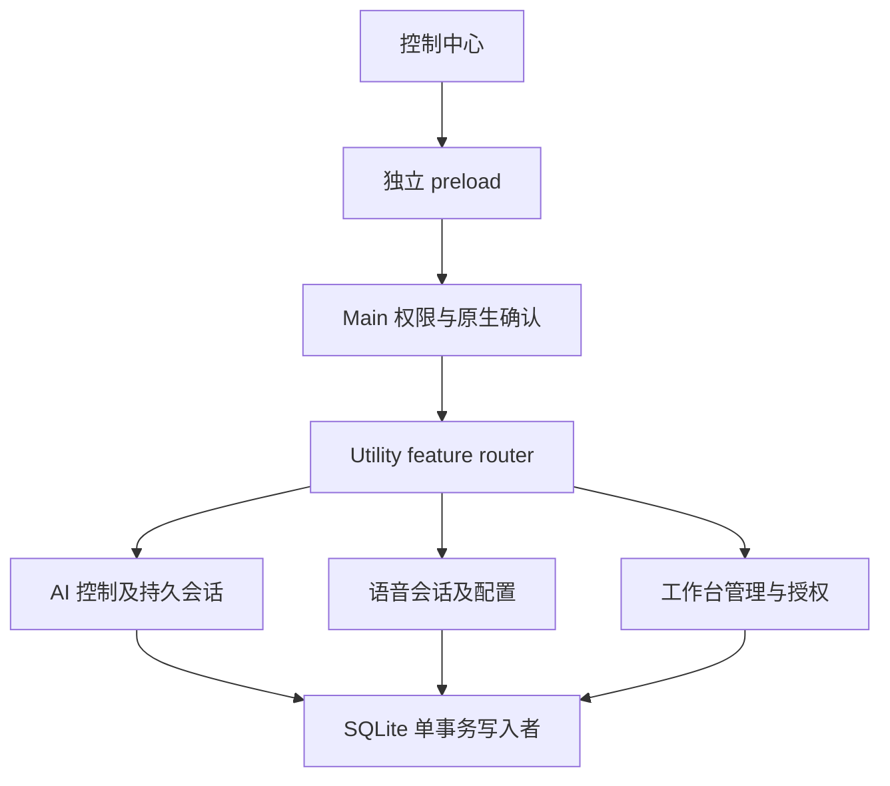

# 007E-2 / 008C / 009D：真实 AI、语音、快捷工作台统一业务接入

日期：2026-11-25。设计依据：[V1.1](../design/V1.1.md)、007A–E、008A–B、009A–B 的既有约束。本阶段由根代理统一 IPC/宿主接线，子代理独立完成 AI 控制、语音、本地工作台及窗口 UI；没有启动真实桌宠窗口、录音、真实外部服务或外部应用。

## 权威链路

- `AppService.withFeatureTransaction` 在既有同一写入连接内推进权威世界时钟并访问独立 feature storage；无额外数据库写入者。请求/结果、会话身份、服务世代、语音所有权均校验。
- AI 实际保存 Provider 配置、逐宠绑定、会话、消息、候选记忆、授权分享和提案。Mock 由明确配置选用；OpenAI-compatible 已接入有界流适配器，真实网络默认不启用。凭据由 Main 原生确认和 OS safeStorage 保护，Utility 仅可按当前运行身份限时查询，不下发 Renderer；取消、重启与授权变化均限制旧任务继续。
- 语音服务共享同一本地 Provider，按住说话、转写、实际文本完成后合成、音频打断、逐宠配置与真实 SAPI 列表；Main 只对当前控制中心文档发一次性音频许可，监督超时和失焦。缺少本地 Windows 工件时诚实返回 UNAVAILABLE，不生成假声音、不假装录音。
- 工作台真实收藏、原生选择/重新授权、场景维护、批次执行反馈。原生确认之前不会执行；应用与文件夹仅接受授权的固定目标，不接受任意执行参数、脚本或 shell 命令；每次路径与文件身份重新验证。HTTPS 必须经手动输入、预览和批准。组合场景显示完整顺序并按独立目标操作；失败、取消后不自动重试。
- 使用统计默认关闭；仅记录明确授权的本站工作台操作、目标 ID 和粗粒度时段，推荐基于实际频率/时段/共现，可关闭并清除，不扫描用户系统使用历史。推荐展示须由实际可见的当前卡片触发并由权威端复核计数。

## 原生发行约束

Windows `native/launch-inspect` 是实际 C++ 文件身份与类型检查源码，不是当前已验证的 PE 工件。SAPI helper 和 Whisper adapter 同样需要 Windows 构建/分发。`package:win` 在打包前要求下列固定位置存在有效 staged 文件，计算 SHA-256 并编译进 Main/Utility；生产资源仅复制指定文件，不从可变相邻 manifest 读取运行期信任值。

| 发行前工件（相对 apps/desktop/native/publish/win-x64） | 用途 |
|---|---|
| `voice/whisper-cli.exe` | Whisper 本地 STT |
| `voice/pet-desktop-sapi.exe` | SAPI 本地 TTS/音色枚举 |
| `launch-inspect/launch-inspect.exe` | 已授权本地目标身份复核 |

未在此 Mac 上编译上述 Win 二进制或打包安装器；Windows 原生实际录放音、快捷目标启动和系统行为推迟到用户指定的真机阶段。普通开发构建可在缺少工件时成功，但运行时明确不可用。PixiJS v8.23.0 依赖由用户安装并固定锁定，仅表示下一步 SDK 已准备，尚不等价于正式渲染接通。

## 验证及边界

- 真正的临时 SQLite + 两侧 transport integration：实际 Mock 会话提交、跨宠请求隔离、服务重启后消息仍可读取、无本机语音工件时报告不可用；模拟凭据请求只命中当前任务，取消后拒绝旧请求。新增测试也覆盖逐宠静音设置和工作台统计 opt-in 的重启持久化。
- 2026-11-25 17:18，AI/Voice/Workspace/Main/preload/utility 15 个相关测试文件合计 296 项通过；17:23 扩展真实 SQLite 重启链路后，针对14文件重新执行 291/291 通过（未重复计入凭据仓的5项）；17:22 完整生产构建成功，独立 Main/Utility/两 preload/两 renderer 六入口验证通过。
- 当前全仓检查受到并行 v11 数据库挂载和 v12 准备中的最新迁移断言影响；这些历史预期更新由存储子代理独立处理，本阶段不将未完成的 v11/v12 当成通过。实际 GUI 与真实外部 I/O 仍未进行。

下一步：接入实际 Pixi、逐宠主动陪伴和本机设置、备份；继续旅行地图/新版回合战斗与资源管理，并重新执行全仓测试、类型/构建及固定 75 项覆盖核对。
